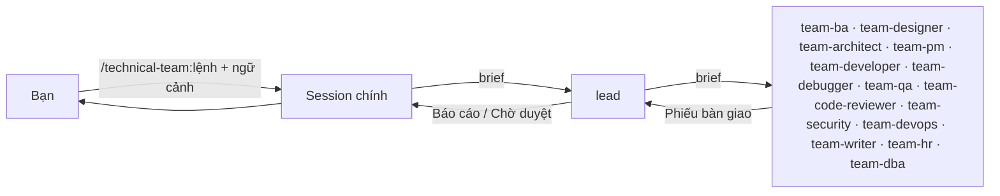
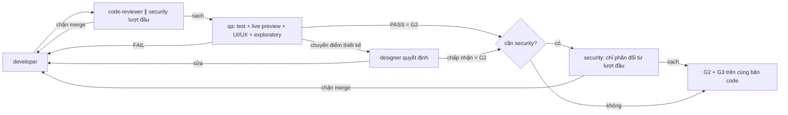
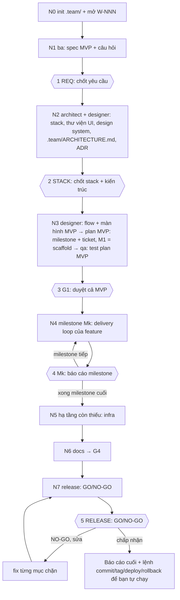
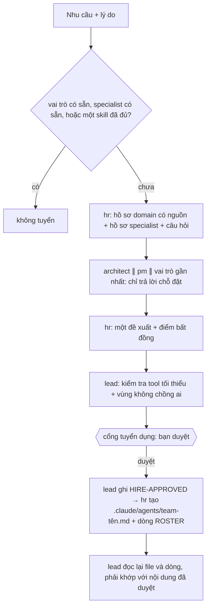

# technical-team

Plugin Claude Code dựng một team kỹ thuật cho nhiều dự án sản phẩm cùng lúc:

- **14 agent `team-*`**: 14 vai trò chia thành 4 squad, do một tech lead điều phối; mỗi vùng của project có đúng một chủ.
- **12 lệnh workflow**: mỗi lệnh chứa luôn pipeline của nó, có `argument-hint`; biến thể chọn bằng cờ; `new` chạy trọn một project mới.
- **4 skill**: `run-kit` (tài liệu sử dụng, quy tắc chung, phiếu bàn giao), `business-analysis` (cách BA khơi gợi yêu cầu khi người dùng chưa rõ mình cần gì, theo BABOK), `test-process` (toàn bộ quy trình kiểm thử của QA theo ISTQB/STLC) và `live-preview` (chạy sản phẩm thật để kiểm thử: web, mobile, desktop, CLI, API/service, worker/bot; kèm danh mục lỗi hay lọt theo nền tảng).
- **Không có hook**: ranh giới giữa các vai trò nằm ở trường `tools` của từng agent, ở vùng sở hữu ghi trong prompt, và ở bước lead kiểm tra phiếu bàn giao.
- **Skill theo vai trò**: mỗi project tự gắn thêm skill cho từng agent trong `.claude/technical-team.json`.
- **Không gian làm việc chung `.team/`** trong repo của từng project.

Plugin không gắn với ngôn ngữ hay framework nào: agent tự đọc stack, convention và lệnh build/test của repo.



## Mục lục

| # | Mục |
|---|---|
| 1 | [Yêu cầu](#1-yêu-cầu) |
| 2 | [Cài đặt, chạy thử, gỡ](#2-cài-đặt-chạy-thử-gỡ) |
| 3 | [Hai cách làm việc với lead](#3-hai-cách-làm-việc-với-lead) |
| 4 | [Đội hình, squad và vùng sở hữu](#4-đội-hình-squad-và-vùng-sở-hữu) |
| 5 | [Tầng, cổng, vòng lặp giao hàng](#5-tầng-cổng-vòng-lặp-giao-hàng) |
| 6 | [Lệnh workflow](#6-lệnh-workflow) |
| 7 | [Vùng sở hữu và mức bảo vệ thực tế](#7-vùng-sở-hữu-và-mức-bảo-vệ-thực-tế) |
| 8 | [Run kit và phiếu bàn giao](#8-run-kit-và-phiếu-bàn-giao) |
| 9 | [Specialist và tuyển dụng](#9-specialist-và-tuyển-dụng) |
| 10 | [Không gian làm việc `.team/`](#10-không-gian-làm-việc-team) |
| 11 | [Cấu hình theo project](#11-cấu-hình-theo-project) |
| 12 | [Giới hạn đã biết](#12-giới-hạn-đã-biết) |
| 13 | [Phát triển plugin](#13-phát-triển-plugin) |

---

## 1. Yêu cầu

| Thành phần | Phiên bản | Vì sao |
|---|---|---|
| Claude Code | **≥ 2.1.246**, khuyến nghị bản mới nhất; đã validate với **2.1.318** | subagent gọi subagent (sâu 3 tầng mặc định), tool `Agent`, tên skill plugin có tiền tố |
| Node.js | **≥ 18**, có trên `PATH` | chỉ script `init` (tạo file `.team/`) cần Node; team vẫn chạy được khi thiếu, agent tự tạo file từ template |

Đừng đặt `CLAUDE_CODE_MAX_SUBAGENT_SPAWN_DEPTH=1`: khi chạy qua lệnh, chuỗi gọi là *session chính → lead → agent của team* (2 tầng).

---

## 2. Cài đặt, chạy thử, gỡ

Repo `https://github.com/Tuan-Quyen/technical-teams` vừa là plugin (`.claude-plugin/plugin.json`) vừa là marketplace (`.claude-plugin/marketplace.json`, tên `technical-team-marketplace`). Mọi cách cài đều đi qua git, không trỏ tới thư mục trên máy.

| Mục đích | Lệnh |
|---|---|
| Thêm marketplace | `claude plugin marketplace add Tuan-Quyen/technical-teams` (hoặc URL đầy đủ `https://github.com/Tuan-Quyen/technical-teams.git`) |
| Cài cho mọi project của bạn | `claude plugin install technical-team@technical-team-marketplace --scope user` |
| Cài cho một repo (cả team) | chạy trong repo đó: `claude plugin marketplace add Tuan-Quyen/technical-teams --scope project` rồi `claude plugin install technical-team@technical-team-marketplace --scope project` |
| Cập nhật bản mới | `claude plugin marketplace update technical-team-marketplace` rồi `claude plugin update technical-team@technical-team-marketplace` |
| Gỡ | `claude plugin uninstall technical-team@technical-team-marketplace --scope user` (hoặc `--scope project`); bỏ marketplace: `claude plugin marketplace remove technical-team-marketplace` |
| Kiểm tra | `claude plugin details technical-team` → 14 agent, 16 skill (12 lệnh + `run-kit` + `business-analysis` + `test-process` + `live-preview`), 0 hook |

**Repo private:** máy cài phải có quyền đọc repo qua git, ví dụ `gh auth login` hoặc credential helper của git. Việc tự cập nhật nền cần thêm biến môi trường `GITHUB_TOKEN`. Không có quyền thì lệnh `marketplace add` báo lỗi xác thực.

Với project scope, lệnh cài ghi vào `.claude/settings.json` của repo; commit file đó để đồng đội mở repo là được nhắc cài. Nội dung tương đương nếu muốn tự khai:

```json
{
  "extraKnownMarketplaces": {
    "technical-team-marketplace": { "source": { "source": "github", "repo": "Tuan-Quyen/technical-teams" } }
  },
  "enabledPlugins": { "technical-team@technical-team-marketplace": true }
}
```

Gỡ plugin **không** xóa `.team/`, `README.md`, `CHANGELOG.md` hay specialist của project.

**Bắt đầu ở một project:** gõ `/technical-team:init`.
- Không bắt buộc. Lệnh chỉ tạo `.team/STATE.md` và `.claude/technical-team.json`, không bao giờ ghi đè file đã có.
- Các file `.team/` khác (`SPEC`, `PLAN`, `TASKS`, `OPS_HANDOFF`, `ROSTER`, `archive/`) chỉ được tạo khi pipeline cần tới lần đầu; `.claude/agents/` chỉ có khi tuyển specialist đầu tiên. Muốn tạo hết từ đầu như trước: `/technical-team:init --all`.
- Nên commit `.team/` để cả team dùng chung.

---

## 3. Hai cách làm việc với lead

| Cách | Khởi động | Tại cổng cần duyệt |
|---|---|---|
| **Qua lệnh** (mặc định) | gõ `/technical-team:<lệnh>`; session chính giao cho `technical-team:team-lead` chạy như subagent | lead ghi trạng thái vào `.team/STATE.md`, trả về `Chờ duyệt …` rồi dừng; bạn trả lời ở session chính, session chính gọi lại lead |
| **Lead là session chính** | `claude --agent technical-team:team-lead`, hoặc `"agent": "technical-team:team-lead"` trong `.claude/settings.json` của project | lead hỏi thẳng bạn (có `AskUserQuestion`) |

| Ghi chú | |
|---|---|
| Lệnh dùng được ở cả hai cách | khi session *là* lead, lead chạy thẳng phần `## Pipeline` của lệnh |
| Plugin không đặt `agent` mặc định | nếu đặt, mọi session ở mọi project bật plugin sẽ thành lead |
| Lead làm session chính | session đó đóng vai lead (chỉ điều phối, không tự sửa code); muốn tự sửa file thì mở một session thường |
| Ngữ cảnh của bạn | cài skill ngoài và tự gọi ở session chính; khi giao việc, session chính tóm tắt trung thực những gì bạn đưa vào mục **User-provided context** của prompt gửi lead |

---

## 4. Đội hình, squad và vùng sở hữu

Mọi agent của team có tiền tố `team-`; tên đầy đủ khi gọi là `technical-team:team-<vai trò>`. Trong pipeline và tài liệu, tên vai trò viết gọn (`developer`, `qa`) nghĩa là agent `team-developer`, `team-qa`. Model dùng alias nên luôn theo bản mới nhất.

Đội chia thành 4 squad. Squad chỉ là quy tắc giao việc, không có trưởng nhóm: lead vẫn là người duy nhất phân việc và nhận mọi phiếu bàn giao. **Vùng sở hữu** là phần của project mà chỉ agent đó được thay đổi; cần sửa ở vùng của người khác thì ghi vào phiếu bàn giao để lead giao cho đúng chủ.

| Squad | Agent | Model | Trách nhiệm | Vùng sở hữu |
|---|---|---|---|---|
| — | `team-lead` | `inherit` (theo session) | người duy nhất phân việc: xếp tầng, chạy pipeline, giữ cổng, kiểm tra phiếu bàn giao, báo cáo | `.team/STATE.md` |
| **Discovery** (nối tiếp, bước sau đọc file của bước trước) | `team-ba` | sonnet | dẫn dắt người dùng chưa rõ yêu cầu: hỏi theo vòng (lý do, phương án kèm hệ quả, đề xuất mặc định), diễn lại cách hiểu bằng kịch bản cụ thể; bức tranh tổng thể của sản phẩm; spec với acceptance criteria kiểm chứng được; `--discover` để xếp hạng nên làm gì tiếp | `.team/SPEC.md`, `.team/PRODUCT.md` |
| | `team-designer` | opus | user flow, màn hình, đủ trạng thái (rỗng/đang tải/lỗi/không có quyền), design system, microcopy; quyết định các điểm UI/UX mà qa chuyển lên | `.team/DESIGN.md` |
| | `team-architect` | opus | thiết kế kỹ thuật, plan triển khai, ADR | `.team/PLAN.md`, `.team/ARCHITECTURE.md`, `.team/adr/` |
| | `team-pm` | sonnet | ticket, ước lượng, phụ thuộc, tập file độc quyền, trạng thái | ticket trong `.team/TASKS.md` |
| **Build** (song song theo ticket, tập file không giao nhau) | `team-developer` ×N | sonnet | viết/sửa code theo plan, giữ hợp đồng backend–frontend khớp nhau | source, config, manifest dependency, model ORM, schema-as-code: mọi thứ không thuộc ai khác; test cũ chỉ **Edit** khi hành vi được chủ đích thay đổi |
| | `team-devops` | sonnet | CI/CD, Docker, deploy, hạ tầng | file hạ tầng (Dockerfile, compose, CI/CD, manifest deploy, IaC, script ops), `.team/OPS_HANDOFF.md` |
| | `team-dba` | opus | migration không downtime, review schema/query, pipeline ETL/ELT/dbt/DAG/warehouse | migration, seed, schema dump, code pipeline, mọi lệnh DB/migrate/pipeline (chỉ trên đích local/test) |
| **Verify** (tỏa nhánh: reviewer cùng đọc một diff; qa chia theo nền tảng) | `team-code-reviewer` | sonnet | review **code** (diff), không review project; phân mức chặn merge / nên sửa / gợi ý | không ghi gì (kết quả là danh sách phát hiện) |
| | `team-security` | opus | audit code, dependency, secrets, phân quyền, cấu hình | không ghi gì |
| | `team-qa` | sonnet | người giữ cổng chất lượng: test plan + review tĩnh trước khi code (P3a), test tự động, **live preview** trên sản phẩm đang chạy, **xác minh UI/UX**, exploratory, báo lỗi có severity/priority, retest + regression, kết luận PASS/FAIL | test mới, fixture, dữ liệu test; section `### QA` của từng work item trong `.team/TASKS.md` |
| **Support** (gọi khi cần) | `team-debugger` | opus | tái hiện, chứng minh nguyên nhân gốc, đề xuất hướng sửa | không ghi gì (developer sửa theo chẩn đoán) |
| | `team-writer` | sonnet | README, API docs, CHANGELOG, runbook, hướng dẫn | `README.md`, `CHANGELOG.md`, `.team/docs/` |
| | `team-hr` | opus | tuyển specialist khi thiếu chuyên môn domain | `.team/ROSTER.md`, file agent của specialist |

Specialist được tuyển (`team-<tên>`, mục 9) vào squad theo điểm gắn của nó: `design` → Discovery, `execute` → Build, `review` / `test` → Verify.

Lead dùng `inherit`, nên session chạy sonnet thì lead cũng là sonnet và điều phối sẽ kém hơn opus.

Vài chỗ dễ nhầm chủ:

| Việc | Chủ |
|---|---|
| *cái gì / vì sao* · *làm thế nào* · chia ticket | ba · architect · pm (pm không đổi thiết kế, architect không đổi AC) |
| mô hình dữ liệu · model ORM và `schema.prisma` · migration và lệnh DB | architect · developer · dba |
| test mới và kết luận PASS/FAIL · sửa code để test qua | qa · developer |
| dữ kiện vận hành thô (`OPS_HANDOFF.md`) · runbook cho người đọc | devops · writer |
| màn hình, flow, trạng thái · code dựng UI · xác minh UI khớp thiết kế | designer · developer · qa |

---

## 5. Tầng, cổng, vòng lặp giao hàng

### Tầng (khi dùng `run` hoặc không chỉ định pipeline)

| Tầng | Khi nào | Lệnh |
|---|---|---|
| **T0** việc lẻ | câu hỏi, sửa một chỗ, cập nhật tài liệu | giao thẳng 1 agent |
| **T1** thay đổi nhỏ | phạm vi rõ, không đổi thiết kế | `feature --small` |
| **T2** tính năng | tính năng mới hoặc chạm thiết kế | `feature` (`--plan` nếu chỉ cần kế hoạch) |
| **TB** lỗi | bug, test fail, hành vi sai | `fix` (`--hotfix` nếu khẩn, `--diagnose` nếu chỉ cần nguyên nhân) |
| **Project mới** | làm sản phẩm từ đầu, repo chưa có code ứng dụng | `new` (mục 6.1) |

| Tham gia bắt buộc (mọi tầng) | Khi |
|---|---|
| designer | có giao diện người dùng: màn hình mới, đổi flow, layout, giao diện (thiết kế ở P1a; sau qa chỉ khi qa chuyển điểm cần quyết định) |
| qa live preview | mọi thay đổi người dùng hay client quan sát được (UI web/mobile/desktop, CLI, response API, output của worker/bot, đóng gói): qa bắt buộc chạy sản phẩm thật; không có G2 chỉ dựa trên unit test |
| security | chạm auth, input người dùng, truy cập dữ liệu, secrets, thanh toán, dữ liệu cá nhân |
| devops | chạm hạ tầng, build, deploy |
| writer | ảnh hưởng cách dùng, API, vận hành |
| dba | chạm schema, migration, seed, dữ liệu hiện có, query bảng lớn, pipeline dữ liệu |
| specialist | điều kiện kích hoạt trong danh bạ khớp |

Lead luôn nói đã chọn tầng nào và vì sao; bạn có thể yêu cầu đổi.

### Cổng

| Cổng | Điều kiện qua |
|---|---|
| **G1** duyệt hướng làm | bạn duyệt spec + plan (hoặc hướng sửa rủi ro cao của debugger) |
| **G2** chất lượng | qa PASS trên bản code cuối, nghĩa là đạt exit criteria: test có output thật, live preview sạch (nếu thay đổi quan sát được), UI/UX đã xác minh, không còn lỗi blocker/critical/major; các điểm thiết kế qa chuyển lên đã được designer quyết định |
| **G3** review | không còn phát hiện "chặn merge" từ code-reviewer / security / specialist, trên đúng bản code đã qua G2 |
| **G4** hoàn tất | tài liệu cập nhật (nếu cần), `.team/` cập nhật, báo cáo đã gửi |

### Vòng lặp giao hàng (thứ tự cố định, không giới hạn số vòng)



| Quy tắc | |
|---|---|
| Mọi lần sửa code đi lại từ code-reviewer | không code nào tới qa khi chưa review sạch; bước security cuối chỉ chạy sau G2 |
| Review song song | cần security thì lượt review đầu tiên của work item chạy code-reviewer ∥ security trên cùng diff (cả hai chỉ đọc). Các vòng sau chỉ code-reviewer. Sau G2, security chỉ review **phần đổi** kể từ lượt đầu, không đổi gì thì khỏi gọi. Lỗi bảo mật lộ ra trước qa, nên không phải chạy lại qa vì bản sửa bảo mật, và số lần gọi security tối đa là 2 |
| QA tỏa nhánh theo nền tảng | test plan có từ 2 nền tảng **độc lập** trong phạm vi (lệnh chạy, cổng hoặc thiết bị riêng, không dùng chung dữ liệu test) thì lead gọi cùng lúc: một lượt qa **core** (entry criteria, smoke, test theo RTM, retest + regression; lượt duy nhất được ghi file) ∥ mỗi nền tảng một lượt qa **platform** (live preview + UI/UX + exploratory, không ghi file, trả lỗi trong phiếu bàn giao). Sau đó lượt **merge** gộp lỗi, đánh ID, ghi test summary và ra một kết luận duy nhất cho G2. Một nền tảng, chung cổng/dữ liệu, hoặc không chắc thì chạy một lượt qa như cũ. Vòng sau chỉ tỏa nhánh những nền tảng còn lỗi mở hoặc có code đổi |
| Micro (chỉ small mode) | ≤ 3 file, ≤ 40 dòng, không chạm test/hạ tầng/dữ liệu/dependency/build config, không thuộc diện security, không đổi API/contract/component dùng chung, không có màn hình hay flow mới. Đủ cả → một lượt qa *micro verify* thay cho code-reviewer + qa. qa thấy không đủ điều kiện thì trả "not micro" và chạy luồng thường. Báo cáo cuối ghi rõ đã đi micro |
| Không giới hạn số vòng | không cổng nào mở sớm, không work item nào đóng khi còn lỗi |
| Leo thang khi **cùng một lỗi còn nguyên qua 2 vòng**, hoặc **3 vòng liền không tiến triển** | debugger → architect (+ ba nếu dính AC) → tạm dừng hỏi bạn |
| Leo thang thiết kế | developer nghi lỗi do thiết kế (thư viện không làm được theo docs, contract không giữ được cả hai phía, data model không biểu diễn được AC, cùng một lỗi cứ quay lại) → dừng sau tối đa 2 lần thử, bàn giao `cần quyết định` kèm khối **Nghi lỗi thiết kế** có bằng chứng. Lead gọi thẳng architect, không chờ đủ vòng. Architect tra tài liệu (WebSearch/WebFetch: docs đúng phiên bản, release notes, issue tracker), kết luận *thiết kế vẫn đúng* (kèm cách làm và nguồn) hoặc *sửa thiết kế* (Revision trong PLAN, ADR thay thế nếu cần, ticket/test/màn hình bị ảnh hưởng). Sửa thiết kế mà ảnh hưởng tới những gì bạn đã duyệt (AC, UX, stack/ADR, contract ngoài, chi phí) thì quay lại G1 cho phần đổi; đổi nội bộ thì lead ghi lại và chạy tiếp |
| Tiến triển | số lỗi blocker/critical/major **trong phạm vi** còn mở (cộng phát hiện chặn của review/security) phải **giảm**; tập lỗi chỉ đổi mà không giảm thì không tính |
| Hiệu chỉnh gate của qa | ngưỡng không hạ (lỗi blocker/critical/major trong phạm vi luôn là FAIL), nhưng áp lên **đích cố định**: chỉ lỗi do thay đổi gây ra hoặc phạm AC/DESIGN của work item mới chặn; lỗi có sẵn từ trước thành work item mới. Exit criteria khóa ở G1. Độ sâu theo tầng (T2 đầy đủ, T1 nhẹ hơn, fix, hotfix). Major trở lên phải có nguồn + tác động lên người dùng, lead được trả lại lỗi xếp hạng không có căn cứ |
| Chống "làm cho test xanh" | test bị skip, xóa, nới assertion, mock mất phần đang kiểm tra = chặn merge (code-reviewer) và FAIL (qa) |
| Nhật ký | `STATE.md` → `Loop log` |

`infra` không có qa: devops → code-reviewer → security. `review` (cả `--audit`), `release` chỉ kiểm tra rồi kết luận nên chạy song song.

> PASS QA nghĩa là đạt exit criteria trong test plan: AC và trạng thái thiết kế đã kiểm, sản phẩm chạy thật không lỗi trên các nền tảng trong phạm vi, UI/UX dùng được, không còn lỗi blocker/critical/major. Nó vẫn không chứng minh được là hết lỗi. Vì vậy qa review tĩnh AC và DESIGN ngay từ P3a, trước G1, và test summary ghi rõ phần nào được kiểm ít hơn và vì sao.

---

## 6. Lệnh workflow

Mọi lệnh có tiền tố `/technical-team:`. Mỗi file lệnh gồm hai phần:
- **Running this command**: session chính giao cho lead, chuyển báo cáo chờ duyệt cho bạn, rồi gọi lại lead với câu trả lời.
- **Pipeline**: sơ đồ và bảng các bước mà lead thực thi.

Biến thể của cùng một pipeline là **cờ** (nói bằng lời cũng được: "chỉ lên kế hoạch", "gấp", "chỉ chẩn đoán", "audit", "ghi ADR"); lead ghi chế độ vào `STATE.md`. `run` và `new` không chép lại bước nào: chúng gọi đúng các bước (theo mã bước) trong `feature`, `fix`, `infra`, `docs`, `release`. Thiếu tham số bắt buộc thì lệnh hỏi lại, không đoán.

| Lệnh | Tham số | Pipeline | Cổng |
|---|---|---|---|
| `run` | `<yêu cầu>` | lead xếp T0/T1/T2/TB/project mới rồi chạy đúng lệnh và chế độ | theo tầng |
| `new` | `<ý tưởng \| đường dẫn PRD>` (trống = chạy tiếp) | trọn một project mới (mục 6.1) | REQ, STACK, G1, cuối mỗi milestone, RELEASE |
| `init` | `[--all]` | tạo `.team/STATE.md` + `.claude/technical-team.json`; `--all` tạo hết từ đầu | – |
| `status` | – | tóm tắt `.team/`, không gọi agent | – |
| `feature` | `<mô tả>` | ba khơi gợi yêu cầu (REQ nếu cần hỏi) → plan → G1 → vòng lặp giao hàng (luôn có security) → writer ∥ pm | G1–G4 |
| | `<mục tiêu> --plan` | ba → architect → pm, dừng ở G1, không viết code | G1 |
| | `<mô tả> --small` | thay đổi nhỏ (T1): vòng lặp giao hàng (security nếu bị kích hoạt) | G2–G4 |
| | `<nhu cầu> --discover` | chưa rõ nên làm gì: ba tìm cơ hội, xếp hạng phương án vào backlog trong `.team/PRODUCT.md`, bạn chọn; không viết code | DISCOVER |
| `fix` | `<lỗi>` | debugger → vòng lặp giao hàng với regression test | G1 nếu rủi ro, G2–G4 |
| | `<lỗi> --hotfix` | khẩn/production: bản sửa nhỏ nhất, security luôn chạy, tài liệu rút gọn | G2–G4 |
| | `<triệu chứng> --diagnose` | chỉ debugger chẩn đoán, không sửa code | – |
| `review` | `[phạm vi diff]` | code-reviewer ∥ security, gộp một kết luận | G3 |
| | `--audit [phạm vi]` | security quét toàn diện, chỉ-đọc | – |
| `test` | `[phạm vi]` | qa bổ sung test còn thiếu | G2 |
| `infra` | `<yêu cầu>` | devops đề xuất → G1 → làm → code-reviewer → security → runbook | G1, G3, G4 |
| `release` | `[version]` | devops ∥ security ∥ qa → CHANGELOG → GO/NO-GO | G2–G4 |
| `docs` | `[phạm vi]` | writer đồng bộ tài liệu với code | G4 |
| | `--adr <quyết định>` | architect ghi ADR + cập nhật `.team/ARCHITECTURE.md` | – |
| `hire` | `<domain/nhu cầu> [lý do]` | tuyển specialist (mục 9) | cổng tuyển dụng |
| | `--roster` | danh bạ + đề xuất rà soát của hr | duyệt cho nghỉ |

**Đổi từ bản 18 lệnh:** `plan` → `feature --plan` · `change` → `feature --small` · `hotfix` → `fix --hotfix` · `investigate` → `fix --diagnose` · `audit` → `review --audit` · `adr` → `docs --adr` · `roster` → `hire --roster`. Không mất bước, cổng hay bước security nào. Lệnh giữ riêng vì có cổng/quyền/rủi ro khác: `infra` (G1 bắt buộc, không có qa, chạm secrets/hạ tầng), `release` (GO/NO-GO, không deploy), `test` (qa ghi test, không sửa code), `hire` (cổng tuyển dụng đổi quyền của team), `init`/`status` (tiện ích), `run` (cửa vào chung), `new` (chạy dài nhiều pha).

| Ví dụ | Kết quả |
|---|---|
| `/technical-team:run Thêm "Quên mật khẩu" ở trang đăng nhập` | lead chọn T2 (chạm auth), nói lý do, chạy `feature` |
| `/technical-team:new docs/prd-booking.md` | chạy từ yêu cầu tới release, dừng ở 5 cổng; gọi lại `new` không tham số để chạy tiếp |
| `/technical-team:feature Xuất báo cáo doanh thu ra CSV theo khoảng ngày --plan` | dừng ở G1 với tóm tắt AC, thiết kế, ticket |
| `/technical-team:feature --small Đổi thông báo lỗi email thành "Email không hợp lệ"` | lead ghi hành vi mong đợi thay cho AC, chạy vòng lặp giao hàng |
| `/technical-team:fix Tổng tiền sai khi áp 2 mã giảm giá` | debugger chứng minh nguyên nhân gốc rồi mới sửa |
| `/technical-team:fix --hotfix API /orders trả 500 trên production` | sửa nhỏ nhất; hướng sửa rủi ro cao thì vẫn dừng hỏi bạn |
| `/technical-team:fix --diagnose Worker thỉnh thoảng treo sau vài giờ` | chỉ báo nguyên nhân gốc, bằng chứng, hướng sửa |
| `/technical-team:review main...HEAD` | không có tham số: working tree so với `HEAD`, hoặc commit cuối nếu sạch |
| `/technical-team:review --audit src/payments/` | audit bảo mật chỉ-đọc, gợi ý work item tiếp theo |
| `/technical-team:infra Thêm GitHub Actions chạy lint + test cho PR` | devops đề xuất trước, bạn duyệt, rồi mới làm |
| `/technical-team:release 1.4.0` | GO/NO-GO; team không tag, không deploy |
| `/technical-team:docs --adr Chuyển từ REST polling sang WebSocket` | ADR mới + cập nhật `.team/ARCHITECTURE.md` |
| `/technical-team:hire IoT: firmware ESP32, MQTT, OTA` | hồ sơ domain, hồ sơ specialist, chỗ đặt, rồi chờ bạn duyệt |

### 6.1 `new`: chạy trọn một project mới

Gọi một lần với ý tưởng ngắn hoặc đường dẫn PRD. Team chỉ dừng hỏi ở 5 cổng; G2/G3/G4 vẫn áp dụng nội bộ. Các điểm dừng bắt buộc sẵn có vẫn giữ: cổng tuyển dụng, leo thang khi cùng một lỗi lặp 2 vòng, đổi hướng sau G1, thiếu tool hoặc quyền truy cập mà chỉ bạn sửa được.



| Cổng | Bạn nhận được | Bạn trả lời |
|---|---|---|
| REQ | phạm vi MVP (trong/ngoài), story chính, câu hỏi đánh số kèm đáp án mặc định, giả định | trả lời, hoặc "OK" = nhận hết mặc định |
| STACK | 2–3 phương án stack, phương án đề xuất, thư viện UI + định hướng thiết kế, tóm tắt kiến trúc, ADR, máy bạn cần cài gì | duyệt / chọn phương án khác / chỉnh |
| G1 | bảng milestone, số ticket mỗi milestone, rủi ro, ước lượng số lượt agent | duyệt một lần cho cả MVP |
| Mk | đã xong gì, bằng chứng test, screenshot live preview, review/security, lỗi theo severity từ phần QA trong `TASKS.md`, chỗ lệch kế hoạch, lệnh chạy thử local, lệnh commit gợi ý | đi tiếp / chỉnh / dừng |
| RELEASE | GO/NO-GO kèm lý do, version (mặc định `0.1.0`), lệnh commit/tag/push/deploy/rollback | chấp nhận / sửa các mục NO-GO / đóng ở NO-GO |

| Lưu ý | |
|---|---|
| Bị ngắt giữa chừng | lead ghi `Phase`, `Next step`, `Milestones`, cổng đang chờ vào `.team/STATE.md` sau mỗi bước; gọi lại `new` không tham số là chạy tiếp; `status` hiện pha và bước kế tiếp |
| Git | repo chưa `git init` thì lead hỏi ở REQ; code mới là file untracked nên review dùng thêm `git status --porcelain`; commit sau mỗi milestone (lệnh có trong báo cáo) cho milestone sau diff sạch |
| Repo đã có code | `new` dừng và đề xuất `feature`/`run` (hoặc chạy trong thư mục con bạn chỉ định) |
| Sau khi chốt stack | nên khai skill hợp với stack cho từng agent trong `.claude/technical-team.json` → `skills` (mục 11) |

---

## 7. Vùng sở hữu và mức bảo vệ thực tế

Plugin không còn hook. Trước đây một guard (`PreToolUse`) chặn từng lệnh ghi và từng lệnh Bash theo vai trò; nó phức tạp, làm chậm mọi tool call, và vẫn bị lách được qua `node -e`, `python -c` hay tool MCP. Bây giờ ranh giới dựa trên ba lớp đơn giản hơn, và bạn nên biết rõ lớp nào là cứng, lớp nào là quy ước.

| Lớp | Cơ chế | Mức độ |
|---|---|---|
| **A** frontmatter `tools` | agent chỉ có tool được liệt kê: `team-debugger`, `team-code-reviewer`, `team-security` không có Write/Edit; `team-ba`, `team-designer`, `team-architect`, `team-pm`, `team-writer`, `team-hr` không có Bash; chỉ lead có `Agent` | **cứng** (Claude Code thực thi) |
| **B** vùng sở hữu | dòng `Owns` trong từng agent + bảng một-chủ-mỗi-vùng trong `run-kit` §4 (preload vào mọi agent) | quy ước trong prompt |
| **C** lead kiểm tra phiếu | mỗi phiếu bàn giao được đối chiếu với `git diff --stat` / `git status --porcelain`; file đổi ngoài vùng của agent → trả lại để hoàn tác, giao cho đúng chủ, ghi vào `STATE.md` | kiểm tra sau, do lead làm |
| **D** quyền của Claude Code | permission prompt, `permissions.deny` trong `.claude/settings.json`, sandbox | **cứng**, do bạn cấu hình |

### 7.1 Một chủ cho mỗi vùng

| Vùng | Chủ |
|---|---|
| `.team/STATE.md` | lead |
| `.team/SPEC.md`, `.team/PRODUCT.md` | ba |
| `.team/DESIGN.md` | designer |
| `.team/PLAN.md`, `.team/ARCHITECTURE.md`, `.team/adr/` | architect |
| `.team/TASKS.md`: ticket · section `### QA` | pm · qa |
| test: file test mới, fixture, dữ liệu test | qa (developer chỉ **Edit** test cũ khi plan chủ đích đổi hành vi đó) |
| hạ tầng: Dockerfile, compose, CI/CD, manifest deploy, IaC, script ops · `.team/OPS_HANDOFF.md` | devops |
| dữ liệu: migration, seed, schema dump, pipeline (dbt, DAG, ETL) · lệnh database | dba |
| tài liệu: `README.md`, `CHANGELOG.md`, `.team/docs/` | writer |
| `.team/ROSTER.md`, file agent của specialist | hr |
| còn lại: source, config, manifest dependency, model ORM, schema-as-code | developer |
| vùng của specialist | cột `Owns` trong dòng `.team/ROSTER.md` của nó, cắt ra từ vùng của developer |
| không ghi gì | debugger, code-reviewer, security |

Tài liệu của team nằm trong `.team/`, chỉ `README.md` và `CHANGELOG.md` ở ngoài; nên commit `.team/`, đừng cho vào `.gitignore`. Project đã có `docs/` hay `ARCHITECTURE.md` ở root và muốn giữ: nói với lead, lead ghi vào brief cho architect / writer.

### 7.2 Quy tắc shell chung (`run-kit`, quy tắc 9)

| Không agent nào | Thay vào đó |
|---|---|
| commit, push, mở PR | lead đưa lệnh để bạn tự chạy |
| chạy lệnh thay đổi thứ gì ngoài máy này: deploy, publish, database từ xa, production | devops / dba liệt kê lệnh chính xác trong phiếu bàn giao |
| git phá hủy (`reset --hard`, `clean`), ghi `.env`, `.claude/` | — |
| cài driver / runtime cho live preview | qa dừng ở `cần quyết định`, nêu đúng thứ cần thêm |

dba chỉ chạy lệnh DB/migrate/pipeline khi chứng minh được đích là local/test ngay trong lệnh; không chứng minh được thì dừng và báo.

### 7.3 Muốn chặn cứng thì dùng quyền của Claude Code

Các quy tắc ở 7.2 là chỉ dẫn, không phải hàng rào. Chỗ nào bạn cần bảo đảm thật, khai trong `.claude/settings.json` của project (không cần code hook):

```json
{
  "permissions": {
    "deny": [
      "Bash(git push:*)", "Bash(git commit:*)", "Bash(gh pr create:*)",
      "Bash(terraform apply:*)", "Bash(kubectl apply:*)",
      "Read(./.env)", "Edit(./.env)"
    ]
  }
}
```

| Điểm | Thực tế |
|---|---|
| Agent ghi ngoài vùng của mình | không có gì chặn trước; lead phát hiện ở bước kiểm tra phiếu (lớp C) và bạn thấy trong `git diff`. Đây là cái giá của việc bỏ guard |
| Cổng, vòng lặp, "không nới lỏng test" | chỉ dựa vào chỉ dẫn (trước đây cũng vậy) |
| Tool MCP của lead | lead nhận toàn bộ tool của session (GitHub, Slack…); "không mở PR" qua MCP chỉ dựa vào chỉ dẫn |
| Nội dung skill | chỉ khai trong `technical-team.json` những skill bạn đã đọc; skill có thể mang lệnh shell riêng |
| WebFetch | có thể đọc nội dung độc hại; run-kit dặn coi web là dữ liệu và không đưa code/secret vào truy vấn |
| DB `localhost` | có thể là tunnel tới production do bạn tự mở. Bảo đảm thật: máy dev không có credential production |
| Cần cách ly thật | dùng sandbox của Claude Code hoặc chạy trong container |

---

## 8. Run kit và phiếu bàn giao

| Thành phần | Ở đâu | Nạp thế nào | Nội dung |
|---|---|---|---|
| `test-process` | `skills/test-process/SKILL.md` (~550 từ, luật bắt buộc) + `references/`: `process.md`, `techniques.md`, `quality-checklist.md`, `ux-verification.md`, `defects-and-reports.md` | preload vào **qa** | quy trình ISTQB gắn vào pipeline: lập kế hoạch dựa trên rủi ro + review tĩnh (P3a), entry/exit criteria, phân tích → thiết kế (EP, BVA, decision table, state transition, pairwise, exploratory theo charter) → triển khai → thực thi → theo dõi → hoàn tất; các đặc tính chất lượng ISO/IEC 25010:2023; xác minh UI/UX (khớp DESIGN.md, 10 heuristic của Nielsen, WCAG 2.2 AA); mẫu báo lỗi, severity × priority, vòng đời lỗi, retest/regression, test summary |
| `business-analysis` | `skills/business-analysis/SKILL.md` (luật bắt buộc) + `references/`: `elicitation.md`, `contexts.md` | preload vào **ba** | chọn bối cảnh (greenfield / hệ thống đang chạy / discovery) → đọc nguồn trước khi hỏi (brief, tài liệu, `.team/`, code, web) → vòng khơi gợi: diễn lại cách hiểu bằng kịch bản có giá trị cụ thể, tối đa 7 câu hỏi, mỗi câu có lý do, phương án kèm hệ quả, đề xuất mặc định → kiểm tra ready-to-spec. Mọi dữ kiện gắn nhãn **C** (bạn đã xác nhận) / **E** (có bằng chứng) / **A** (giả định), không bịa câu trả lời nghiệp vụ hay con số |
| `live-preview` | `skills/live-preview/SKILL.md` (~550 từ) + `references/`: `pass.md`, `common-bugs.md`, `web.md`, `mobile.md`, `desktop.md`, `cli.md`, `service.md` | preload vào **qa**; developer (tự kiểm tra trước khi bàn giao) và designer nạp khi cần, không cần cấu hình | nhận diện loại sản phẩm → build và chạy bản thật ở nền → điều khiển từng AC qua đúng giao diện: web/extension (Playwright), mobile (Maestro/Detox/`integration_test`/Espresso/XCUITest trên emulator/simulator), desktop (Playwright-Electron, WebDriver, framework UI test; `xvfb-run` khi headless), CLI/TUI (transcript: args, stdin, exit code, pty), API/service/worker/bot (HTTP/gRPC/queue với dependency thật). Thu lỗi/log/crash, screenshot hoặc transcript theo form factor, trạng thái rỗng/tải/lỗi, vòng đời; danh mục lỗi hay lọt qua test xanh, có nhóm riêng cho mobile, desktop, CLI, service |
| `run-kit` | `skills/run-kit/SKILL.md` (quy tắc + phiếu bàn giao + bảng vùng sở hữu) + `references/usage.md` (cách dùng) | SKILL.md (~800 từ) preload vào **mọi** agent; `usage.md` chỉ đọc khi cần; session chính nạp khi bạn hỏi cách dùng; `/technical-team:run-kit` để xem | cách dùng (chế độ, bảng lệnh, cổng, vòng lặp, specialist, skill), quy tắc làm việc, **phiếu bàn giao**, **một chủ cho mỗi vùng** |
| Lead manual | `agents/team-lead.md`, phần cuối | system prompt của lead | tầng, cổng, vòng lặp, mẫu brief, vùng sở hữu, `.team/`, điểm gắn, mẫu báo cáo |
| Pipeline | `commands/<lệnh>.md` → `## Pipeline` | lead đọc bằng Read khi chạy | các bước, agent, song song, cổng, vòng lặp, file `.team/`, điểm gắn, kết thúc |

Nội dung agent, command và skill viết dạng bảng + sơ đồ Mermaid, bằng tiếng Anh. Agent luôn trả lời theo ngôn ngữ của bạn mà lead ghi trong brief. Chi phí cố định mỗi session khoảng 1,9k token.

### Phiếu bàn giao (mọi agent, cuối mỗi lần chạy)

```
### Phiếu bàn giao
- **Kết quả:** xong | vướng | cần quyết định
- **Bằng chứng:** <output lệnh, test, hoặc file:line>
- **Đã ghi vào:** <file đã tạo/sửa, hoặc "không">
- **Còn mở:** <rủi ro, câu hỏi, việc chưa làm>
- **Đề xuất bước tiếp:** <ai làm gì tiếp>
```

| Cơ chế | |
|---|---|
| Định nghĩa | chỉ ở `run-kit` §3 |
| Kiểm tra | lead đọc phiếu của mọi agent: thiếu phiếu → yêu cầu bổ sung một lần, vẫn thiếu thì coi là `vướng`; `xong` không có bằng chứng → trả lại; "Đã ghi vào" phải khớp `git diff` và nằm trong vùng sở hữu của agent |
| Lead | kết thúc bằng `## Báo cáo …` hoặc `## Chờ duyệt …` thay cho phiếu |

---

## 9. Specialist và tuyển dụng

Khi team thiếu chuyên môn domain, hr tuyển **specialist**: một agent của project tên `team-<tên>`.

| Thành phần | Ở đâu |
|---|---|
| File agent | `.claude/agents/team-<tên>.md` (hoặc `~/.claude/agents/` nếu bạn chọn user scope) |
| Hồ sơ | một dòng trong `.team/ROSTER.md`: domain, điểm gắn, trigger, vùng sở hữu (`Owns`) |
| Phê duyệt | `HIRE-APPROVED: <tên>` trong `.team/STATE.md`, do lead ghi sau khi bạn duyệt; thiếu dòng này lead không gọi specialist |
| Skill riêng | `skills.team-<tên>` trong `.claude/technical-team.json` |

Trước khi tuyển, cân nhắc **skill**: nếu một vai trò có sẵn chỉ thiếu kiến thức (framework, thư viện, quy ước), khai skill cho nó ở mục 11 là đủ và rẻ hơn nhiều. Chỉ tuyển khi công việc cần một chủ riêng, một vùng riêng hoặc một bước review riêng.

Agent của plugin **không bị thay thế** bằng file agent của project: lead chỉ gọi `technical-team:team-<vai trò>` và specialist đã duyệt; một agent tên `developer` trong project không thuộc team. hr không tạo file trùng tên agent của plugin.

### Quy trình `hire`



| Quy tắc | |
|---|---|
| Tool tối thiểu | mặc định chỉ đọc và tư vấn; Write/Edit/Bash chỉ khi thật sự cần, kèm lý do; không bao giờ có `Agent`. Dòng `tools` của file agent là giới hạn cứng duy nhất của specialist, nên đọc kỹ ở cổng tuyển dụng |
| Vùng sở hữu | cắt ra từ vùng của developer; không chồng `.team/`, docs, hạ tầng, test, vùng dữ liệu của dba hay specialist khác |
| Cách duyệt | trả lời "duyệt" ở session chính như mọi cổng khác; lead ghi lời bạn vào `STATE.md` rồi mới giao hr tạo file |
| Kích hoạt | `.claude/agents/` thường nhận trong vài giây; khởi động lại session nếu thư mục chưa có lúc mở |
| Rà soát (`hire --roster`) | hr đề xuất cho nghỉ specialist lâu không dùng hoặc trùng việc; bạn duyệt; hr không xóa file, bạn tự xóa |

| Điểm gắn | Cùng ai | Khi nào |
|---|---|---|
| `design` | architect | trước G1 |
| `execute` | developer | khi triển khai |
| `review` | code-reviewer | bước code review, trước qa; chặn merge giữ G3 |
| `test` | qa | bước qa, trước G2 |

---

## 10. Không gian làm việc `.team/`

| File | Người ghi | Nội dung |
|---|---|---|
| `.team/STATE.md` | lead | work item, tầng/pipeline, cổng, phê duyệt, `Loop log`, kết quả, phát hiện hoãn, `HIRE-APPROVED`, lần dùng specialist, báo cáo cuối |
| `.team/SPEC.md` | ba | theo work item: mục tiêu, as-is và tác động, kịch bản đã xác nhận, user story, acceptance criteria, trường hợp biên, giả định, câu hỏi mở |
| `.team/PRODUCT.md` | ba | bức tranh tổng thể: tầm nhìn, người dùng, mục tiêu và thước đo, bản đồ năng lực, thuật ngữ, quy tắc nghiệp vụ, backlog xếp hạng, quyết định và giả định |
| `.team/DESIGN.md` | designer | design system (đầu file); mỗi work item: flow, màn hình, ma trận trạng thái, copy |
| `.team/PLAN.md` | architect | plan triển khai |
| `.team/TASKS.md` | pm (ticket) + qa (section `### QA`) | ticket, ước lượng, phụ thuộc, tập file độc quyền, trạng thái; mỗi work item có section QA: test plan, review tĩnh, RTM, nhật ký từng vòng, lỗi, test summary. Hai bên không sửa phần của nhau |
| `.team/OPS_HANDOFF.md` | devops | thông tin vận hành thô cho writer |
| `.team/ROSTER.md` | hr | specialist: điểm gắn, trigger, vùng sở hữu |
| `.team/ARCHITECTURE.md` | architect | tổng quan kiến trúc |
| `.team/adr/NNNN-<quyet-dinh>.md` | architect | ADR |
| `.team/docs/**` | writer | runbook, API docs, hướng dẫn |

| Quy ước | |
|---|---|
| Mã định danh | lead cấp `W-001`, `W-002`…; SPEC (`W-001.AC1`), PLAN, TASKS (`W-001-T1`) dùng chung mã |
| Trạng thái | SPEC/PLAN `draft` → `done` (PLAN có `superseded`); TASKS `todo` · `doing` · `blocked` · `review` · `done`; phê duyệt G1 chỉ ghi ở `STATE.md` |
| Archive | work item `done` → mỗi chủ file tự chuyển phần của mình sang `.team/archive/<FILE>-<YYYY-MM>.md` |
| Nội dung | tóm tắt và kết luận; không log dài, không secret, không dữ liệu thật |
| Quy ước vận hành | nằm trong plugin, không nằm trong `.team/` |

---

## 11. Cấu hình theo project: gắn skill cho từng vai trò

`.claude/technical-team.json` chỉ còn một việc: cho project **gắn thêm skill vào từng agent**. File do `init` tạo ra; không có file thì team chạy với skill mặc định của plugin.

```json
{
  "skills": {
    "*": ["company-conventions"],
    "team-designer": ["<skill-ui-ux-cài-từ-github>"],
    "team-developer": ["react-native", "mobile-kit:ios-release"],
    "team-qa": ["detox-e2e"],
    "team-dba": ["postgres-zero-downtime"],
    "team-iot": ["esp-idf"]
  }
}
```

| Quy tắc | |
|---|---|
| Khóa | tên agent (`team-developer`, `team-qa`…), tên specialist đã tuyển, hoặc `"*"` cho mọi agent |
| Giá trị | skill của project ghi tên trần (`.claude/skills/<tên>/`), skill của plugin khác ghi `<plugin>:<skill>` |
| Ai nạp | lead đọc file một lần mỗi lượt chạy và ghi vào dòng `Skills:` của brief những skill hợp với việc đang giao; agent được gọi không qua brief thì tự đọc danh sách của mình (run-kit quy tắc 10) |
| Tác dụng | skill thêm kiến thức, không đổi vùng sở hữu. Chỉ khai skill bạn đã đọc |
| Sẵn có | `run-kit` (mọi agent), `business-analysis` (ba), `test-process` + `live-preview` (qa) được preload, không cần khai; developer và designer tự nạp `live-preview` khi cần |

Skill UI/UX khai cho `team-designer`; skill frontend tương ứng khai cho `team-developer`, vì developer mới là người dựng UI. Lệnh build/test/run của project không khai ở đây: ghi vào `CLAUDE.md`, agent nào cũng đọc.

Live preview cần driver của nền tảng: `@playwright/test` (web, Electron), Maestro/Detox/`integration_test` + emulator (mobile), `xvfb-run` (desktop Linux headless), Hurl/curl (API). qa không tự cài: với project chưa có thì qa dừng ở `cần quyết định` để developer/devops thêm. Với `new`, việc này nằm sẵn trong scaffold M1.

---

## 12. Giới hạn đã biết

| Giới hạn | Chi tiết |
|---|---|
| Chưa chạy end-to-end với model thật | đã kiểm chứng: unit test tính nhất quán của bộ lệnh/agent/skill/cấu hình, chạy thử `init`. Sau khi cài nên chạy `claude plugin validate . --strict` và `claude plugin details technical-team` |
| Vùng sở hữu là quy ước | không còn guard chặn trước; lead kiểm tra sau qua phiếu bàn giao và `git diff`. Cần chặn cứng → `permissions.deny` hoặc sandbox (mục 7.3) |
| Live preview | cần driver của nền tảng có sẵn (Playwright, Maestro/Detox, emulator Android, Xvfb…); qa không tự cài mà dừng ở `cần quyết định`. Máy không chạy được nền tảng đó (iOS simulator cần macOS, app chỉ chạy trên Windows) thì qa preview phần chạy được và ghi rõ phần chưa preview. Subagent không dùng được preview pane của app Claude; bằng chứng là output của runner, screenshot/transcript trong `test-results/`, qa và designer xem ảnh bằng Read |
| Chất lượng UI | designer chỉ đặc tả và quyết định; code UI vẫn do developer viết. Kết quả đẹp hay không phụ thuộc vào skill frontend bạn khai cho `team-developer` và thư viện UI của project |
| Chưa kiểm chứng được | preload skill bằng tên có tiền tố (`technical-team:run-kit`) trên mọi phiên bản Claude Code |
| Thử nhanh sau khi cài | `/technical-team:status`, rồi `/technical-team:run` với một việc nhỏ và xem lead gọi đúng `technical-team:team-<vai trò>` |
| Chi phí | `feature` gọi khoảng 10–12 lượt agent (đã gồm designer P1a, qa P3a); mỗi vòng D3 làm nhiều việc hơn (live preview, UI/UX, exploratory), từ vòng 2 qa chỉ retest + regression + phần mới đổi (nhiều hơn nếu có vòng lặp, specialist); dùng `run` để lead chọn tầng nhẹ nhất |
| Commit/push | agent được dặn không làm, kể cả khi bạn yêu cầu qua lead; lead đưa lệnh để bạn tự chạy |
| Lead gọi agent ngoài | chỉ `Explore` để lấy ngữ cảnh hiện trạng; kết quả của Explore không phải bằng chứng cho cổng |
| `status` | suy ra ai đang làm từ `STATE.md` / `TASKS.md`, không theo dõi agent đang chạy theo thời gian thực |

**Đổi từ bản 0.16:** agent đổi tên thành `team-*` (`technical-team:lead` → `technical-team:team-lead`; sửa lại `"agent"` trong `.claude/settings.json` nếu bạn đã đặt). Bỏ toàn bộ hook, `config/ownership.json`, `config/agents.json`. Trong `.claude/technical-team.json` chỉ còn `skills`, và khóa đổi từ tên vai trò sang tên agent (`"developer"` → `"team-developer"`); các mục `commands`, `paths`, `db`, `devopsAllowRemote`, `externalAgents` không còn được đọc. Cột `Write scope` / `Bash` trong `ROSTER.md` gộp thành `Owns`; specialist cũ nên đổi tên file thành `team-<tên>`.

---

## 13. Phát triển plugin

| Việc | Lệnh |
|---|---|
| Test | `node --test "tests/*.test.mjs"` (bộ lệnh/agent/skill khớp run-kit và README; agent có tiền tố `team-`, có dòng `Owns`, không còn hook) |
| Validate | `claude plugin validate . --strict` và `claude plugin validate .claude-plugin/marketplace.json --strict` |
| Chạy thử bản đang sửa (từ thư mục clone của repo) | `claude --plugin-dir .`, sửa xong gõ `/reload-plugins` |
| Thêm vai trò vào plugin | thêm `agents/team-<tên>.md` (có dòng `Owns`), một dòng trong bảng squad của `agents/team-lead.md`, `run-kit` §4, README mục 4 và 7.1, khóa trong `templates/technical-team.json` |

**Quy tắc khi sửa plugin:** mỗi lần thêm, đổi tên, gộp hoặc xóa một **agent, skill hay command** (kể cả đổi tham số/cờ), cập nhật trong cùng thay đổi:

| Thay đổi | Cập nhật |
|---|---|
| command (tên, `argument-hint`, cờ, gate) | `skills/run-kit/references/usage.md` §2, README mục 6 (+ 6.1 nếu là `new`), `agents/team-lead.md` §1 nếu ảnh hưởng tầng, dòng "Called in" của agent liên quan |
| agent (thêm/xóa/đổi vùng sở hữu, tool) | README mục 4 và 7, `agents/team-lead.md` (bảng squad, §5), `skills/run-kit/SKILL.md` §4, `templates/technical-team.json` |
| skill | `skills/run-kit/SKILL.md` + README mục 8 |

`tests/commands.test.mjs` fail khi bảng lệnh trong run-kit/README lệch với `commands/`, khi còn tham chiếu tới lệnh đã bỏ, khi `new` gọi một bước không còn tồn tại, khi một agent/skill không có trong README, khi một agent thiếu tiền tố `team-` hoặc dòng `Owns`, hoặc khi hook quay lại.

```
technical-team/
├── .claude-plugin/
│   ├── plugin.json
│   └── marketplace.json
├── agents/                 14 vai trò, file team-<vai trò>.md
├── commands/               12 lệnh, mỗi lệnh chứa pipeline của nó (biến thể = cờ)
├── skills/run-kit/         tài liệu sử dụng + quy tắc chung + phiếu bàn giao + bảng vùng sở hữu
├── skills/test-process/    quy trình kiểm thử của QA + references/ (kỹ thuật, đặc tính chất lượng, xác minh UI/UX, lỗi và báo cáo)
├── skills/business-analysis/  cách làm của BA + references/ (khơi gợi yêu cầu, ba bối cảnh)
├── skills/live-preview/    kiểm thử trên sản phẩm đang chạy + references/ (lỗi hay gặp, web, mobile, desktop, cli, service)
├── scripts/team-init.mjs
├── templates/              .team/*.md, ARCHITECTURE.md, adr.md, specialist-agent.md, technical-team.json
└── tests/                  commands.test.mjs
```

**Vai trò có thể cần sau này** (tuyển qua `hire` khi project cần): product owner (ưu tiên backlog giữa nhiều work item; hiện là bạn).
