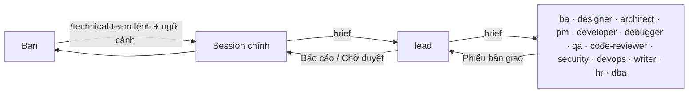
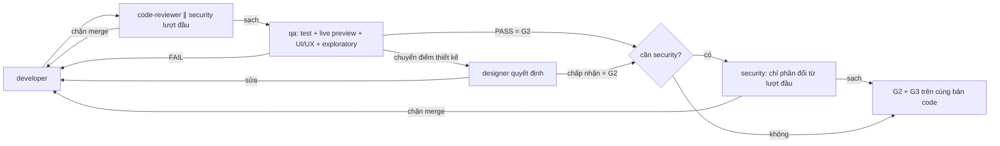
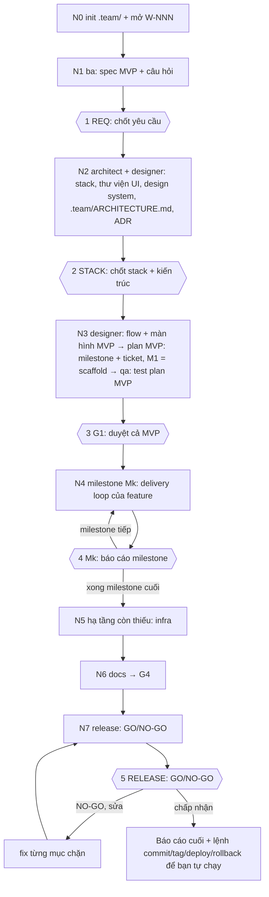
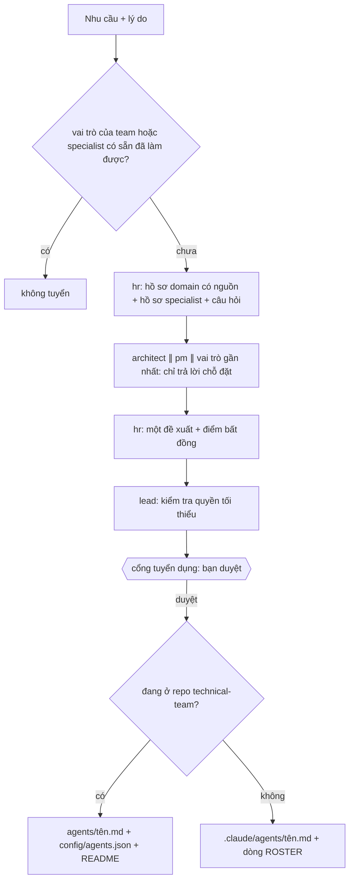

# technical-team

Plugin Claude Code dựng một team kỹ thuật cho nhiều dự án sản phẩm cùng lúc:

- **14 agent**: 14 vai trò do một tech lead điều phối, có UI/UX designer.
- **12 lệnh workflow**: mỗi lệnh chứa luôn pipeline của nó, có `argument-hint`; biến thể chọn bằng cờ; `new` chạy trọn một project mới.
- **4 skill**: `run-kit` (tài liệu sử dụng, quy tắc chung, phiếu bàn giao), `business-analysis` (cách BA khơi gợi yêu cầu khi người dùng chưa rõ mình cần gì, theo BABOK), `test-process` (toàn bộ quy trình kiểm thử của QA theo ISTQB/STLC) và `live-preview` (chạy sản phẩm thật để kiểm thử: web, mobile, desktop, CLI, API/service, worker/bot; kèm danh mục lỗi hay lọt theo nền tảng).
- **Không gian làm việc chung `.team/`** trong repo của từng project: mỗi work item một file theo từng loại tài liệu, mỗi file đúng một vai trò ghi.
- **Không có hook nào.** Phân quyền là chỉ dẫn trong file agent cộng với danh sách `tools` của từng agent; không có gì chặn một agent làm sai chỉ dẫn (mục 7).

Plugin không gắn với ngôn ngữ hay framework nào: agent tự đọc stack, convention và lệnh build/test của repo.



## Mục lục

| # | Mục |
|---|---|
| 1 | [Yêu cầu](#1-yêu-cầu) |
| 2 | [Cài đặt, chạy thử, gỡ](#2-cài-đặt-chạy-thử-gỡ) |
| 3 | [Hai cách làm việc với lead](#3-hai-cách-làm-việc-với-lead) |
| 4 | [Đội hình và ranh giới](#4-đội-hình-và-ranh-giới) |
| 5 | [Tầng, cổng, vòng lặp giao hàng](#5-tầng-cổng-vòng-lặp-giao-hàng) |
| 6 | [Lệnh workflow](#6-lệnh-workflow) |
| 7 | [Phân quyền (chỉ là chỉ dẫn)](#7-phân-quyền-chỉ-là-chỉ-dẫn) |
| 8 | [Run kit và phiếu bàn giao](#8-run-kit-và-phiếu-bàn-giao) |
| 9 | [Specialist và tuyển dụng](#9-specialist-và-tuyển-dụng) |
| 10 | [Không gian làm việc `.team/`](#10-không-gian-làm-việc-team) |
| 11 | [Cấu hình theo project](#11-cấu-hình-theo-project) |
| 12 | [Giới hạn đã biết](#12-giới-hạn-đã-biết) |
| 13 | [Phát triển plugin](#13-phát-triển-plugin) |

---

## 1. Yêu cầu

| Thành phần | Phiên bản | Vì sao |
|---|---|---|
| Claude Code | **≥ 2.1.246**, khuyến nghị bản mới nhất; đã validate với **2.1.318** | subagent gọi subagent (sâu 3 tầng mặc định), tool `Agent`, tên skill plugin có tiền tố |
| Node.js | **≥ 18**, có trên `PATH` | script `team-init.mjs` và `team-migrate.mjs` chạy bằng Node |

Đừng đặt `CLAUDE_CODE_MAX_SUBAGENT_SPAWN_DEPTH=1`: khi chạy qua lệnh, chuỗi gọi là *session chính → lead → agent của team* (2 tầng).

---

## 2. Cài đặt, chạy thử, gỡ

Repo `https://github.com/Tuan-Quyen/technical-teams` vừa là plugin (`.claude-plugin/plugin.json`) vừa là marketplace (`.claude-plugin/marketplace.json`, tên `technical-team-marketplace`). Mọi cách cài đều đi qua git, không trỏ tới thư mục trên máy.

| Mục đích | Lệnh |
|---|---|
| Thêm marketplace | `claude plugin marketplace add Tuan-Quyen/technical-teams` (hoặc URL đầy đủ `https://github.com/Tuan-Quyen/technical-teams.git`) |
| Cài cho mọi project của bạn | `claude plugin install technical-team@technical-team-marketplace --scope user` |
| Cài cho một repo (cả team) | chạy trong repo đó: `claude plugin marketplace add Tuan-Quyen/technical-teams --scope project` rồi `claude plugin install technical-team@technical-team-marketplace --scope project` |
| Cập nhật bản mới | `claude plugin marketplace update technical-team-marketplace` rồi `claude plugin update technical-team@technical-team-marketplace` |
| Gỡ | `claude plugin uninstall technical-team@technical-team-marketplace --scope user` (hoặc `--scope project`); bỏ marketplace: `claude plugin marketplace remove technical-team-marketplace` |
| Kiểm tra | `claude plugin details technical-team` → 14 agent, 16 skill (12 lệnh + `run-kit` + `business-analysis` + `test-process` + `live-preview`), không có hook |

**Repo private:** máy cài phải có quyền đọc repo qua git, ví dụ `gh auth login` hoặc credential helper của git. Việc tự cập nhật nền cần thêm biến môi trường `GITHUB_TOKEN`. Không có quyền thì lệnh `marketplace add` báo lỗi xác thực.

Với project scope, lệnh cài ghi vào `.claude/settings.json` của repo; commit file đó để đồng đội mở repo là được nhắc cài. Nội dung tương đương nếu muốn tự khai:

```json
{
  "extraKnownMarketplaces": {
    "technical-team-marketplace": { "source": { "source": "github", "repo": "Tuan-Quyen/technical-teams" } }
  },
  "enabledPlugins": { "technical-team@technical-team-marketplace": true }
}
```

Gỡ plugin **không** xóa `.team/`, `README.md`, `CHANGELOG.md` hay specialist của project.

**Bắt đầu ở một project:** gõ `/technical-team:init`.
- Không bắt buộc. Lệnh chỉ tạo `.team/STATE.md` và `.claude/technical-team.json`, không bao giờ ghi đè file đã có.
- Các file và thư mục `.team/` khác (`TASKS.md`, `PRODUCT.md`, `requirements/`, `system-design/`, `qa/`, `reports/`, `archive/`…) chỉ được tạo khi pipeline cần tới lần đầu; `.claude/agents/` chỉ có khi tuyển specialist đầu tiên. `/technical-team:init --all` tạo sẵn các file đơn (`STATE`, `TASKS`, `PRODUCT`, `ARCHITECTURE`, `ROSTER`); file theo work item không bao giờ tạo trước.
- Project đang dùng layout cũ (mỗi vai trò một file): xem ghi chú migrate ở mục 10.
- Nên commit `.team/` để cả team dùng chung.

---

## 3. Hai cách làm việc với lead

| Cách | Khởi động | Tại cổng cần duyệt |
|---|---|---|
| **Qua lệnh** (mặc định) | gõ `/technical-team:<lệnh>`; session chính giao cho `technical-team:team-lead` chạy như subagent | lead ghi trạng thái vào `.team/STATE.md`, trả về `Chờ duyệt …` rồi dừng; bạn trả lời ở session chính, session chính gọi lại lead |
| **Lead là session chính** | `claude --agent technical-team:team-lead`, hoặc `"agent": "technical-team:team-lead"` trong `.claude/settings.json` của project | lead hỏi thẳng bạn (có `AskUserQuestion`) |

| Ghi chú | |
|---|---|
| Lệnh dùng được ở cả hai cách | khi session *là* lead, lead chạy thẳng phần `## Pipeline` của lệnh |
| Plugin không đặt `agent` mặc định | nếu đặt, mọi session ở mọi project bật plugin sẽ thành lead |
| Lead làm session chính | session đó có đủ mọi tool; chỉ có chỉ dẫn giữ lead không tự viết code. Muốn tự sửa file thì mở một session thường |
| Ngữ cảnh của bạn | cài skill ngoài và tự gọi ở session chính; khi giao việc, session chính tóm tắt trung thực những gì bạn đưa vào mục **User-provided context** của prompt gửi lead |

---

## 4. Đội hình và ranh giới

Tên đầy đủ có tiền tố plugin: `technical-team:<tên>`. Model dùng alias nên luôn theo bản mới nhất.

| Tên | Vai trò | Model | Trách nhiệm |
|---|---|---|---|
| `team-lead` | Tech lead | `inherit` (theo session) | người duy nhất phân việc: xếp tầng, chạy pipeline, giữ cổng, báo cáo |
| `team-ba` | Business analyst (BA) | sonnet | dẫn dắt người dùng chưa rõ yêu cầu: hỏi theo vòng (mỗi câu có lý do, phương án kèm hệ quả, đề xuất mặc định), diễn lại cách hiểu bằng kịch bản cụ thể để người dùng xác nhận; giữ bức tranh tổng thể trong `.team/PRODUCT.md` (tầm nhìn, người dùng, mục tiêu, bản đồ năng lực, thuật ngữ, quy tắc nghiệp vụ, backlog); viết yêu cầu của từng work item trong `.team/requirements/<slug>.md` (as-is và tác động với hệ thống đang chạy, user story, acceptance criteria kiểm chứng được, trường hợp biên); chế độ `--discover` để xếp hạng nên làm gì tiếp |
| `team-designer` | UI/UX designer | opus | user flow, màn hình, đủ trạng thái (rỗng/đang tải/lỗi/không có quyền), microcopy trong `.team/frontend-design/<slug>.md`, design system trong `.team/frontend-design/_system.md`; quyết định các điểm UI/UX mà qa chuyển lên |
| `team-architect` | Architect | opus | thiết kế kỹ thuật + kế hoạch triển khai trong `.team/system-design/<slug>.md`, tổng quan `.team/ARCHITECTURE.md` (trần ~200 dòng), ADR (số do lead cấp) |
| `team-pm` | Project manager | sonnet | lập ticket trong `.team/TASKS.md`: ước lượng, phụ thuộc, tập file độc quyền; lead đổi cột trạng thái |
| `team-developer` | Developer fullstack | sonnet | viết/sửa code theo plan, giữ hợp đồng backend–frontend khớp nhau |
| `team-debugger` | Debugger | opus | tái hiện, chứng minh nguyên nhân gốc, đề xuất hướng sửa trong `.team/reports/<slug>/debug.md`; không sửa code |
| `team-qa` | QA, người giữ cổng chất lượng sản phẩm | sonnet | quy trình kiểm thử đầy đủ: test plan + review tĩnh spec/design trước khi code (P3a), thiết kế test case bằng kỹ thuật, test tự động, **live preview** trên sản phẩm đang chạy (web, mobile, desktop, CLI, API), **xác minh UI/UX** (khớp thiết kế, heuristic usability, accessibility), exploratory, báo lỗi có severity/priority, retest + regression, test summary, kết luận PASS/FAIL; tất cả trong `.team/qa/<slug>.md`, mỗi work item một lượt qa mỗi vòng |
| `team-code-reviewer` | Code reviewer | sonnet | review **code** (diff), không review project; phân mức chặn merge / nên sửa / gợi ý; ghi `.team/reports/<slug>/review.md` |
| `team-security` | Security | opus | audit code, dependency, secrets, phân quyền, cấu hình; ghi `.team/reports/<slug>/security.md` |
| `team-devops` | DevOps | sonnet | CI/CD, Docker, deploy, hạ tầng; thông tin vận hành trả về trong phiếu bàn giao, không ghi file `.team/` nào |
| `team-writer` | Technical writer | sonnet | README, API docs, CHANGELOG, runbook, hướng dẫn |
| `team-hr` | HR | opus | tuyển specialist khi thiếu chuyên môn domain |
| `team-dba` | DBA + data engineer | opus | migration không downtime, review schema/query, pipeline ETL/ELT/dbt/DAG/warehouse |

Lead dùng `inherit`, nên session chạy sonnet thì lead cũng là sonnet và điều phối sẽ kém hơn opus.

Đội chia thành 4 nhóm (squad). Nhóm chỉ là quy tắc giao việc, không có trưởng nhóm: lead vẫn là người duy nhất phân việc và nhận mọi phiếu bàn giao.

| Nhóm | Thành viên | Cách chạy |
|---|---|---|
| **Discovery** | ba, designer, architect, pm, qa (test plan) | nối tiếp, từng người một: bước sau đọc file của bước trước |
| **Build** | developer ×N, devops, dba | song song theo ticket: cùng nhóm song song **và** tập file không giao nhau |
| **Verify** | code-reviewer, security, qa | reviewer cùng đọc một diff; qa một lượt cho mỗi work item, tự kiểm hết các nền tảng trong phạm vi |
| **Support** | debugger, writer, hr | gọi khi cần |

| Cặp | Ranh giới |
|---|---|
| pm ↔ ba | ba quyết định *cái gì / vì sao*; pm quyết định ticket, thứ tự, ước lượng |
| designer ↔ ba | ba giữ AC và phạm vi; designer quyết định người dùng đi qua chúng thế nào. Tính năng còn thiếu mà designer phát hiện thì trả về ba quyết định |
| designer ↔ architect | designer giữ màn hình, flow, trạng thái, design system; architect giữ cấu trúc code đằng sau. Ở `new` N2 hai bên cùng chọn thư viện UI, architect ghi ADR |
| designer ↔ developer / qa | developer dựng đúng `frontend-design/<slug>.md`; qa xác minh sản phẩm có khớp thiết kế và dùng được không, và là người ra kết luận; designer chỉ quyết định các điểm qa chuyển lên (thiết kế chưa có câu trả lời, hoặc chỗ lệch có thể chấp nhận) |
| pm ↔ architect | architect quyết định *làm thế nào*; pm chia plan đã duyệt, không đổi thiết kế |
| pm ↔ lead | pm lập ticket và đề xuất thứ tự; lead đổi cột trạng thái, giao việc và cho qua cổng |
| debugger ↔ developer | debugger chẩn đoán có bằng chứng, không viết patch; developer sửa theo chẩn đoán |
| developer ↔ qa | qa viết test mới và kết luận; developer chỉ **Edit** test cũ bị gãy do hành vi được chủ đích thay đổi |
| devops ↔ writer | devops trả dữ kiện vận hành trong phiếu bàn giao, lead chép vào brief của writer; writer đọc file hạ tầng thật rồi viết runbook, không sửa hạ tầng |
| hr ↔ lead | lead đề xuất nhu cầu, ghi phê duyệt của bạn; hr đánh giá, tra cứu, soạn, tạo agent; bạn quyết định |
| dba ↔ developer | developer giữ model/ORM và `schema.prisma`; dba giữ migration, seed, schema dump, code pipeline và mọi lệnh DB/migrate/pipeline |
| dba ↔ architect | architect quyết định mô hình dữ liệu; dba quyết định cách đưa thay đổi lên DB an toàn |
| dba ↔ devops | devops giữ CI/deploy và hạ tầng orchestrator; dba đưa thứ tự chạy và rollback |

---

## 5. Tầng, cổng, vòng lặp giao hàng

### Tầng (khi dùng `run` hoặc không chỉ định pipeline)

| Tầng | Khi nào | Lệnh |
|---|---|---|
| **T0** việc lẻ | câu hỏi, sửa một chỗ, cập nhật tài liệu | giao thẳng 1 agent |
| **T1** thay đổi nhỏ | phạm vi rõ, không đổi thiết kế | `feature --small` |
| **T2** tính năng | tính năng mới hoặc chạm thiết kế | `feature` (`--plan` nếu chỉ cần kế hoạch) |
| **TB** lỗi | bug, test fail, hành vi sai | `fix` (`--hotfix` nếu khẩn, `--diagnose` nếu chỉ cần nguyên nhân) |
| **Project mới** | làm sản phẩm từ đầu, repo chưa có code ứng dụng | `new` (mục 6.1) |

| Tham gia bắt buộc (mọi tầng) | Khi |
|---|---|
| team-designer | có giao diện người dùng: màn hình mới, đổi flow, layout, giao diện (thiết kế ở P1a; sau qa chỉ khi qa chuyển điểm cần quyết định) |
| qa live preview | mọi thay đổi người dùng hay client quan sát được (UI web/mobile/desktop, CLI, response API, output của worker/bot, đóng gói): qa bắt buộc chạy sản phẩm thật; không có G2 chỉ dựa trên unit test |
| team-security | chạm auth, input người dùng, truy cập dữ liệu, secrets, thanh toán, dữ liệu cá nhân |
| team-devops | chạm hạ tầng, build, deploy |
| team-writer | ảnh hưởng cách dùng, API, vận hành |
| team-dba | chạm schema, migration, seed, dữ liệu hiện có, query bảng lớn, pipeline dữ liệu |
| specialist | điều kiện kích hoạt trong danh bạ khớp |

Lead luôn nói đã chọn tầng nào và vì sao; bạn có thể yêu cầu đổi.

### Cổng

| Cổng | Điều kiện qua |
|---|---|
| **G1** duyệt hướng làm | bạn duyệt spec + plan (hoặc hướng sửa rủi ro cao của debugger) |
| **G2** chất lượng | qa PASS trên bản code cuối, nghĩa là đạt exit criteria: test có output thật, live preview sạch (nếu thay đổi quan sát được), UI/UX đã xác minh, không còn lỗi blocker/critical/major; các điểm thiết kế qa chuyển lên đã được designer quyết định |
| **G3** review | không còn phát hiện "chặn merge" từ code-reviewer / security / specialist, trên đúng bản code đã qua G2 |
| **G4** hoàn tất | tài liệu cập nhật (nếu cần), báo cáo đã gửi, work item được đóng: finding chưa `verified` thành ticket, phần còn đúng gộp vào file tổng, mọi file của item chuyển sang `.team/archive/<slug>/` (mục 10) |

### Vòng lặp giao hàng (thứ tự cố định, không giới hạn số vòng)



| Quy tắc | |
|---|---|
| Mọi lần sửa code đi lại từ code-reviewer | không code nào tới qa khi chưa review sạch; bước security cuối chỉ chạy sau G2 |
| Finding có ID cố định | review, security, qa ghi finding vào file của mình với ID `R-01`, `S-01`, `Q-01`… không đổi qua các vòng; trạng thái `open` → `fixed` → `verified`. Brief cho developer liệt kê ID còn `open`; vòng sau chủ file kiểm lại và tự đổi trạng thái |
| Review song song | cần security thì lượt review đầu tiên của work item chạy code-reviewer ∥ security trên cùng diff (cả hai chỉ đọc). Các vòng sau chỉ code-reviewer. Sau G2, security chỉ review **phần đổi** kể từ lượt đầu, không đổi gì thì khỏi gọi. Lỗi bảo mật lộ ra trước qa, nên không phải chạy lại qa vì bản sửa bảo mật, và số lần gọi security tối đa là 2 |
| Một lượt qa mỗi vòng | mỗi work item, mỗi vòng chỉ có một lượt qa: lượt đó tự chạy lần lượt mọi nền tảng trong phạm vi và ghi `qa/<slug>.md`. Dòng `Verdict:` đầu file là kết luận duy nhất cho G2 |
| Micro (chỉ small mode) | ≤ 3 file, ≤ 40 dòng, không chạm test/hạ tầng/dữ liệu/dependency/build config, không thuộc diện security, không đổi API/contract/component dùng chung, không có màn hình hay flow mới. Đủ cả → một lượt qa *micro verify* thay cho code-reviewer + qa. qa thấy không đủ điều kiện thì trả "not micro" và chạy luồng thường. Báo cáo cuối ghi rõ đã đi micro |
| Không giới hạn số vòng | không cổng nào mở sớm, không work item nào đóng khi còn lỗi |
| Leo thang khi **cùng một lỗi còn nguyên qua 2 vòng**, hoặc **3 vòng liền không tiến triển** | debugger → architect (+ ba nếu dính AC) → tạm dừng hỏi bạn |
| Leo thang thiết kế | developer nghi lỗi do thiết kế (thư viện không làm được theo docs, contract không giữ được cả hai phía, data model không biểu diễn được AC, cùng một lỗi cứ quay lại) → dừng sau tối đa 2 lần thử, bàn giao `cần quyết định` kèm khối **Nghi lỗi thiết kế** có bằng chứng. Lead gọi thẳng architect, không chờ đủ vòng. Architect tra tài liệu (WebSearch/WebFetch: docs đúng phiên bản, release notes, issue tracker), kết luận *thiết kế vẫn đúng* (kèm cách làm và nguồn) hoặc *sửa thiết kế* (Revision trong `system-design/<slug>.md`, ADR thay thế nếu cần, ticket/test/màn hình bị ảnh hưởng). Sửa thiết kế mà ảnh hưởng tới những gì bạn đã duyệt (AC, UX, stack/ADR, contract ngoài, chi phí) thì quay lại G1 cho phần đổi; đổi nội bộ thì lead ghi lại và chạy tiếp |
| Tiến triển | số lỗi blocker/critical/major **trong phạm vi** còn mở (cộng phát hiện chặn của review/security) phải **giảm**; tập lỗi chỉ đổi mà không giảm thì không tính |
| Hiệu chỉnh gate của qa | ngưỡng không hạ (lỗi blocker/critical/major trong phạm vi luôn là FAIL), nhưng áp lên **đích cố định**: chỉ lỗi do thay đổi gây ra hoặc phạm AC/thiết kế của work item mới chặn; lỗi có sẵn từ trước vẫn `open` và thành ticket follow-up khi đóng item. Exit criteria khóa ở G1. Độ sâu theo tầng (T2 đầy đủ, T1 nhẹ hơn, fix, hotfix). Major trở lên phải có nguồn + tác động lên người dùng, lead được trả lại lỗi xếp hạng không có căn cứ |
| Chống "làm cho test xanh" | test bị skip, xóa, nới assertion, mock mất phần đang kiểm tra = chặn merge (code-reviewer) và FAIL (qa) |
| Nhật ký | `STATE.md` → `Loop log` |

`infra` không có qa: devops → code-reviewer → security. `review` (cả `--audit`), `release` chỉ kiểm tra rồi kết luận nên chạy song song.

> PASS QA nghĩa là đạt exit criteria trong test plan: AC và trạng thái thiết kế đã kiểm, sản phẩm chạy thật không lỗi trên các nền tảng trong phạm vi, UI/UX dùng được, không còn lỗi blocker/critical/major. Nó vẫn không chứng minh được là hết lỗi. Vì vậy qa review tĩnh AC và thiết kế ngay từ P3a, trước G1, và test summary ghi rõ phần nào được kiểm ít hơn và vì sao.

---

## 6. Lệnh workflow

Mọi lệnh có tiền tố `/technical-team:`. Mỗi file lệnh gồm hai phần:
- **Running this command**: session chính giao cho lead, chuyển báo cáo chờ duyệt cho bạn, rồi gọi lại lead với câu trả lời.
- **Pipeline**: sơ đồ và bảng các bước mà lead thực thi.

Biến thể của cùng một pipeline là **cờ** (nói bằng lời cũng được: "chỉ lên kế hoạch", "gấp", "chỉ chẩn đoán", "audit", "ghi ADR"); lead ghi chế độ vào `STATE.md`. `run` và `new` không chép lại bước nào: chúng gọi đúng các bước (theo mã bước) trong `feature`, `fix`, `infra`, `docs`, `release`. Thiếu tham số bắt buộc thì lệnh hỏi lại, không đoán.

| Lệnh | Tham số | Pipeline | Cổng |
|---|---|---|---|
| `run` | `<yêu cầu>` | lead xếp T0/T1/T2/TB/project mới rồi chạy đúng lệnh và chế độ | theo tầng |
| `new` | `<ý tưởng \| đường dẫn PRD>` (trống = chạy tiếp) | trọn một project mới (mục 6.1) | REQ, STACK, G1, cuối mỗi milestone, RELEASE |
| `init` | `[--all]` | tạo `.team/STATE.md` + `.claude/technical-team.json`; `--all` tạo hết từ đầu | – |
| `status` | – | tóm tắt `.team/`, không gọi agent | – |
| `feature` | `<mô tả>` | ba khơi gợi yêu cầu (REQ nếu cần hỏi) → plan → G1 → vòng lặp giao hàng (luôn có security) → writer ∥ pm | G1–G4 |
| | `<mục tiêu> --plan` | ba → architect → pm, dừng ở G1, không viết code | G1 |
| | `<mô tả> --small` | thay đổi nhỏ (T1): vòng lặp giao hàng (security nếu bị kích hoạt) | G2–G4 |
| | `<nhu cầu> --discover` | chưa rõ nên làm gì: ba tìm cơ hội, xếp hạng phương án vào backlog trong `.team/PRODUCT.md`, bạn chọn; không viết code | DISCOVER |
| `fix` | `<lỗi>` | debugger → vòng lặp giao hàng với regression test | G1 nếu rủi ro, G2–G4 |
| | `<lỗi> --hotfix` | khẩn/production: bản sửa nhỏ nhất, security luôn chạy, tài liệu rút gọn | G2–G4 |
| | `<triệu chứng> --diagnose` | chỉ debugger chẩn đoán, không sửa code | – |
| `review` | `[phạm vi diff]` | code-reviewer ∥ security, gộp một kết luận | G3 |
| | `--audit [phạm vi]` | security quét toàn diện, chỉ-đọc | – |
| `test` | `[phạm vi]` | qa bổ sung test còn thiếu | G2 |
| `infra` | `<yêu cầu>` | devops đề xuất → G1 → làm → code-reviewer → security → runbook | G1, G3, G4 |
| `release` | `[version]` | devops ∥ security ∥ qa → CHANGELOG → GO/NO-GO | G2–G4 |
| `docs` | `[phạm vi]` | writer đồng bộ tài liệu với code | G4 |
| | `--adr <quyết định>` | architect ghi ADR + cập nhật `.team/ARCHITECTURE.md` | – |
| `hire` | `<domain/nhu cầu> [lý do]` | tuyển specialist (mục 9) | cổng tuyển dụng |
| | `--roster` | danh bạ + đề xuất rà soát của hr | duyệt cho nghỉ |

**Đổi từ bản 18 lệnh:** `plan` → `feature --plan` · `change` → `feature --small` · `hotfix` → `fix --hotfix` · `investigate` → `fix --diagnose` · `audit` → `review --audit` · `adr` → `docs --adr` · `roster` → `hire --roster`. Không mất bước, cổng hay bước security nào. Lệnh giữ riêng vì có cổng/quyền/rủi ro khác: `infra` (G1 bắt buộc, không có qa, chạm secrets/hạ tầng), `release` (GO/NO-GO, không deploy), `test` (qa ghi test, không sửa code), `hire` (cổng tuyển dụng thêm người vào team), `init`/`status` (tiện ích), `run` (cửa vào chung), `new` (chạy dài nhiều pha).

| Ví dụ | Kết quả |
|---|---|
| `/technical-team:run Thêm "Quên mật khẩu" ở trang đăng nhập` | lead chọn T2 (chạm auth), nói lý do, chạy `feature` |
| `/technical-team:new docs/prd-booking.md` | chạy từ yêu cầu tới release, dừng ở 5 cổng; gọi lại `new` không tham số để chạy tiếp |
| `/technical-team:feature Xuất báo cáo doanh thu ra CSV theo khoảng ngày --plan` | dừng ở G1 với tóm tắt AC, thiết kế, ticket |
| `/technical-team:feature --small Đổi thông báo lỗi email thành "Email không hợp lệ"` | lead ghi hành vi mong đợi thay cho AC, chạy vòng lặp giao hàng |
| `/technical-team:fix Tổng tiền sai khi áp 2 mã giảm giá` | debugger chứng minh nguyên nhân gốc rồi mới sửa |
| `/technical-team:fix --hotfix API /orders trả 500 trên production` | sửa nhỏ nhất; hướng sửa rủi ro cao thì vẫn dừng hỏi bạn |
| `/technical-team:fix --diagnose Worker thỉnh thoảng treo sau vài giờ` | chỉ báo nguyên nhân gốc, bằng chứng, hướng sửa |
| `/technical-team:review main...HEAD` | không có tham số: working tree so với `HEAD`, hoặc commit cuối nếu sạch |
| `/technical-team:review --audit src/payments/` | audit bảo mật chỉ-đọc, gợi ý work item tiếp theo |
| `/technical-team:infra Thêm GitHub Actions chạy lint + test cho PR` | devops đề xuất trước, bạn duyệt, rồi mới làm |
| `/technical-team:release 1.4.0` | GO/NO-GO; team không tag, không deploy |
| `/technical-team:docs --adr Chuyển từ REST polling sang WebSocket` | ADR mới + cập nhật `.team/ARCHITECTURE.md` |
| `/technical-team:hire IoT: firmware ESP32, MQTT, OTA` | hồ sơ domain, hồ sơ specialist, chỗ đặt, rồi chờ bạn duyệt |

### 6.1 `new`: chạy trọn một project mới

Gọi một lần với ý tưởng ngắn hoặc đường dẫn PRD. Team chỉ dừng hỏi ở 5 cổng; G2/G3/G4 vẫn áp dụng nội bộ. Các điểm dừng bắt buộc sẵn có vẫn giữ: cổng tuyển dụng, leo thang khi cùng một lỗi lặp 2 vòng, đổi hướng sau G1, thiếu công cụ hay quyền mà chỉ bạn cấp được.



| Cổng | Bạn nhận được | Bạn trả lời |
|---|---|---|
| REQ | phạm vi MVP (trong/ngoài), story chính, câu hỏi đánh số kèm đáp án mặc định, giả định | trả lời, hoặc "OK" = nhận hết mặc định |
| STACK | 2–3 phương án stack, phương án đề xuất, thư viện UI + định hướng thiết kế, tóm tắt kiến trúc, ADR, máy bạn cần cài gì | duyệt / chọn phương án khác / chỉnh |
| G1 | bảng milestone, số ticket mỗi milestone, rủi ro, ước lượng số lượt agent | duyệt một lần cho cả MVP |
| Mk | đã xong gì, bằng chứng test, screenshot live preview, review/security, lỗi theo severity từ `qa/<slug>.md`, chỗ lệch kế hoạch, lệnh chạy thử local, lệnh commit gợi ý | đi tiếp / chỉnh / dừng |
| RELEASE | GO/NO-GO kèm lý do, version (mặc định `0.1.0`), lệnh commit/tag/push/deploy/rollback | chấp nhận / sửa các mục NO-GO / đóng ở NO-GO |

| Lưu ý | |
|---|---|
| Bị ngắt giữa chừng | lead ghi `Phase`, `Next step`, `Milestones`, cổng đang chờ vào `.team/STATE.md` sau mỗi bước; gọi lại `new` không tham số là chạy tiếp; `status` hiện pha và bước kế tiếp |
| Git | repo chưa `git init` thì lead hỏi ở REQ; code mới là file untracked nên review dùng thêm `git status --porcelain`; commit sau mỗi milestone (lệnh có trong báo cáo) cho milestone sau diff sạch |
| Repo đã có code | `new` dừng và đề xuất `feature`/`run` (hoặc chạy trong thư mục con bạn chỉ định) |
| Sau khi chốt stack | nên điền `skills.*` trong `.claude/technical-team.json` |

---

## 7. Phân quyền (chỉ là chỉ dẫn)

> ⚠️ Từ bản 0.18 plugin **không còn hook nào**. Trước đây một hook chặn agent ghi sai file, chạy sai lệnh, nạp sai skill; nay không còn. Mọi dòng "chỉ ghi…", "không chạy…" dưới đây là **chỉ dẫn trong file agent**, không phải thứ bị chặn bằng kỹ thuật. Một agent làm sai chỉ dẫn thì lệnh của nó vẫn chạy.

### 7.1 Còn lại những lớp nào

| Lớp | Cơ chế | Chặn được thật không |
|---|---|---|
| **A** frontmatter `tools` | agent chỉ có tool được liệt kê | **có**, và là lớp kỹ thuật duy nhất: không có Bash thì không chạy shell, không có Write/Edit thì không ghi bằng tool; chỉ lead có `Agent` |
| **B** chỉ dẫn | file agent (mục Rules), `run-kit` (một file một người ghi), dòng `Write:` trong brief của lead | không; agent thường làm theo, nhưng không có gì bảo đảm |
| **C** lead kiểm phiếu | mục "Đã ghi vào" phải khớp `git status` và chỉ gồm file vai trò đó được ghi; sai thì trả lại | phát hiện sau khi đã ghi, không ngăn trước |
| **D** quyền của Claude Code | permission mode, `permissions.deny` trong settings, sandbox của bạn | có, nhưng do bạn cấu hình, plugin không đặt gì |

Hệ quả cần biết trước khi dùng:
- Agent có `Write`/`Edit` ghi được **mọi file**, kể cả code, `.claude/`, file `.team/` của vai trò khác. Agent có `Bash` chạy được **mọi lệnh**, kể cả `git commit`, `git push`, lệnh DB, cài dependency.
- code-reviewer, security, debugger trước đây không có tool ghi; nay có `Write` + `Edit` để ghi report của mình, nên về kỹ thuật cũng sửa được code.
- Cần bảo đảm thật thì đặt ở lớp D: ví dụ `permissions.deny` cho `Bash(git push:*)`, chạy trong sandbox, máy dev không có credential production.

### 7.2 Bảng quyền

| Vai trò | Tools | Được ghi (chỉ dẫn) | Bash (chỉ dẫn) |
|---|---|---|---|
| team-lead | không khai → nhận toàn bộ tool của session | `.team/STATE.md`; cột `Status` của `.team/TASKS.md`; chuyển file của item đã đóng vào `.team/archive/<slug>/` | `git status`, `git diff` (+ bộ lọc), script `team-init` / `team-migrate`, `mkdir` / `mv` trong `.team/` khi đóng item |
| team-ba | Read, Write, Edit, Glob, Grep, Skill, WebSearch, WebFetch | `.team/requirements/<slug>.md`, `.team/PRODUCT.md` | không có tool |
| team-designer | Read, Write, Edit, Glob, Grep, Skill, WebSearch, WebFetch | `.team/frontend-design/<slug>.md`, `.team/frontend-design/_system.md` | không có tool (xem screenshot bằng Read) |
| team-architect | Read, Write, Edit, Glob, Grep, Skill, WebSearch, WebFetch | `.team/system-design/<slug>.md`, `.team/ARCHITECTURE.md`, `.team/adr/**` | không có tool |
| team-pm | Read, Write, Edit, Glob, Grep, Skill | `.team/TASKS.md` | không có tool |
| team-developer | Read, Write, Edit, Glob, Grep, Bash, Skill, WebSearch, WebFetch | source/config trong phạm vi ticket; test cũ chỉ sửa khi hành vi được chủ đích thay đổi | build, lint, test, chạy local; không lệnh DB/migrate |
| team-debugger | Read, Write, Edit, Glob, Grep, Bash, Skill, WebSearch, WebFetch | chỉ `.team/reports/<slug>/debug.md` | chỉ-đọc |
| team-qa | Read, Write, Edit, Glob, Grep, Bash, Skill | file test + `.team/qa/<slug>.md` | test runner, lệnh chạy app, driver preview; không cài đặt |
| team-code-reviewer | Read, Write, Edit, Glob, Grep, Bash, Skill | chỉ `.team/reports/<slug>/review.md` | chỉ `git diff`, `git log`, `git status` |
| team-security | Read, Write, Edit, Glob, Grep, Bash, Skill, WebSearch, WebFetch | chỉ `.team/reports/<slug>/security.md` | scan chỉ-đọc, không `audit fix` |
| team-devops | Read, Write, Edit, Glob, Grep, Bash, Skill, WebSearch, WebFetch | file hạ tầng; không file `.team/` nào | build/validate local; không lệnh từ xa (push image, apply, deploy) |
| team-writer | Read, Write, Edit, Glob, Grep, Skill | `README.md`, `CHANGELOG.md`, `.team/docs/**` | không có tool |
| team-hr | Read, Write, Edit, Glob, Grep, WebSearch, WebFetch, Skill | file agent đã duyệt, `.team/ROSTER.md` (+ `agents/`, `config/agents.json` trong repo plugin) | không có tool |
| team-dba | Read, Write, Edit, Glob, Grep, Bash, Skill, WebSearch, WebFetch | migration, seed, schema dump, code pipeline | lệnh DB/migrate/pipeline chỉ trên DB local/test mà dba tự chứng minh được đích trước khi chạy |
| specialist | do bạn duyệt; không bao giờ có `Agent` | cột `Write scope` của dòng đã duyệt | cột `Bash`: `none` / `readonly` / `developer` / `db-local` |
| Explore (agent ngoài) | của Claude Code | không | chỉ-đọc |

Cột "Tools" là lớp A (chặn thật). Hai cột sau là lớp B. Không ai trong team được commit, push, mở PR, hay ghi vào `.claude/`, `.git/`, `.env`: đây cũng là chỉ dẫn.

### 7.3 Một file, một người ghi

Layout `.team/` (mục 10) chia sao cho hai vai trò không bao giờ ghi chung một file: file theo work item nằm trong thư mục của loại tài liệu, report của từng reviewer nằm trong `reports/<slug>/`. Việc này thay cho phần hook từng làm ở mức đường dẫn, nhưng chỉ giảm va chạm chứ không ngăn được ghi nhầm. Hai ngoại lệ có chủ đích: lead đổi cột `Status` trong `TASKS.md` của pm, và lead chuyển file vào `archive/`.

### 7.4 Những gì trước đây bị chặn, nay không

| Điểm | Trước (có hook) | Nay |
|---|---|---|
| Ghi sai file | bị từ chối | ghi được; lead phát hiện khi đối chiếu phiếu với `git status` |
| `git commit` / `push`, `sudo`, `rm -r`, `curl \| sh` | bị từ chối | chạy được nếu permission mode của bạn cho phép |
| Lệnh DB vào đích không phải local/test | bị từ chối | dba tự kiểm đích theo chỉ dẫn; bảo đảm thật là máy dev không có credential production |
| devops chạy lệnh từ xa | chặn trừ khi bật cờ | chỉ dẫn "không bao giờ"; devops đưa lệnh để bạn chạy |
| `HIRE-APPROVED` | hộp xác nhận của Claude Code | lead hỏi thẳng bạn, chỉ ghi khi bạn trả lời đồng ý rõ ràng, kèm nguyên văn; hr tự kiểm dòng này trước khi tạo agent |
| Skill ngoài danh sách | bị từ chối | agent được dặn không nạp |
| Lead gọi agent ngoài danh sách | bị từ chối | chỉ dẫn; agent ngoài (`Explore`) được brief chỉ-đọc |
| Thiếu phiếu bàn giao | hook trả agent lại | lead coi là `vướng` |
| Cài driver/dependency khi preview | bị từ chối | quy tắc của team: qa không tự cài, dừng ở `cần quyết định` |
| Agent đang chạy (`status`) | hook ghi lại | không còn; `status` chỉ đọc `STATE.md`, `TASKS.md` và dòng `Verdict:` của report |

---

## 8. Run kit và phiếu bàn giao

| Thành phần | Ở đâu | Nạp thế nào | Nội dung |
|---|---|---|---|
| `test-process` | `skills/test-process/SKILL.md` (~550 từ, luật bắt buộc) + `references/`: `process.md`, `techniques.md`, `quality-checklist.md`, `ux-verification.md`, `defects-and-reports.md` | preload vào **team-qa** | quy trình ISTQB gắn vào pipeline: lập kế hoạch dựa trên rủi ro + review tĩnh (P3a), entry/exit criteria, phân tích → thiết kế (EP, BVA, decision table, state transition, pairwise, exploratory theo charter) → triển khai → thực thi → theo dõi → hoàn tất; các đặc tính chất lượng ISO/IEC 25010:2023; xác minh UI/UX (khớp thiết kế trong `frontend-design/`, 10 heuristic của Nielsen, WCAG 2.2 AA); mẫu báo lỗi, severity × priority, vòng đời lỗi, retest/regression, test summary |
| `business-analysis` | `skills/business-analysis/SKILL.md` (luật bắt buộc) + `references/`: `elicitation.md`, `contexts.md` | preload vào **team-ba** | chọn bối cảnh (greenfield / hệ thống đang chạy / discovery) → đọc nguồn trước khi hỏi (brief, tài liệu, `.team/`, code, web) → vòng khơi gợi: diễn lại cách hiểu bằng kịch bản có giá trị cụ thể, tối đa 7 câu hỏi, mỗi câu có lý do, phương án kèm hệ quả, đề xuất mặc định → kiểm tra ready-to-spec. Mọi dữ kiện gắn nhãn **C** (bạn đã xác nhận) / **E** (có bằng chứng) / **A** (giả định), không bịa câu trả lời nghiệp vụ hay con số |
| `live-preview` | `skills/live-preview/SKILL.md` (~550 từ) + `references/`: `pass.md`, `common-bugs.md`, `web.md`, `mobile.md`, `desktop.md`, `cli.md`, `service.md` | preload vào **team-qa**; developer (tự kiểm tra trước khi bàn giao) và designer nạp khi cần, không cần cấu hình | nhận diện loại sản phẩm → build và chạy bản thật ở nền → điều khiển từng AC qua đúng giao diện: web/extension (Playwright), mobile (Maestro/Detox/`integration_test`/Espresso/XCUITest trên emulator/simulator), desktop (Playwright-Electron, WebDriver, framework UI test; `xvfb-run` khi headless), CLI/TUI (transcript: args, stdin, exit code, pty), API/service/worker/bot (HTTP/gRPC/queue với dependency thật). Thu lỗi/log/crash, screenshot hoặc transcript theo form factor, trạng thái rỗng/tải/lỗi, vòng đời; danh mục lỗi hay lọt qua test xanh, có nhóm riêng cho mobile, desktop, CLI, service |
| `run-kit` | `skills/run-kit/SKILL.md` (quy tắc + phiếu bàn giao) + `references/usage.md` (cách dùng) | SKILL.md (~600 từ) preload vào **mọi** agent; `usage.md` chỉ đọc khi cần; session chính nạp khi bạn hỏi cách dùng; `/technical-team:run-kit` để xem | cách dùng (chế độ, bảng lệnh, cổng, vòng lặp, specialist, skill), quy tắc làm việc, **phiếu bàn giao** |
| Lead manual | `agents/team-lead.md`, phần cuối | system prompt của lead | tầng, cổng, vòng lặp, mẫu brief, ai ghi file nào, layout `.team/`, file theo tầng, quy trình đóng item, điểm gắn, mẫu báo cáo |
| Pipeline | `commands/<lệnh>.md` → `## Pipeline` | lead đọc bằng Read khi chạy | các bước, agent, song song, cổng, vòng lặp, file `.team/`, điểm gắn, kết thúc |

Nội dung agent, command và skill viết dạng bảng + sơ đồ Mermaid, bằng tiếng Anh. Agent luôn trả lời theo ngôn ngữ của bạn mà lead ghi trong brief. Chi phí cố định mỗi session khoảng 1,9k token.

### Phiếu bàn giao (mọi agent, cuối mỗi lần chạy)

```
### Phiếu bàn giao
- **Kết quả:** xong | vướng | cần quyết định
- **Bằng chứng:** <output lệnh, test, hoặc file:line>
- **Đã ghi vào:** <file đã tạo/sửa, hoặc "không">
- **Còn mở:** <rủi ro, câu hỏi, việc chưa làm>
- **Đề xuất bước tiếp:** <ai làm gì tiếp>
```

| Cơ chế | |
|---|---|
| Định nghĩa | chỉ ở `run-kit` §3 |
| Kiểm tra | lead đọc phiếu: thiếu hoặc sai mẫu → coi là `vướng`; `xong` không có bằng chứng → trả lại. Không có hook nào kiểm |
| Lead | kết thúc bằng `## Báo cáo …` hoặc `## Chờ duyệt …` thay cho phiếu |

---

## 9. Specialist và tuyển dụng

Khi team thiếu chuyên môn domain, hr tuyển **specialist**. Specialist nằm ở một trong hai nơi:

| Loại | Ở đâu | Có hiệu lực |
|---|---|---|
| Specialist của plugin | `agents/` + `config/agents.json` của plugin (tuyển khi làm việc trong repo `technical-team`) | mọi project dùng plugin |
| Specialist của project | `.claude/agents/<tên>.md` + dòng `.team/ROSTER.md` | chỉ project đó, khi dòng `active` và `STATE.md` có `HIRE-APPROVED: <tên>` |

Agent của plugin **không bao giờ bị thay thế** bằng file agent của project hay user:
- Lead chỉ gọi agent của plugin dưới tên `technical-team:<tên>`. Một agent tên `team-developer` trong project không phải agent của team, và lead được dặn không gọi nó.
- hr không được tạo file trùng tên agent của plugin.
- Muốn mở rộng thì dùng cấu hình (mục 11) hoặc `hire`.

### Quy trình `hire`



| Quy tắc | |
|---|---|
| Quyền tối thiểu | mặc định chỉ đọc và tư vấn; Write/Edit/Bash chỉ khi thật sự cần, kèm lý do; không bao giờ có `Agent`; phạm vi ghi không chồng ai; preload `technical-team:run-kit` |
| Repo plugin | khi gốc project có `.claude-plugin/plugin.json` tên `technical-team`, agent được tuyển thành **specialist của plugin**; có hiệu lực sau `/reload-plugins` |
| Project khác | specialist của riêng project; `.claude/agents/` thường nhận trong vài giây, khởi động lại nếu thư mục chưa có lúc mở session |
| Cách duyệt | lead hỏi thẳng bạn ở cổng tuyển dụng, câu hỏi nêu rõ tên specialist, tools và phạm vi ghi. Chỉ khi bạn trả lời đồng ý rõ ràng thì lead mới ghi `HIRE-APPROVED: <tên>` kèm nguyên văn câu trả lời vào `STATE.md`; hr kiểm dòng đó rồi mới tạo agent. Không còn hộp xác nhận nào của hook: hãy đọc kỹ câu hỏi trước khi trả lời |
| Rà soát (`hire --roster`) | hr đề xuất cho nghỉ specialist lâu không dùng hoặc trùng việc; bạn duyệt; hr không xóa file, bạn tự xóa |

| Điểm gắn | Cùng ai | Khi nào |
|---|---|---|
| `design` | architect | trước G1 |
| `execute` | developer | khi triển khai |
| `review` | code-reviewer | bước code review, trước qa; chặn merge giữ G3 |
| `test` | qa | bước qa, trước G2 |

---

## 10. Không gian làm việc `.team/`

```
.team/
├── STATE.md                    lead: chỉ item đang mở (index, cổng, phê duyệt, loop log)
├── TASKS.md                    pm lập ticket; lead đổi cột Status
├── PRODUCT.md                  ba: sự thật hiện hành của sản phẩm
├── ARCHITECTURE.md             architect: tổng quan, trần ~200 dòng, trỏ sang ADR
├── ROSTER.md                   hr
├── requirements/<slug>.md      ba
├── system-design/<slug>.md     architect: thiết kế + kế hoạch triển khai
├── frontend-design/_system.md  designer: design system
├── frontend-design/<slug>.md   designer
├── adr/NNNN-<quyet-dinh>.md    architect; số NNNN do lead cấp trong brief
├── qa/<slug>.md                qa: test plan → RTM → finding → chi tiết vòng mới nhất → verdict
├── reports/<slug>/review.md    code-reviewer
├── reports/<slug>/security.md  security
├── reports/<slug>/debug.md     debugger
├── docs/**                     writer
└── archive/<slug>/             mọi file của item đã đóng
```

| File | Người ghi | Nội dung |
|---|---|---|
| `STATE.md` | lead | bảng index item đang mở, mỗi item một khối: tầng/pipeline, cổng, phê duyệt, `Loop log`, kết quả, báo cáo cuối; việc T0 mỗi việc một dòng; `HIRE-APPROVED`; số ADR kế tiếp |
| `TASKS.md` | pm (lead đổi `Status`) | ticket của item đang mở: ước lượng, phụ thuộc, tập file độc quyền; mục `Follow-ups` cho finding còn mở của item đã đóng |
| `PRODUCT.md` | ba | bức tranh tổng thể: tầm nhìn, người dùng, mục tiêu, bản đồ năng lực, thuật ngữ, quy tắc nghiệp vụ, backlog |
| `ARCHITECTURE.md` | architect | tổng quan hệ thống (kể cả vận hành), tối đa ~200 dòng, chỉ mục ADR |
| `requirements/<slug>.md` | ba | mục tiêu, as-is và tác động, kịch bản đã xác nhận, user story, acceptance criteria, trường hợp biên, giả định |
| `system-design/<slug>.md` | architect | cách làm, component, contract, dữ liệu, rủi ro, kế hoạch triển khai; chỉ **trỏ** tới số ADR |
| `frontend-design/<slug>.md` | designer | flow, màn hình, ma trận trạng thái, copy của work item |
| `adr/NNNN-<quyet-dinh>.md` | architect | nơi duy nhất ghi quyết định cùng lý do và phương án bị loại |
| `qa/<slug>.md` | qa | test plan, review tĩnh, RTM, bảng finding, chi tiết vòng mới nhất, test summary |
| `reports/<slug>/*.md` | code-reviewer · security · debugger | dòng verdict, bảng finding/nguyên nhân tích lũy, chi tiết vòng mới nhất |
| `docs/**` | writer | runbook, API docs, hướng dẫn |

| Quy ước | |
|---|---|
| Slug | lead cấp `W-001`, `W-002`… và slug `W-NNN-<kebab-title>` khi mở item; cùng một slug ở mọi thư mục, không đổi về sau |
| Một file, một người ghi | quyết định chỉ ghi ở ADR; `system-design/<slug>.md` chỉ trỏ tới số ADR |
| Report và `qa/<slug>.md` | dòng đầu `Verdict: PASS \| FAIL · Round N` (file qa là `PENDING · Round 0` trước lượt chạy đầu); bảng finding tích lũy, ID cố định (`R-01`, `S-01`, `Q-01`), trạng thái `open` → `fixed` → `verified`; phần chi tiết chỉ giữ vòng mới nhất |
| Nội dung | tóm tắt và kết luận; không log dài, không secret, không dữ liệu thật |
| Archive | agent không tìm trong `archive/` trừ khi được brief |

**File tạo theo tầng** (không tạo gì ngoài bảng này):

| Tầng | File |
|---|---|
| T0 | không file nào: một dòng trong `STATE.md` |
| T1 | một ticket trong `TASKS.md` + `reports/<slug>/review.md` + `qa/<slug>.md` (đi micro thì không có `review.md`) |
| TB | `reports/<slug>/debug.md` + `review.md` + `qa/<slug>.md` |
| T2 / `new` | đủ bộ |

**Đóng item ở G4**, từng item một, theo đúng thứ tự:

| # | Bước | Ai |
|---|---|---|
| 1 | finding chưa `verified` (hoặc chưa `dropped`) trong `qa/` và `reports/` thành ticket ở mục `Follow-ups` của `TASKS.md` | lead đọc, pm ghi |
| 2 | gộp phần còn đúng vào file tổng: `PRODUCT.md`, `ARCHITECTURE.md`, `frontend-design/_system.md` | ba, architect, designer, lần lượt |
| 3 | chuyển mọi file của slug sang `archive/<slug>/` (ADR, `docs/`, `_system.md` ở lại) | lead |
| 4 | cắt khối của item khỏi `STATE.md` và section của nó khỏi `TASKS.md`, đưa vào `archive/<slug>/` | lead |

<!-- migrate-note:start -->
### Migrate từ layout cũ (trước 0.18)

Bản cũ ghi mỗi vai trò một file, chia section theo `W-NNN`: `SPEC.md`, `PLAN.md`, `DESIGN.md`, `TASKS.md` (có mục `### QA` của qa), `OPS_HANDOFF.md`, và archive dạng `archive/<FILE>-<YYYY-MM>.md`. Bản cũ cũng có `hooks/` (guard, activity, handoff-check), `config/ownership.json`, thư mục `.team/.live/` và bước "QA fan-out" theo nền tảng; tất cả đã bỏ.

| Việc | Lệnh (chạy ở gốc project) |
|---|---|
| Xem kế hoạch, không ghi gì | `node <plugin>/scripts/team-migrate.mjs` |
| Thực hiện | `node <plugin>/scripts/team-migrate.mjs --apply` |

| Nguồn cũ | Đích |
|---|---|
| mỗi section `## W-NNN — <tiêu đề>` của `SPEC.md` | `requirements/<slug>.md` |
| … của `PLAN.md` | `system-design/<slug>.md` |
| … của `DESIGN.md`; mục `## Design system` | `frontend-design/<slug>.md`; `frontend-design/_system.md` |
| mục `### QA` của từng item trong `TASKS.md` | `qa/<slug>.md` (verdict lấy từ status cũ, số vòng từ execution log) |
| `OPS_HANDOFF.md`, `archive/<FILE>-<YYYY-MM>.md` | chuyển nguyên vào `archive/legacy/` |

- Slug sinh từ tiêu đề (bỏ dấu tiếng Việt, tối đa 6 từ); item đã có file theo layout mới thì dùng lại slug đó.
- Script **không xóa và không sửa** `SPEC.md`, `PLAN.md`, `DESIGN.md`, `TASKS.md`, `STATE.md`, và không ghi đè file đích nên chạy lại được. Sau khi kiểm tra file mới, bạn tự xóa ba file cũ, nhờ pm gỡ các mục `### QA` khỏi `TASKS.md`, và để lead thêm slug vào `STATE.md` (script in sẵn bảng `W-NNN → slug`).
- ID lỗi cũ (`W-NNN-D1`) và execution log nhiều vòng được giữ nguyên trong file qa đã migrate; finding mới đánh `Q-01`…
- Nội dung `OPS_HANDOFF.md` không có file thay thế: thông tin vận hành nay nằm trong file hạ tầng thật, mục "Operations" của `ARCHITECTURE.md` và runbook ở `docs/`. Nếu file cũ còn dữ kiện chưa có ở đâu khác, chạy `/technical-team:docs` và đưa nó làm ngữ cảnh.
- Trong `.claude/technical-team.json`, các khóa `commands`, `paths`, `db`, `devopsAllowRemote` không còn ai đọc; xóa đi cho gọn.
- Gặp layout cũ khi chưa migrate, lead vẫn đọc nó như nội dung hiện hành và nhắc bạn chạy script.
<!-- migrate-note:end -->

---

## 11. Cấu hình theo project

Tùy biến nằm trong `.claude/technical-team.json`. File này do `init` tạo ra (không có thì dùng mặc định) và do bạn sửa; agent được dặn không ghi vào `.claude/`.

```json
{
  "externalAgents": ["Explore"],
  "skills": {
    "team-designer": ["<skill-ui-ux-cài-từ-github>"],
    "team-developer": ["react-native", "mobile-kit:ios-release", "<skill-frontend-cài-từ-github>"],
    "team-qa": ["detox-e2e"]
  }
}
```

| Mục | Tác dụng |
|---|---|
| `skills` | skill lead được ghi vào brief cho từng vai trò; skill của project ghi tên trần (`.claude/skills/<tên>/`), skill plugin khác ghi `<plugin>:<skill>`; lead chỉ chọn skill hợp với việc đang giao; specialist khai theo tên |
| `externalAgents` | agent ngoài team mà lead được gọi để lấy ngữ cảnh hiện trạng, brief chỉ-đọc; `[]` để tắt |

Cả hai mục là dữ liệu cho lead đọc, không có gì thực thi chúng. Skill chỉ thêm kiến thức, không thêm quyền. Skill UI/UX bạn cài từ GitHub thì khai vào `skills.team-designer`; skill frontend tương ứng khai vào `skills.team-developer`, vì developer mới là người dựng UI. `live-preview` đi kèm plugin nên không cần khai.

Live preview cần driver của nền tảng: `@playwright/test` (web, Electron), Maestro/Detox/`integration_test` + emulator (mobile), `xvfb-run` (desktop Linux headless), Hurl/curl (API). Quy tắc của team là qa không tự cài, nên với project chưa có thì qa dừng ở `cần quyết định` để developer/devops thêm. Với `new`, việc này nằm sẵn trong scaffold M1.

Muốn giới hạn thật (cấm push, cấm lệnh DB, cấm ghi ngoài một thư mục) thì dùng `permissions` trong `.claude/settings.json` hoặc sandbox của Claude Code; plugin không làm thay.

---

## 12. Giới hạn đã biết

| Giới hạn | Chi tiết |
|---|---|
| Chưa chạy end-to-end với model thật | đã kiểm chứng: unit test (tính nhất quán của bộ lệnh/agent/skill/template, `team-init`, `team-migrate` trên một `.team/` mẫu). Layout `.team/` mới và quy trình đóng item chưa được chạy thử với agent thật |
| Không còn lớp chặn | mọi phân quyền là chỉ dẫn (mục 7). Agent có `Write`/`Bash` làm được mọi thứ permission mode của bạn cho phép, kể cả commit và push |
| Đóng item phụ thuộc lead làm đúng | bước chuyển file và cắt section làm bằng tay (shell `mv` + Edit), không có script kiểm; nên xem `git status` sau mỗi lần đóng |
| Một ticket cho T1 | small mode nay thêm một lượt pm ở S0 để lập ticket |
| Live preview | cần driver của nền tảng có sẵn (Playwright, Maestro/Detox, emulator Android, Xvfb…); qa được dặn không tự cài mà dừng ở `cần quyết định`. Máy không chạy được nền tảng đó (iOS simulator cần macOS, app chỉ chạy trên Windows) thì qa preview phần chạy được và ghi rõ phần chưa preview. Subagent không dùng được preview pane của app Claude; bằng chứng là output của runner, screenshot/transcript trong `test-results/`, qa và designer xem ảnh bằng Read |
| Chất lượng UI | designer chỉ đặc tả và review; code UI vẫn do developer viết. Kết quả đẹp hay không phụ thuộc vào skill frontend bạn khai cho `skills.team-developer` và thư viện UI của project |
| Chưa kiểm chứng được | preload skill bằng tên có tiền tố (`technical-team:run-kit`) |
| `status` không biết agent nào đang chạy | chỉ thấy bước cuối đã ghi trong `STATE.md` / `TASKS.md` |
| Chi phí | `feature` gọi khoảng 10–12 lượt agent (đã gồm designer P1a, qa P3a), cộng 1–4 lượt khi đóng item (pm, ba, architect, designer, tùy file nào có); dùng `run` để lead chọn tầng nhẹ nhất |
| Commit/push | agent được dặn không làm, kể cả khi bạn yêu cầu; lead đưa lệnh để bạn tự chạy |
| Lead gọi agent ngoài | chỉ những agent trong `externalAgents` (mặc định `Explore`, brief chỉ-đọc); kết quả của Explore chỉ là ngữ cảnh, không phải bằng chứng cho cổng |

---

## 13. Phát triển plugin

| Việc | Lệnh |
|---|---|
| Test | `node --test "tests/*.test.mjs"` (bộ lệnh/agent/skill khớp run-kit và README, layout `.team/`, `team-init`, `team-migrate`) |
| Validate | `claude plugin validate . --strict` và `claude plugin validate .claude-plugin/marketplace.json --strict` |
| Chạy thử bản đang sửa (từ thư mục clone của repo) | `claude --plugin-dir .`, sửa xong gõ `/reload-plugins` |
| Tuyển specialist vào plugin | mở chính repo này làm project rồi chạy `/technical-team:hire …` |

**Quy tắc khi sửa plugin:** mỗi lần thêm, đổi tên, gộp hoặc xóa một **agent, skill hay command** (kể cả đổi tham số/cờ), cập nhật trong cùng thay đổi:

| Thay đổi | Cập nhật |
|---|---|
| command (tên, `argument-hint`, cờ, gate) | `skills/run-kit/references/usage.md` §2, README mục 6 (+ 6.1 nếu là `new`), `agents/team-lead.md` §1 nếu ảnh hưởng tầng, phần Responsibilities của agent liên quan |
| agent (thêm/xóa/đổi quyền, tool) | README mục 4 và 7, `agents/team-lead.md` (Delegating, §5), `skills/run-kit/references/usage.md` §4 nếu là specialist |
| layout `.team/` (thêm/đổi file, thư mục) | `templates/team/`, `scripts/team-init.mjs`, `agents/team-lead.md` §5–§6, file agent của vai trò ghi file đó, `skills/run-kit/references/usage.md` §5, README mục 7 và 10 |
| skill | `skills/run-kit/SKILL.md` + README mục 8 |

`tests/commands.test.mjs` fail khi bảng lệnh trong run-kit/README lệch với `commands/`, khi còn tham chiếu tới lệnh đã bỏ, khi `new` gọi một bước không còn tồn tại, khi một agent/skill không có trong README, hoặc khi còn sót đường dẫn của layout cũ hay câu nhắc tới hook.

```
technical-team/
├── .claude-plugin/
│   ├── plugin.json
│   └── marketplace.json
├── agents/                 14 vai trò
├── commands/               12 lệnh, mỗi lệnh chứa pipeline của nó (biến thể = cờ)
├── skills/run-kit/         tài liệu sử dụng + quy tắc chung + phiếu bàn giao
├── skills/test-process/    quy trình kiểm thử của QA + references/ (kỹ thuật, đặc tính chất lượng, xác minh UI/UX, lỗi và báo cáo)
├── skills/business-analysis/  cách làm của BA + references/ (khơi gợi yêu cầu, ba bối cảnh)
├── skills/live-preview/    kiểm thử trên sản phẩm đang chạy + references/ (lỗi hay gặp, web, mobile, desktop, cli, service)
├── config/
│   └── agents.json         specialist tuyển vào plugin (hiện trống)
├── scripts/
│   ├── team-init.mjs       tạo file .team/ khi cần: file đơn, hoặc <type> <slug>
│   └── team-migrate.mjs    chuyển .team/ từ layout cũ sang layout theo work item (mặc định dry-run)
├── templates/
│   ├── team/               STATE, TASKS, PRODUCT, ARCHITECTURE, ROSTER, frontend-design-system
│   ├── team/item/          requirements, system-design, frontend-design, qa, review, security, debug
│   ├── adr.md, specialist-agent.md, technical-team.json
└── tests/                  commands.test.mjs, migrate.test.mjs
```

**Vai trò có thể cần sau này** (tuyển qua `hire` khi project cần): product owner (ưu tiên backlog giữa nhiều work item; hiện là bạn).
