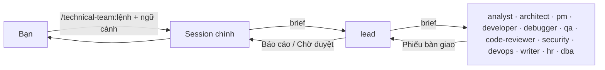
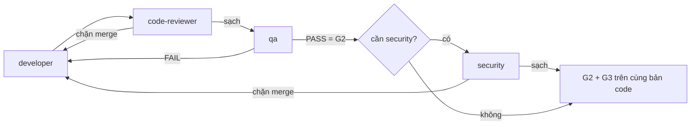
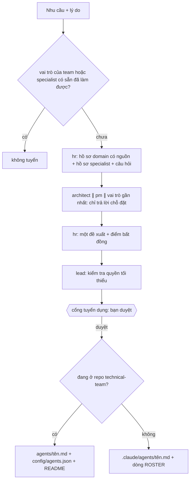

# technical-team

Plugin Claude Code dựng một team kỹ thuật cho nhiều dự án sản phẩm cùng lúc:

- **13 agent**: 13 vai trò do một tech lead điều phối.
- **18 lệnh workflow**: mỗi lệnh chứa luôn pipeline của nó, có `argument-hint`.
- **1 skill `run-kit`**: tài liệu sử dụng, quy tắc chung, phiếu bàn giao.
- **2 hook**: guard thực thi phân quyền, và kiểm tra phiếu bàn giao.
- **Không gian làm việc chung `.team/`** trong repo của từng project.

Plugin không gắn với ngôn ngữ hay framework nào: agent tự đọc stack, convention và lệnh build/test của repo.



## Mục lục

| # | Mục |
|---|---|
| 1 | [Yêu cầu](#1-yêu-cầu) |
| 2 | [Cài đặt, chạy thử, gỡ](#2-cài-đặt-chạy-thử-gỡ) |
| 3 | [Hai cách làm việc với lead](#3-hai-cách-làm-việc-với-lead) |
| 4 | [Đội hình và ranh giới](#4-đội-hình-và-ranh-giới) |
| 5 | [Tầng, cổng, vòng lặp giao hàng](#5-tầng-cổng-vòng-lặp-giao-hàng) |
| 6 | [Lệnh workflow](#6-lệnh-workflow) |
| 7 | [Phân quyền và mức bảo vệ thực tế](#7-phân-quyền-và-mức-bảo-vệ-thực-tế) |
| 8 | [Run kit và phiếu bàn giao](#8-run-kit-và-phiếu-bàn-giao) |
| 9 | [Specialist và tuyển dụng](#9-specialist-và-tuyển-dụng) |
| 10 | [Không gian làm việc `.team/`](#10-không-gian-làm-việc-team) |
| 11 | [Cấu hình theo project](#11-cấu-hình-theo-project) |
| 12 | [Giới hạn đã biết](#12-giới-hạn-đã-biết) |
| 13 | [Phát triển plugin](#13-phát-triển-plugin) |

---

## 1. Yêu cầu

| Thành phần | Phiên bản | Vì sao |
|---|---|---|
| Claude Code | **≥ 2.1.246**, khuyến nghị bản mới nhất; đã validate với **2.1.318** | subagent gọi subagent (sâu 3 tầng mặc định), tool `Agent`, tên skill plugin có tiền tố, `agent_type` trong input của hook |
| Node.js | **≥ 18**, có trên `PATH` | cả hai hook và script `init` chạy bằng Node |

> ⚠️ Không có `node` thì hook không chạy được, và Claude Code **vẫn cho tool chạy tiếp**. Khi đó mọi giới hạn chỉ còn dựa vào chỉ dẫn trong prompt. Kiểm tra bằng `node --version`.

Đừng đặt `CLAUDE_CODE_MAX_SUBAGENT_SPAWN_DEPTH=1`: khi chạy qua lệnh, chuỗi gọi là *session chính → lead → agent của team* (2 tầng).

---

## 2. Cài đặt, chạy thử, gỡ

Thư mục này vừa là plugin (`.claude-plugin/plugin.json`) vừa là marketplace (`.claude-plugin/marketplace.json`, tên `technical-team-marketplace`).

| Mục đích | Lệnh |
|---|---|
| Chạy thử, không cài | `claude --plugin-dir "D:/code/AI/storage/plugin/technical-team"` (sửa xong gõ `/reload-plugins`) |
| Thêm marketplace | `claude plugin marketplace add "D:/code/AI/storage/plugin/technical-team"` |
| Cài cho mọi project của bạn | `claude plugin install technical-team@technical-team-marketplace --scope user` |
| Cài cho một repo (cả team) | chạy trong repo: `claude plugin marketplace add <nguồn> --scope project` rồi `claude plugin install technical-team@technical-team-marketplace --scope project` |
| Gỡ | `claude plugin uninstall technical-team@technical-team-marketplace --scope user` (hoặc `--scope project`) |
| Kiểm tra | `claude plugin details technical-team` → 13 agent, 19 skill (18 lệnh + `run-kit`), 2 hook |

Với project scope, lệnh cài ghi vào `.claude/settings.json` của repo; commit file đó. Đường dẫn `D:/...` chỉ dùng được trên máy bạn. Để đồng đội cài được, hãy đẩy plugin lên một git repo và khai báo như sau:

```json
{
  "extraKnownMarketplaces": {
    "technical-team-marketplace": { "source": { "source": "git", "url": "https://<git-host>/<org>/technical-team.git" } }
  },
  "enabledPlugins": { "technical-team@technical-team-marketplace": true }
}
```

Gỡ plugin **không** xóa `.team/`, `ARCHITECTURE.md`, `docs/adr/` hay specialist của project.

**Bắt đầu ở một project:** gõ `/technical-team:init`.
- Lệnh tạo `.team/`, `.claude/agents/` và `.claude/technical-team.json`, không bao giờ ghi đè file đã có.
- Nên commit `.team/` để cả team dùng chung.

---

## 3. Hai cách làm việc với lead

| Cách | Khởi động | Tại cổng cần duyệt |
|---|---|---|
| **Qua lệnh** (mặc định) | gõ `/technical-team:<lệnh>`; session chính giao cho `technical-team:lead` chạy như subagent | lead ghi trạng thái vào `.team/STATE.md`, trả về `Chờ duyệt …` rồi dừng; bạn trả lời ở session chính, session chính gọi lại lead |
| **Lead là session chính** | `claude --agent technical-team:lead`, hoặc `"agent": "technical-team:lead"` trong `.claude/settings.json` của project | lead hỏi thẳng bạn (có `AskUserQuestion`) |

| Ghi chú | |
|---|---|
| Lệnh dùng được ở cả hai cách | khi session *là* lead, lead chạy thẳng phần `## Pipeline` của lệnh |
| Plugin không đặt `agent` mặc định | nếu đặt, mọi session ở mọi project bật plugin sẽ thành lead |
| Lead làm session chính | guard áp quyền của lead lên chính session đó; muốn tự sửa file thì mở một session thường |
| Ngữ cảnh của bạn | cài skill ngoài và tự gọi ở session chính; khi giao việc, session chính tóm tắt trung thực những gì bạn đưa vào mục **User-provided context** của prompt gửi lead |

---

## 4. Đội hình và ranh giới

Tên đầy đủ có tiền tố plugin: `technical-team:<tên>`. Model dùng alias nên luôn theo bản mới nhất.

| Tên | Vai trò | Model | Trách nhiệm |
|---|---|---|---|
| `lead` | Tech lead | `inherit` (theo session) | người duy nhất phân việc: xếp tầng, chạy pipeline, giữ cổng, báo cáo |
| `analyst` | Business analyst | sonnet | user story, acceptance criteria kiểm chứng được, trường hợp biên |
| `architect` | Architect | opus | thiết kế, plan triển khai, `ARCHITECTURE.md`, ADR |
| `pm` | Project manager | sonnet | ticket, ước lượng, phụ thuộc, tập file độc quyền, trạng thái |
| `developer` | Developer fullstack | sonnet | viết/sửa code theo plan, giữ hợp đồng backend–frontend khớp nhau |
| `debugger` | Debugger | opus | tái hiện, chứng minh nguyên nhân gốc, đề xuất hướng sửa; không sửa code |
| `qa` | QA | sonnet | AC → test, viết và chạy test, kết luận PASS/FAIL, regression test |
| `code-reviewer` | Code reviewer | sonnet | review **code** (diff), không review project; phân mức chặn merge / nên sửa / gợi ý |
| `security` | Security | opus | audit code, dependency, secrets, phân quyền, cấu hình |
| `devops` | DevOps | sonnet | CI/CD, Docker, deploy, hạ tầng; ghi `.team/OPS_HANDOFF.md` |
| `writer` | Technical writer | sonnet | README, API docs, CHANGELOG, runbook, hướng dẫn |
| `hr` | HR | opus | tuyển specialist khi thiếu chuyên môn domain |
| `dba` | DBA + data engineer | opus | migration không downtime, review schema/query, pipeline ETL/ELT/dbt/DAG/warehouse |

Lead dùng `inherit`, nên session chạy sonnet thì lead cũng là sonnet và điều phối sẽ kém hơn opus.

| Cặp | Ranh giới |
|---|---|
| pm ↔ analyst | analyst quyết định *cái gì / vì sao*; pm quyết định ticket, thứ tự, ước lượng |
| pm ↔ architect | architect quyết định *làm thế nào*; pm chia plan đã duyệt, không đổi thiết kế |
| pm ↔ lead | pm đề xuất thứ tự, theo dõi trạng thái; chỉ lead giao việc và cho qua cổng |
| debugger ↔ developer | debugger chẩn đoán có bằng chứng, không viết patch; developer sửa theo chẩn đoán |
| developer ↔ qa | qa viết test mới và kết luận; developer chỉ **Edit** test cũ bị gãy do hành vi được chủ đích thay đổi |
| devops ↔ writer | devops ghi dữ kiện thô vào `OPS_HANDOFF.md`; writer viết runbook, không sửa hạ tầng |
| hr ↔ lead | lead đề xuất nhu cầu, ghi phê duyệt của bạn; hr đánh giá, tra cứu, soạn, tạo agent; bạn quyết định |
| dba ↔ developer | developer giữ model/ORM và `schema.prisma`; dba giữ migration, seed, schema dump, code pipeline và mọi lệnh DB/migrate/pipeline |
| dba ↔ architect | architect quyết định mô hình dữ liệu; dba quyết định cách đưa thay đổi lên DB an toàn |
| dba ↔ devops | devops giữ CI/deploy và hạ tầng orchestrator; dba đưa thứ tự chạy và rollback |

---

## 5. Tầng, cổng, vòng lặp giao hàng

### Tầng (khi dùng `run` hoặc không chỉ định pipeline)

| Tầng | Khi nào | Lệnh |
|---|---|---|
| **T0** việc lẻ | câu hỏi, sửa một chỗ, cập nhật tài liệu | giao thẳng 1 agent |
| **T1** thay đổi nhỏ | phạm vi rõ, không đổi thiết kế | `change` |
| **T2** tính năng | tính năng mới hoặc chạm thiết kế | `feature` |
| **TB** lỗi | bug, test fail, hành vi sai | `fix` (`hotfix` nếu khẩn) |

| Tham gia bắt buộc (mọi tầng) | Khi |
|---|---|
| security | chạm auth, input người dùng, truy cập dữ liệu, secrets, thanh toán, dữ liệu cá nhân |
| devops | chạm hạ tầng, build, deploy |
| writer | ảnh hưởng cách dùng, API, vận hành |
| dba | chạm schema, migration, seed, dữ liệu hiện có, query bảng lớn, pipeline dữ liệu |
| specialist | điều kiện kích hoạt trong danh bạ khớp |

Lead luôn nói đã chọn tầng nào và vì sao; bạn có thể yêu cầu đổi.

### Cổng

| Cổng | Điều kiện qua |
|---|---|
| **G1** duyệt hướng làm | bạn duyệt spec + plan (hoặc hướng sửa rủi ro cao của debugger) |
| **G2** test | qa PASS, có output thật, trên bản code cuối |
| **G3** review | không còn phát hiện "chặn merge" từ code-reviewer / security / specialist, trên đúng bản code đã qua G2 |
| **G4** hoàn tất | tài liệu cập nhật (nếu cần), `.team/` cập nhật, báo cáo đã gửi |

### Vòng lặp giao hàng (thứ tự cố định, không giới hạn số vòng)



| Quy tắc | |
|---|---|
| Mọi lần sửa code đi lại từ code-reviewer | không code nào tới qa khi chưa review sạch, không code nào tới security khi chưa có qa PASS |
| Không giới hạn số vòng | không cổng nào mở sớm, không work item nào đóng khi còn lỗi |
| Leo thang khi **cùng một lỗi còn nguyên qua 2 vòng** | debugger → architect (+ analyst nếu dính AC) → tạm dừng hỏi bạn |
| Chống "làm cho test xanh" | test bị skip, xóa, nới assertion, mock mất phần đang kiểm tra = chặn merge (code-reviewer) và FAIL (qa) |
| Nhật ký | `STATE.md` → `Loop log` |

`infra` không có qa: devops → code-reviewer → security. `review`, `audit`, `release` chỉ kiểm tra rồi kết luận nên chạy song song.

> PASS QA nghĩa là đạt AC và các test hiện có, không chứng minh được là không còn lỗi. Chất lượng phụ thuộc nhiều nhất vào việc AC ở G1 có đủ và đúng hay không.

---

## 6. Lệnh workflow

Mọi lệnh có tiền tố `/technical-team:`. Mỗi file lệnh gồm hai phần:
- **Running this command**: session chính giao cho lead, chuyển báo cáo chờ duyệt cho bạn, rồi gọi lại lead với câu trả lời.
- **Pipeline**: sơ đồ và bảng các bước mà lead thực thi.

Thiếu tham số bắt buộc thì lệnh hỏi lại, không đoán.

| Lệnh | Tham số | Pipeline | Cổng |
|---|---|---|---|
| `run` | `<yêu cầu>` | lead xếp T0/T1/T2/TB rồi chạy lệnh tương ứng | theo tầng |
| `init` | – | tạo `.team/` từ template | – |
| `status` | – | tóm tắt `.team/`, không gọi agent | – |
| `plan` | `<mục tiêu>` | analyst → architect → pm, dừng ở G1 | G1 |
| `feature` | `<mô tả>` | plan → G1 → vòng lặp giao hàng (luôn có security) → writer ∥ pm | G1–G4 |
| `change` | `<mô tả>` | vòng lặp giao hàng (security nếu bị kích hoạt) | G2–G4 |
| `fix` | `<lỗi>` | debugger → vòng lặp giao hàng với regression test | G1 nếu rủi ro, G2–G4 |
| `hotfix` | `<lỗi>` | debugger → bản sửa nhỏ nhất → vòng lặp với security → tài liệu rút gọn | G2–G4 |
| `investigate` | `<triệu chứng>` | chỉ debugger chẩn đoán | – |
| `review` | `[phạm vi diff]` | code-reviewer ∥ security, gộp một kết luận | G3 |
| `audit` | `[phạm vi]` | security quét toàn diện, chỉ-đọc | – |
| `test` | `[phạm vi]` | qa bổ sung test còn thiếu | G2 |
| `infra` | `<yêu cầu>` | devops đề xuất → G1 → làm → code-reviewer → security → runbook | G1, G3, G4 |
| `release` | `[version]` | devops ∥ security ∥ qa → CHANGELOG → GO/NO-GO | G2–G4 |
| `docs` | `[phạm vi]` | writer đồng bộ tài liệu với code | G4 |
| `adr` | `<quyết định>` | architect ghi ADR | – |
| `hire` | `<domain/nhu cầu> [lý do]` | tuyển specialist (mục 9) | cổng tuyển dụng |
| `roster` | – | danh bạ + đề xuất rà soát của hr | duyệt cho nghỉ |

| Ví dụ | Kết quả |
|---|---|
| `/technical-team:run Thêm "Quên mật khẩu" ở trang đăng nhập` | lead chọn T2 (chạm auth), nói lý do, chạy `feature` |
| `/technical-team:plan Xuất báo cáo doanh thu ra CSV theo khoảng ngày` | dừng ở G1 với tóm tắt AC, thiết kế, ticket |
| `/technical-team:change Đổi thông báo lỗi email thành "Email không hợp lệ"` | lead ghi hành vi mong đợi thay cho AC, chạy vòng lặp giao hàng |
| `/technical-team:fix Tổng tiền sai khi áp 2 mã giảm giá` | debugger chứng minh nguyên nhân gốc rồi mới sửa |
| `/technical-team:hotfix API /orders trả 500 trên production` | sửa nhỏ nhất; hướng sửa rủi ro cao thì vẫn dừng hỏi bạn |
| `/technical-team:review main...HEAD` | không có tham số: working tree so với `HEAD`, hoặc commit cuối nếu sạch |
| `/technical-team:infra Thêm GitHub Actions chạy lint + test cho PR` | devops đề xuất trước, bạn duyệt, rồi mới làm |
| `/technical-team:release 1.4.0` | GO/NO-GO; team không tag, không deploy |
| `/technical-team:hire IoT: firmware ESP32, MQTT, OTA` | hồ sơ domain, hồ sơ specialist, chỗ đặt, rồi chờ bạn duyệt |

---

## 7. Phân quyền và mức bảo vệ thực tế

### 7.1 Các lớp bảo vệ

| Lớp | Cơ chế | Chặn được |
|---|---|---|
| **A** frontmatter `tools` | agent chỉ có tool được liệt kê | loại tool (không có Bash thì không chạy shell, không có Write/Edit thì không ghi bằng tool); chỉ lead có `Agent` |
| **B** guard (`hooks/guard.mjs`, `PreToolUse`) | đọc `agent_type` để biết lệnh gọi đến từ agent nào | đường dẫn ghi theo chủ sở hữu, nội dung lệnh Bash theo vai trò, ai được gọi agent nào, cổng tuyển dụng, skill nào được nạp, lệnh DB |
| **B2** kiểm tra phiếu (`hooks/handoff-check.mjs`, `SubagentStop`) | đọc tin nhắn cuối của agent khi nó kết thúc | thiếu phiếu, thiếu nhãn, `Kết quả` sai, `xong` không có bằng chứng → trả agent lại (tối đa 2 lần) |
| **C** chỉ dẫn | prompt agent + `run-kit` | thứ tự pipeline, cổng G1–G4, vòng lặp, "không nới lỏng test", chất lượng bằng chứng |

Tài liệu Claude Code xác nhận ba điều sau, và cả ba ảnh hưởng tới thiết kế:
- Agent trong plugin bị **bỏ qua** các trường `hooks`, `mcpServers`, `permissionMode`. Vì vậy mọi kiểm tra theo vai trò nằm trong một hook cấp plugin.
- Cú pháp `Bash(<pattern>)` không được tài liệu hóa cho trường `tools`. Agent khai `Bash` trơn, guard giới hạn nội dung lệnh.
- Subagent không có `AskUserQuestion`. Vì vậy lead chạy dưới dạng subagent phải dừng lại ở mỗi cổng cần bạn duyệt.

### 7.2 Bảng quyền

| Vai trò | Tools | Ghi | Bash |
|---|---|---|---|
| lead | không khai → nhận toàn bộ tool của session | chỉ `.team/STATE.md` | chỉ `git status`, `git diff` (+ `head`/`tail`/`grep`/`wc`/`sort`/`uniq`/`cut`), script `init` |
| analyst | Read, Write, Edit, Glob, Grep, Skill | chỉ `.team/SPEC.md` | không có |
| architect | Read, Write, Edit, Glob, Grep, Skill, WebSearch, WebFetch | `.team/PLAN.md`, `ARCHITECTURE.md`, `docs/adr/**` | không có |
| pm | Read, Write, Edit, Glob, Grep, Skill | chỉ `.team/TASKS.md` | không có |
| developer | Read, Write, Edit, Glob, Grep, Bash, Skill, WebSearch, WebFetch | mọi đường dẫn **không** thuộc ai khác; test cũ chỉ bằng Edit | build, lint, test, chạy local; không lệnh DB/migrate/pipeline |
| debugger | Read, Glob, Grep, Bash, Skill, WebSearch, WebFetch | không | chỉ-đọc |
| qa | Read, Write, Edit, Glob, Grep, Bash, Skill | chỉ file/thư mục test | chỉ-đọc, hoặc chỉ lệnh test đã cấu hình |
| code-reviewer | Read, Glob, Grep, Bash, Skill | không | chỉ `git diff`, `git log` (+ bộ lọc) |
| security | Read, Glob, Grep, Bash, Skill, WebSearch, WebFetch | không | chỉ-đọc (chặn `audit fix`) |
| devops | Read, Write, Edit, Glob, Grep, Bash, Skill, WebSearch, WebFetch | file hạ tầng + `.team/OPS_HANDOFF.md` | Docker/IaC/kiểm tra config; không thay đổi môi trường từ xa trừ khi bật |
| writer | Read, Write, Edit, Glob, Grep, Skill | `README.md`, `CHANGELOG.md` (mọi cấp), `docs/**` trừ `docs/adr/**` | không có |
| hr | Read, Write, Edit, Glob, Grep, WebSearch, WebFetch, Skill | file agent đã duyệt, `.team/ROSTER.md` (+ `agents/`, `config/agents.json` trong repo plugin) | không có |
| dba | Read, Write, Edit, Glob, Grep, Bash, Skill, WebSearch, WebFetch | migration, seed, schema dump, code pipeline | `db-local` (7.5) |
| specialist | do bạn duyệt; không bao giờ có `Agent` | cột `Write scope` của dòng đã duyệt | cột `Bash`: `none` / `readonly` / `developer` / `db-local` |
| Explore (agent ngoài) | của Claude Code | không | chỉ-đọc |

Mọi agent có `Skill` nhưng chỉ nạp được `run-kit` và danh sách bạn khai cho vai trò đó (mục 11). Không ai trong team được commit, push, mở PR, hay ghi vào `.claude/`, `.git/`, `.env`.

### 7.3 Mỗi đường dẫn có đúng một chủ

Guard đi qua các bước dưới đây theo thứ tự, gặp bước khớp đầu tiên thì dừng:

| # | Đường dẫn | Chủ |
|---|---|---|
| 1 | `.git/**`, `.claude/**` (trừ file agent đã duyệt cho hr), `.env`, `.env.*` (trừ `*.example`/`*.sample`/`*.template`), file lạ trong `.team/` | không ai |
| 2 | `.team/STATE.md` · `SPEC.md` · `PLAN.md` · `TASKS.md` · `OPS_HANDOFF.md` · `ROSTER.md` (kể cả `archive/<FILE>-<YYYY-MM>.md`) | lead · analyst · architect · pm · devops · hr |
| 3 | `ARCHITECTURE.md`, `docs/adr/**` | architect |
| 4 | `README.md`, `CHANGELOG.md` (mọi cấp), `docs/**` | writer |
| 5 | hạ tầng: Dockerfile, compose, `.github/workflows/**`, `.gitlab-ci.yml`, `Jenkinsfile`, `infra/`, `deploy/`, `k8s/`, `helm/`, `terraform/`, `ops/`, `scripts/ci|deploy|ops/**`… | devops |
| 6 | test: `tests/`, `test/`, `__tests__/`, `e2e/`, `spec/`, `*.spec.*`, `*.test.*`, `*_test.*`, `test_*.py`… | qa |
| 7 | dữ liệu (`data`): `**/migrations/**`, `db/migrate/**`, `**/db/migration/**`, `alembic/versions/**`, `drizzle/**`, `**/seeds/**`, `**/seeders/**`, `db/seeds.rb`, `prisma/seed.*`, `db/schema.rb`, `db/structure.sql`, `dbt/**`, `dags/**`, `etl/**`, `elt/**`, `warehouse/**`… | dba |
| 8 | specialist của plugin (`config/agents.json`), rồi `Write scope` của specialist project `active` có `HIRE-APPROVED` | specialist đó |
| 9 | còn lại | developer |

Danh sách đầy đủ nằm ở `config/ownership.json`; mỗi project mở rộng được (mục 11). Không agent nào được ghi ra ngoài thư mục project, trừ một ngoại lệ: hr ghi vào `~/.claude/agents/` khi bạn chọn user scope.

### 7.4 Bash theo stack

| Chế độ | Khi nào | Bảo vệ |
|---|---|---|
| Denylist (mặc định) | `commands.*` để trống | luôn chặn `sudo`, `git commit/push`, `git reset --hard`, `git clean`, bỏ thay đổi, `gh pr create/merge`, `curl … \| sh`, `rm -r` vào `/`, `~`, `..`, `.git`, `.team`, `.claude`; redirect/`tee` vào file của người khác |
| Allowlist | bạn điền `commands.build/lint/test/run` (developer), `commands.test` (qa), `commands.infra` (devops) | chỉ các lệnh có tiền tố đó + lệnh chỉ-đọc |
| Chỉ-đọc | debugger, security, Explore, specialist `readonly` | chặn ghi file qua shell, `sed -i`, git thay đổi repo, `find -delete/-exec`, `xargs`, cài dependency, lệnh thay đổi hạ tầng từ xa |

### 7.5 Lệnh database và pipeline (`db-local`, dùng cho `dba`)

| Quy tắc | |
|---|---|
| Chỉ dba chạy | các lệnh DB/migrate/pipeline (`config/ownership.json` → `dbCommands`: Prisma, Django, Alembic, Rails, Flyway, Liquibase, EF Core, Knex, TypeORM, Drizzle, goose, dbmate, `pg_dump`, `dbt run/build/test…`, trigger Airflow/Dagster/Prefect, `bq query`, `snowsql`, `spark-submit`… + client `psql`, `mysql`, `sqlite3`, `mongosh`, `sqlcmd`). Vai trò khác bị chặn; `npx prisma generate`, `npm test`, `dbt parse` vẫn chạy được |
| Đích phải chứng minh là local/test | URL ngay trong lệnh, `--host` + `-d`, hoặc `db.envFile`; host thuộc `db.allowedHosts`, tên DB khớp `db.allowedDatabases` |
| Luôn chặn | đích là biến shell, lệnh có `prod`/`staging`/`live`/`uat`…, tunnel/port-forward, chạy file SQL qua client, qua `psql -c` / `mysql -e` mọi thứ ngoài `EXPLAIN`/`SHOW`/`DESCRIBE`/`\d`/SELECT catalog, `EXPLAIN ANALYZE` lệnh ghi |
| Warehouse từ xa | dbt/Airflow lấy đích từ file cấu hình mà guard không đọc được → bị chặn; dba đưa lệnh trong phiếu bàn giao để bạn chạy |
| Cấu hình | mục `db` trong `.claude/technical-team.json` (mục 11); thư mục dữ liệu khác mặc định → `paths.data` |

### 7.6 Những gì cấu hình **không** chặn được

| Điểm | Thực tế |
|---|---|
| Bash ghi file theo đường vòng | guard bắt redirect, `tee` và lệnh ghi phổ biến; `node -e`, `python -c`, test runner tạo snapshot vẫn ghi được. Cần cách ly thật thì dùng sandbox của Claude Code hoặc allowlist |
| Cổng, vòng lặp, "không nới lỏng test" | chỉ dựa vào chỉ dẫn; guard không phân biệt sửa test đúng hay nới lỏng |
| `HIRE-APPROVED` | do lead ghi sau khi bạn duyệt: là dấu vết kiểm soát, không phải chữ ký của bạn |
| Tool MCP của lead | lead nhận toàn bộ tool của session; guard không thấy tool MCP (GitHub, Slack…), nên "không mở PR" qua MCP chỉ dựa vào chỉ dẫn |
| Nội dung skill | guard kiểm soát *skill nào* được nạp, không kiểm soát nội dung; skill có lệnh shell tự chạy hoặc `allowed-tools` có thể đi ngoài guard. Chỉ khai skill bạn đã đọc |
| WebFetch | có thể đọc nội dung độc hại hoặc làm lộ dữ liệu qua URL; run-kit dặn coi web là dữ liệu và không đưa code/secret vào truy vấn, guard không kiểm tra URL |
| DB `localhost` | có thể là tunnel tới production do bạn tự mở; config của tool có thể hardcode host. Bảo đảm thật: máy dev không có credential production |
| Thiếu Node | không có guard, không có kiểm tra phiếu |
| Session chính | không bị guard giới hạn (trừ khi lead là session chính); agent ngoài team không trong `externalAgents` cũng không bị đụng tới |

---

## 8. Run kit và phiếu bàn giao

| Thành phần | Ở đâu | Nạp thế nào | Nội dung |
|---|---|---|---|
| `run-kit` | `skills/run-kit/SKILL.md` | preload vào **mọi** agent; session chính nạp khi bạn hỏi cách dùng; `/technical-team:run-kit` để xem | cách dùng (chế độ, bảng lệnh, cổng, vòng lặp, specialist, skill), quy tắc làm việc, **phiếu bàn giao** |
| Lead manual | `agents/lead.md`, phần cuối | system prompt của lead | tầng, cổng, vòng lặp, mẫu brief, bảng quyền, `.team/`, điểm gắn, mẫu báo cáo |
| Pipeline | `commands/<lệnh>.md` → `## Pipeline` | lead đọc bằng Read khi chạy | các bước, agent, song song, cổng, vòng lặp, file `.team/`, điểm gắn, kết thúc |

Nội dung agent, command và skill viết dạng bảng + sơ đồ Mermaid, bằng tiếng Anh. Agent luôn trả lời theo ngôn ngữ của bạn mà lead ghi trong brief. Chi phí cố định mỗi session khoảng 1,9k token.

### Phiếu bàn giao (mọi agent, cuối mỗi lần chạy)

```
### Phiếu bàn giao
- **Kết quả:** xong | vướng | cần quyết định
- **Bằng chứng:** <output lệnh, test, hoặc file:line>
- **Đã ghi vào:** <file đã tạo/sửa, hoặc "không">
- **Còn mở:** <rủi ro, câu hỏi, việc chưa làm>
- **Đề xuất bước tiếp:** <ai làm gì tiếp>
```

| Cơ chế | |
|---|---|
| Định nghĩa | chỉ ở `run-kit` §3 |
| Kiểm tra | hook `SubagentStop` đọc chính mẫu đó; thiếu hoặc sai → trả agent lại kèm mẫu, tối đa 2 lần, sau đó lead coi là `vướng` |
| Lead | kết thúc bằng `## Báo cáo …` hoặc `## Chờ duyệt …` thay cho phiếu |

---

## 9. Specialist và tuyển dụng

Khi team thiếu chuyên môn domain, hr tuyển **specialist**. Specialist nằm ở một trong hai nơi:

| Loại | Ở đâu | Có hiệu lực |
|---|---|---|
| Specialist của plugin | `agents/` + `config/agents.json` của plugin (tuyển khi làm việc trong repo `technical-team`) | mọi project dùng plugin |
| Specialist của project | `.claude/agents/<tên>.md` + dòng `.team/ROSTER.md` | chỉ project đó, khi dòng `active` và `STATE.md` có `HIRE-APPROVED: <tên>` |

Agent của plugin **không bao giờ bị thay thế** bằng file agent của project hay user:
- Guard chỉ nhận agent của plugin dưới tên `technical-team:<tên>`. Một agent tên `developer` trong project không phải agent của team, và lead không gọi được nó.
- hr không được tạo file trùng tên agent của plugin.
- Muốn mở rộng thì dùng cấu hình (mục 11) hoặc `hire`.

### Quy trình `hire`



| Quy tắc | |
|---|---|
| Quyền tối thiểu | mặc định chỉ đọc và tư vấn; Write/Edit/Bash chỉ khi thật sự cần, kèm lý do; không bao giờ có `Agent`; phạm vi ghi không chồng ai; preload `technical-team:run-kit` |
| Repo plugin | khi gốc project có `.claude-plugin/plugin.json` tên `technical-team`, agent được tuyển thành **specialist của plugin**; có hiệu lực sau `/reload-plugins` |
| Project khác | specialist của riêng project; `.claude/agents/` thường nhận trong vài giây, khởi động lại nếu thư mục chưa có lúc mở session |
| Rà soát (`roster`) | hr đề xuất cho nghỉ specialist lâu không dùng hoặc trùng việc; bạn duyệt; hr không xóa file, bạn tự xóa |

| Điểm gắn | Cùng ai | Khi nào |
|---|---|---|
| `design` | architect | trước G1 |
| `execute` | developer | khi triển khai |
| `review` | code-reviewer | bước code review, trước qa; chặn merge giữ G3 |
| `test` | qa | bước qa, trước G2 |

---

## 10. Không gian làm việc `.team/`

| File | Người ghi | Nội dung |
|---|---|---|
| `.team/STATE.md` | lead | work item, tầng/pipeline, cổng, phê duyệt, `Loop log`, kết quả, phát hiện hoãn, `HIRE-APPROVED`, lần dùng specialist, báo cáo cuối |
| `.team/SPEC.md` | analyst | user story, acceptance criteria, trường hợp biên |
| `.team/PLAN.md` | architect | plan triển khai |
| `.team/TASKS.md` | pm | ticket, ước lượng, phụ thuộc, tập file độc quyền, trạng thái |
| `.team/OPS_HANDOFF.md` | devops | thông tin vận hành thô cho writer |
| `.team/ROSTER.md` | hr | specialist của project |
| `ARCHITECTURE.md` | architect | tổng quan kiến trúc |
| `docs/adr/NNNN-<quyet-dinh>.md` | architect | ADR |

| Quy ước | |
|---|---|
| Mã định danh | lead cấp `W-001`, `W-002`…; SPEC (`W-001.AC1`), PLAN, TASKS (`W-001-T1`) dùng chung mã |
| Trạng thái | SPEC/PLAN `draft` → `done` (PLAN có `superseded`); TASKS `todo` · `doing` · `blocked` · `review` · `done`; phê duyệt G1 chỉ ghi ở `STATE.md` |
| Archive | work item `done` → mỗi chủ file tự chuyển phần của mình sang `.team/archive/<FILE>-<YYYY-MM>.md` |
| Nội dung | tóm tắt và kết luận; không log dài, không secret, không dữ liệu thật |
| Quy ước vận hành | nằm trong plugin, không nằm trong `.team/` |

---

## 11. Cấu hình theo project

Mọi tùy biến nằm trong `.claude/technical-team.json`. File này do `init` tạo ra và **chỉ bạn sửa**, vì guard chặn mọi agent ghi vào `.claude/`.

```json
{
  "commands": {
    "build": ["npm run build"],
    "lint":  ["npm run lint"],
    "test":  ["npm test", "npx playwright test"],
    "run":   ["npm run dev"],
    "infra": ["docker build", "docker compose", "terraform plan"]
  },
  "paths": {
    "infra": ["tools/release/**"],
    "tests": ["qa-fixtures/**"],
    "docs":  ["handbook/**"],
    "architecture": [],
    "data": ["database/sql/**"]
  },
  "devopsAllowRemote": false,
  "externalAgents": ["Explore"],
  "db": {
    "commands": [],
    "allowedHosts": ["localhost", "127.0.0.1", "::1", "db"],
    "allowedDatabases": ["*_test", "*_dev", "*_local"],
    "envFile": ".env.test"
  },
  "skills": {
    "developer": ["react-native", "mobile-kit:ios-release"],
    "qa": ["detox-e2e"]
  }
}
```

| Mục | Tác dụng |
|---|---|
| `commands` | mỗi mục là một tiền tố lệnh; danh sách khác rỗng thì vai trò đó chuyển sang allowlist (7.4) |
| `paths` | **cộng thêm** vào mặc định trong `config/ownership.json`; `paths.data` mở rộng vùng ghi của dba, `paths.<specialist plugin>` mở rộng vùng của specialist đó |
| `devopsAllowRemote` | `true` cho devops chạy `docker push`, `kubectl apply`, `terraform apply`… (mặc định tắt) |
| `externalAgents` | agent ngoài team mà lead được gọi để lấy ngữ cảnh hiện trạng; luôn chạy chỉ-đọc, kể cả khi bạn tự gọi; `[]` để tắt |
| `db` | `commands` rỗng = dùng danh sách mặc định; `allowedHosts` thêm service DB của docker-compose; `allowedDatabases` là glob; `envFile` là file env mà tool thật sự đọc |
| `skills` | skill mỗi vai trò được nạp; skill của project ghi tên trần (`.claude/skills/<tên>/`), skill plugin khác ghi `<plugin>:<skill>`; lead chỉ ghi vào brief skill hợp với việc đang giao; specialist khai theo tên |
| JSON lỗi | guard chặn mọi lệnh ghi/Bash của team cho tới khi bạn sửa |

Skill chỉ thêm kiến thức, không thêm quyền. File build/release mobile như Fastlane hay `eas.json` nên khai vào `paths.infra`.

---

## 12. Giới hạn đã biết

| Giới hạn | Chi tiết |
|---|---|
| Chưa chạy end-to-end với model thật | đã kiểm chứng: `claude plugin validate --strict` (plugin + marketplace), cài thử và `claude plugin details`, 32 unit test của hook, chạy thử `init` |
| Chưa kiểm chứng được | giá trị `agent_type` thực tế cho agent plugin; preload skill bằng tên có tiền tố (`technical-team:run-kit`); tên trường input của tool `Skill` (guard chặn khi không đọc được tên); trường `last_assistant_message` của `SubagentStop` (thiếu thì hook không chặn) |
| Thử nhanh sau khi cài | `/technical-team:status`, rồi nhờ `technical-team:pm` ghi thử vào `README.md` → guard phải từ chối |
| Chi phí | `feature` gọi khoảng 8–10 lượt agent (nhiều hơn nếu có vòng lặp, specialist); dùng `run` để lead chọn tầng nhẹ nhất |
| Commit/push | mọi agent bị chặn, kể cả khi bạn yêu cầu; lead đưa lệnh để bạn tự chạy |
| Lead gọi agent ngoài | chỉ những agent trong `externalAgents` (mặc định `Explore`, chỉ-đọc); `general-purpose`, `Plan`, fork, agent plugin khác bị chặn; kết quả của Explore chỉ là ngữ cảnh, không phải bằng chứng cho cổng |
| Explore ở session chính | hook không biết ai gọi Explore, nên khi bạn tự dùng nó cũng chạy chỉ-đọc |
| Hook timeout | guard 15 giây, kiểm tra phiếu 10 giây; với session thường cả hai thoát ngay |

---

## 13. Phát triển plugin

| Việc | Lệnh |
|---|---|
| Test hook | `node --test tests/guard.test.mjs` |
| Validate | `claude plugin validate . --strict` và `claude plugin validate .claude-plugin/marketplace.json --strict` |
| Chạy thử | `claude --plugin-dir .` |
| Tuyển specialist vào plugin | mở chính repo này làm project rồi chạy `/technical-team:hire …` |

```
technical-team/
├── .claude-plugin/
│   ├── plugin.json
│   └── marketplace.json
├── agents/                 13 vai trò
├── commands/               18 lệnh, mỗi lệnh chứa pipeline của nó
├── skills/run-kit/         tài liệu sử dụng + quy tắc chung + phiếu bàn giao
├── hooks/
│   ├── hooks.json          PreToolUse → guard.mjs, SubagentStop → handoff-check.mjs
│   ├── guard.mjs           thực thi phân quyền
│   └── handoff-check.mjs   bắt buộc phiếu bàn giao
├── config/
│   ├── ownership.json      chủ sở hữu đường dẫn (cả `data` của dba), dbCommands, externalAgents
│   └── agents.json         specialist tuyển vào plugin (hiện trống)
├── scripts/team-init.mjs
├── templates/              .team/*.md, ARCHITECTURE.md, adr.md, specialist-agent.md, technical-team.json
└── tests/guard.test.mjs
```

**Vai trò có thể cần sau này** (tuyển qua `hire` khi project cần): UX/UI designer (luồng người dùng, wireframe, accessibility), product owner (ưu tiên backlog giữa nhiều work item; hiện là bạn).
