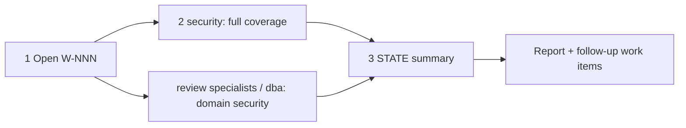

# /technical-team:audit — audit

## Running this command

**Request:** $ARGUMENTS

| Situation | Do |
|---|---|
| Argument required | no |
| This session **is** the tech lead (`--agent technical-team:lead` or `agent` setting) | execute the **Pipeline** below yourself |
| Any other session | Agent tool → `subagent_type: technical-team:lead`, prompt below |
| Lead returns `Chờ duyệt …` | stop, wait for the user; never approve or choose for them |
| User answers | resume the same lead (SendMessage), or a new Agent call: `Continue W-NNN (audit). User's answer (verbatim): <answer>. Read .team/STATE.md first.` |
| Always | show the lead's report as written; do not do the team's work in the main session |

```
Execute the Pipeline section of ${CLAUDE_PLUGIN_ROOT}/commands/audit.md (Read the file).
Request (verbatim): <request>
User's language: <language>
Work item: <W-NNN or new>
User-provided context: <faithful summary of what the user supplied for this request in this conversation — files, notes, output of skills they ran — or "none">
Read .team/STATE.md first.
```
The lead and its agents cannot see this conversation: "User-provided context" is the only way context you were given reaches the team.

## Pipeline

_Executed by the tech lead. Shared rules: Lead manual (tiers §1, gates §2, delivery loop §3, brief §4, members/specialists §7, reports §8–§9)._

| | |
|---|---|
| Gates | none |
| Writes code | no |
| Input | scope (optional; default: whole repository) |



| # | Step | Agent | Parallel |
|---|---|---|---|
| 1 | Open W-NNN (pipeline `audit`) with the scope | lead | — |
| 2 | Trust boundaries, vulnerability classes, dependency audit, secret scan, config and IaC review; large repo → list covered / skipped. **Hook `review`**: domains with their own security concerns (firmware, payments, DB access…) | security ∥ specialists / dba | yes |
| 3 | Summary in `STATE.md`: counts by severity, top issues | lead | — |

| | |
|---|---|
| .team | reads `STATE`, `ARCHITECTURE.md`, `PLAN`, `OPS_HANDOFF`, `ROSTER`; writes lead → `STATE` |
| End | final report: findings by severity with `file:line` + fix direction, coverage and gaps, missing scanners; follow-up work items grouped by effort (`fix` single issues, `change` / `feature` structural); do not start them unless asked |
