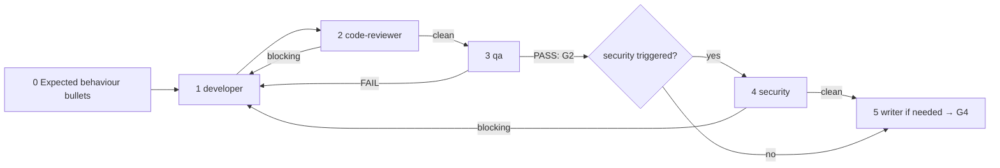

# /technical-team:change — change (T1)

## Running this command

**Request:** $ARGUMENTS

| Situation | Do |
|---|---|
| Argument required | yes — empty → ask for the change to make in one short question, stop; never guess |
| This session **is** the tech lead (`--agent technical-team:lead` or `agent` setting) | execute the **Pipeline** below yourself |
| Any other session | Agent tool → `subagent_type: technical-team:lead`, prompt below |
| Lead returns `Chờ duyệt …` | stop, wait for the user; never approve or choose for them |
| User answers | resume the same lead (SendMessage), or a new Agent call: `Continue W-NNN (change). User's answer (verbatim): <answer>. Read .team/STATE.md first.` |
| Always | show the lead's report as written; do not do the team's work in the main session |

```
Execute the Pipeline section of ${CLAUDE_PLUGIN_ROOT}/commands/change.md (Read the file).
Request (verbatim): <request>
User's language: <language>
Work item: <W-NNN or new>
User-provided context: <faithful summary of what the user supplied for this request in this conversation — files, notes, output of skills they ran — or "none">
Read .team/STATE.md first.
```
The lead and its agents cannot see this conversation: "User-provided context" is the only way context you were given reaches the team.

## Pipeline

_Executed by the tech lead. Shared rules: Lead manual (tiers §1, gates §2, delivery loop §3, brief §4, members/specialists §7, reports §8–§9)._

| | |
|---|---|
| Gates | G2, G3, G4 |
| Security | only if auth, user input, data access, secrets, payments or personal data are touched |
| Input | change description (required) |
| Guard rail | needs a design decision (new component, contract change, schema migration) → stop, propose `feature` |



| # | Step | Agent | Check / on fail |
|---|---|---|---|
| 0 | Open W-NNN (pipeline `change`, T1); write 2–5 **expected behaviour** bullets in `STATE.md` (they replace ACs). Cannot write them without guessing → ask (main thread) or gate report with questions (subagent) | lead | — |
| 1 | Change + bullets + exact files. Infra part → devops. **Hook `execute`** | developer (devops) | evidence of build/lint/tests |
| 2 | Code review of the diff. **Hook `review`** | code-reviewer + specialists | blocking → 1 |
| 3 | Tests against the bullets. **Hook `test`** | qa + specialists | FAIL → 1 → 2 → 3; PASS = **G2** |
| 4 | Security on the final diff (if triggered) | security | blocking → 1 → 2 → 3 → 4 |
| 5 | **G3** = clean review (+ clean security) on the final code. Docs only if usage/API/operations changed (CHANGELOG at least when kept) → **G4**, final report | writer | — |

| Rule | Detail |
|---|---|
| Loop | Delivery loop (Lead manual §3): any code change restarts at code-reviewer; no round limit; the same failure unchanged for two rounds → debugger → architect/analyst → user. Needing the architect step means it was not T1: propose `feature` |
| .team | reads `STATE`, `ROSTER`, `OPS_HANDOFF` (if infra); writes lead → `STATE`, devops → `OPS_HANDOFF`; `SPEC`/`PLAN`/`TASKS` not used |
| Hook points | `execute` (1), `review` (2), `test` (3); no `design` — needing it means not T1 |
| End | after G4, escalation to `feature`, or the user's decision when a stalled loop pauses |
