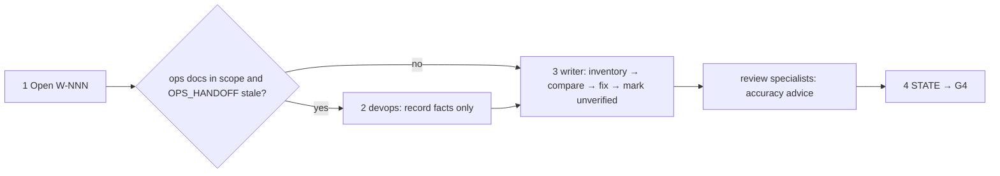
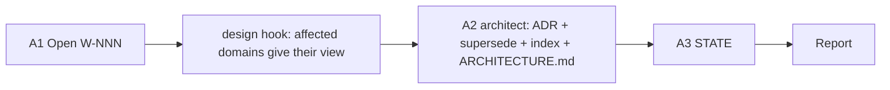

# /technical-team:docs — docs (sync · ADR)

## Running this command

**Request:** $ARGUMENTS

| Situation | Do |
|---|---|
| Argument required | no — except with `--adr`: no decision given → ask for the decision or question to record in one short question, stop; never guess |
| This session **is** the tech lead (`--agent technical-team:lead` or `agent` setting) | execute the **Pipeline** below yourself |
| Any other session | Agent tool → `subagent_type: technical-team:lead`, prompt below |
| Lead returns `Chờ duyệt …` | stop, wait for the user; never approve or choose for them |
| User answers | resume the same lead (SendMessage), or a new Agent call: `Continue W-NNN (docs). User's answer (verbatim): <answer>. Read .team/STATE.md first.` |
| Always | show the lead's report as written; do not do the team's work in the main session |

```
Execute the Pipeline section of ${CLAUDE_PLUGIN_ROOT}/commands/docs.md (Read the file).
Request (verbatim): <request>
User's language: <language>
Work item: <W-NNN or new>
User-provided context: <faithful summary of what the user supplied for this request in this conversation — files, notes, output of skills they ran — or "none">
Read .team/STATE.md first.
```
The lead and its agents cannot see this conversation: "User-provided context" is the only way context you were given reaches the team.

## Pipeline

_Executed by the tech lead. Shared rules: Lead manual (tiers §1, gates §2, delivery loop §3, brief §4, specialists §7, reports §8–§9). `new` reuses the Sync section._

| Flag (or the same intent in words) | Mode | Owner | Gates | Input |
|---|---|---|---|---|
| none | **sync** | writer | G4 | scope (optional; default: all product docs) |
| `--adr <decision>` ("ghi ADR", "record decision") | **adr** | architect | none | decision or question (required) |

### Sync (steps 1–4)



| # | Step | Agent |
|---|---|---|
| 1 | Open W-NNN (pipeline `docs (sync)`) | lead |
| 2 | Only if operations are in scope and `OPS_HANDOFF.md` is empty/stale: record missing facts (no infra changes) | devops |
| 3 | Inventory docs in scope, compare with code/config/scripts/`OPS_HANDOFF.md`, fix wrong, fill missing (incl. runbooks from `OPS_HANDOFF.md`), mark unverified. **Hook `review`**: domain docs accuracy (advice only) | writer (+ specialists) |
| 4 | Update `STATE.md` → **G4** | lead |

### ADR (steps A1–A3)



| # | Step | Agent |
|---|---|---|
| A1 | Open W-NNN (pipeline `docs (adr)`) | lead |
| A2 | **Hook `design`**: specialists whose domain is affected (e.g. dba for data decisions) give their view first. Then `docs/adr/NNNN-<kebab-title>.md` from the template; status `accepted` if the user says the decision is made, else `proposed`; superseded ADR → `superseded by NNNN`; update the index and affected sections of `ARCHITECTURE.md` | specialists → architect |
| A3 | Update `STATE.md` | lead |

| | |
|---|---|
| .team | sync: reads `STATE`, `OPS_HANDOFF`, `SPEC`, `ROSTER`; writes lead → `STATE`, devops → `OPS_HANDOFF` (step 2) · adr: reads `STATE`, `ARCHITECTURE.md`, `docs/adr/`, `ROSTER`; writes lead → `STATE` |
| End | sync: final report — docs changed, discrepancies (which side was wrong), unverified items · adr: final report — ADR path, status, decision in one sentence; if `proposed`, what the user must confirm |
