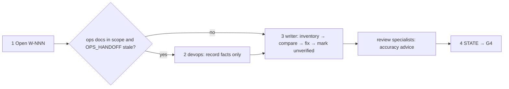

# /technical-team:docs — docs (G4)

## Running this command

**Request:** $ARGUMENTS

| Situation | Do |
|---|---|
| Argument required | no |
| This session **is** the tech lead (`--agent technical-team:lead` or `agent` setting) | execute the **Pipeline** below yourself |
| Any other session | Agent tool → `subagent_type: technical-team:lead`, prompt below |
| Lead returns `Chờ duyệt …` | stop, wait for the user; never approve or choose for them |
| User answers | resume the same lead (SendMessage), or a new Agent call: `Continue W-NNN (docs). User's answer (verbatim): <answer>. Read .team/STATE.md first.` |
| Always | show the lead's report as written; do not do the team's work in the main session |

```
Execute the Pipeline section of ${CLAUDE_PLUGIN_ROOT}/commands/docs.md (Read the file).
Request (verbatim): <request>
User's language: <language>
Work item: <W-NNN or new>
User-provided context: <faithful summary of what the user supplied for this request in this conversation — files, notes, output of skills they ran — or "none">
Read .team/STATE.md first.
```
The lead and its agents cannot see this conversation: "User-provided context" is the only way context you were given reaches the team.

## Pipeline

_Executed by the tech lead. Shared rules: Lead manual (tiers §1, gates §2, delivery loop §3, brief §4, members/specialists §7, reports §8–§9)._

| | |
|---|---|
| Gates | G4 |
| Input | scope (optional; default: all product docs) |



| # | Step | Agent |
|---|---|---|
| 1 | Open W-NNN (pipeline `docs`) | lead |
| 2 | Only if operations are in scope and `OPS_HANDOFF.md` is empty/stale: record missing facts (no infra changes) | devops |
| 3 | Inventory docs in scope, compare with code/config/scripts/`OPS_HANDOFF.md`, fix wrong, fill missing, mark unverified. **Hook `review`**: domain docs accuracy (advice only) | writer (+ specialists) |
| 4 | Update `STATE.md` | lead |

| | |
|---|---|
| .team | reads `STATE`, `OPS_HANDOFF`, `SPEC`, `ROSTER`; writes lead → `STATE`, devops → `OPS_HANDOFF` (step 2) |
| End | final report: docs changed, discrepancies (which side was wrong), unverified items |
