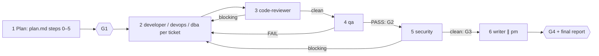

# /technical-team:feature — feature (T2)

## Running this command

**Request:** $ARGUMENTS

| Situation | Do |
|---|---|
| Argument required | yes — empty → ask for the feature description in one short question, stop; never guess |
| This session **is** the tech lead (`--agent technical-team:lead` or `agent` setting) | execute the **Pipeline** below yourself |
| Any other session | Agent tool → `subagent_type: technical-team:lead`, prompt below |
| Lead returns `Chờ duyệt …` | stop, wait for the user; never approve or choose for them |
| User answers | resume the same lead (SendMessage), or a new Agent call: `Continue W-NNN (feature). User's answer (verbatim): <answer>. Read .team/STATE.md first.` |
| Always | show the lead's report as written; do not do the team's work in the main session |

```
Execute the Pipeline section of ${CLAUDE_PLUGIN_ROOT}/commands/feature.md (Read the file).
Request (verbatim): <request>
User's language: <language>
Work item: <W-NNN or new>
User-provided context: <faithful summary of what the user supplied for this request in this conversation — files, notes, output of skills they ran — or "none">
Read .team/STATE.md first.
```
The lead and its agents cannot see this conversation: "User-provided context" is the only way context you were given reaches the team.

## Pipeline

_Executed by the tech lead. Shared rules: Lead manual (tiers §1, gates §2, delivery loop §3, brief §4, members/specialists §7, reports §8–§9)._

| | |
|---|---|
| Gates | G1, G2, G3, G4 |
| Security | always |
| Input | feature description (required) |



| # | Step | Agent | Parallel | Check / on fail |
|---|---|---|---|---|
| 1 | Planning: Pipeline of `${CLAUDE_PLUGIN_ROOT}/commands/plan.md` steps 0–5, exactly | analyst → architect → pm | no | stop until G1 approved |
| 2 | Implementation, tickets in dependency order: developer tickets → developer, infra → devops, migrations/seeds → dba (hand-written: parallel with developer; ORM-generated: after the model change), docs wait for 6. **Hook `execute`** | developer, devops, dba, specialists | same parallel group **and** disjoint files | evidence of build/lint/tests; `git diff --stat` = "Files changed"; developer stuck → debugger |
| 3 | Code review of the W-NNN diff with plan + ACs. **Hook `review`** (dba for DB parts) | code-reviewer + specialists | specialists ∥ reviewer | blocking → 2 |
| 4 | Tests: all ACs + changed files. **Hook `test`** | qa + specialists | specialists ∥ qa | FAIL → 2 (then 3, 4); PASS with output = **G2** |
| 5 | Security on the final diff + plan's security notes | security | no | blocking → 2 (then 3, 4, 5); clean = **G3** |
| 6 | Docs (README / API / CHANGELOG / runbooks; writer confirms with a reason if nothing changed) ∥ pm marks tickets `done` | writer ∥ pm | yes | then `STATE.md`: results, `G4 done`, status `done`; final report §8 |

| Rule | Detail |
|---|---|
| Loop | Delivery loop (Lead manual §3): any code change restarts at code-reviewer; no round limit; the same failure unchanged for two rounds → debugger → architect/analyst → user. |
| Non-blocking findings | fix now if cheap and in scope (through the loop), otherwise deferred with a reason |
| .team reads | all |
| .team writes | lead → `STATE`; analyst → `SPEC`; architect → `PLAN`, `ARCHITECTURE.md`, ADR; pm → `TASKS`; devops → `OPS_HANDOFF` |
| Hook points | `design` (1), `execute` (2), `review` (3), `test` (4) |
| End | after G4; or the user cancels/redirects. A stalled loop pauses for the user but never closes the work item as done |
