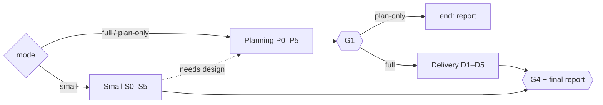
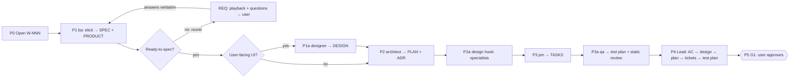
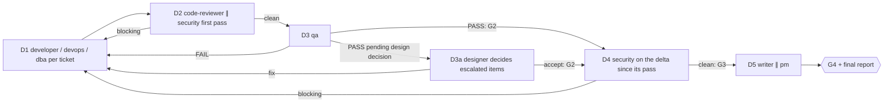
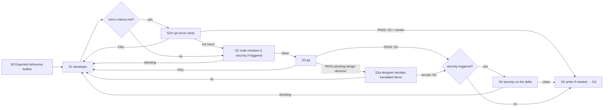

# /technical-team:feature — feature (T2 · plan-only · T1)

## Running this command

**Request:** $ARGUMENTS

| Situation | Do |
|---|---|
| Argument required | yes — empty → ask for the feature or change in one short question, stop; never guess |
| This session **is** the tech lead (`--agent technical-team:team-lead` or `agent` setting) | execute the **Pipeline** below yourself |
| Any other session | Agent tool → `subagent_type: technical-team:team-lead`, prompt below |
| Lead returns `Chờ duyệt …` | stop, wait for the user; never approve or choose for them |
| User answers | resume the same lead (SendMessage), or a new Agent call: `Continue W-NNN (feature). User's answer (verbatim): <answer>. Read .team/STATE.md first.` |
| Always | show the lead's report as written; do not do the team's work in the main session |

```
Execute the Pipeline section of ${CLAUDE_PLUGIN_ROOT}/commands/feature.md (Read the file).
Request (verbatim): <request>
User's language: <language>
Work item: <W-NNN or new>
User-provided context: <faithful summary of what the user supplied for this request in this conversation — files, notes, output of skills they ran — or "none">
Read .team/STATE.md first.
```
The lead and its agents cannot see this conversation: "User-provided context" is the only way context you were given reaches the team.

## Pipeline

_Executed by the tech lead. Shared rules: Lead manual (tiers §1, gates §2, delivery loop §3, brief §4, specialists §7, reports §8–§9). Other pipelines reuse the sections below by step ID (`run`, `new`); keep the step IDs stable (a test checks them)._

### Mode

| Flag (or the same intent in words) | Mode | Runs | Gates | Security | Writes code |
|---|---|---|---|---|---|
| none | **full** (T2) | Planning P0–P5 → Delivery D1–D5 | G1, G2, G3, G4 | always | yes |
| `--plan` ("chỉ lên kế hoạch", "plan only") | **plan-only** | Planning P0–P5, then end | G1 | – | no |
| `--small` ("thay đổi nhỏ") | **small** (T1) | Small S0–S5 | G2, G3, G4 | only if triggered (Lead manual §1) | yes |
| `--discover` ("nên làm gì tiếp", "chưa rõ cần gì", "what should we build") | **discover** | Discovery V0–V3, then end | DISCOVER (user picks) | – | no |

Record the mode in `STATE.md` (`Pipeline / tier: feature (full) / T2`, `feature (plan-only)`, `feature (small) / T1`, `feature (discover)`). The user may switch mode at any time; keep the same W-NNN. A discover item ends with the user's pick; each picked backlog row starts as its own work item in full mode (or small, if it qualifies). A plan-only item resumes as **full** at D1 when the user later says to build it (G1 already recorded).



### Planning (P0–P5)



| # | Step | Agent | Check before moving on |
|---|---|---|---|
| P0 | Open work item: next `W-NNN`, pipeline `feature (<mode>)`, status `running`, gate `G1 pending`; no `.team/` → init script | lead | — |
| P1 | **Elicitation + spec** (`business-analysis` skill) → `.team/SPEC.md#W-NNN`, big picture in `.team/PRODUCT.md` (init script `SPEC` / `PRODUCT` if missing). The ba reads the sources (brief, documents, `.team/`, code), picks the context (greenfield / operating system) and returns either the spec (`xong`) or a **round** (`cần quyết định`): playback of its understanding as concrete scenarios + ≤ 7 questions, each with why it matters, options with consequences, a recommended default, blocking or default-able. Round → gate report **REQ** showing the round as written (main thread: ask in the conversation); brief the ba again with the user's answers verbatim; repeat until ready-to-spec. "OK" accepts every default; "proceed" ends the rounds with the remaining defaults as assumptions. A clear request needs no round | ba | ready-to-spec holds (skill checklist) or each gap is a listed assumption; every AC observable/testable; operating system: as-is, impact and "must not change" present; work item placed in `PRODUCT.md`; no blocking question open (still open after 3 rounds → show the ba's options: spike, smaller scope, user decision). Gaps → send back once |
| P1a | **UI design** (only when the work item has user-facing UI): users + tasks, flows, screens with URLs, state matrix, completeness per screen pattern, tokens/components, copy → `.team/DESIGN.md#W-NNN`; no `DESIGN.md` → init script `DESIGN` | designer | every AC mapped to a flow + screen; state matrix complete; missing capabilities found → ba decides in/out of scope (one round) before P2 |
| P2 | Plan → `.team/PLAN.md#W-NNN` (+ ADR, `.team/ARCHITECTURE.md`); UI parts follow `DESIGN.md#W-NNN` | architect | `Satisfies:` covers every AC; files, interfaces, flags, rejected options present |
| P2a | **dba** when schema/data/pipelines are touched, and **hook `design`** specialists, review the draft | dba / specialists | blocking issue → one architect revision; leftover disagreement → gate report |
| P3 | Tickets → `.team/TASKS.md#W-NNN` | pm | every plan item ticketed; disjoint file sets per parallel group; no L. "Cannot split cleanly" → architect, then pm again |
| P3a | **Test plan + static review** → `.team/TASKS.md#W-NNN` → `### QA` (`test-process` skill): risks, quality characteristics in scope, levels/types, platforms × form factors, data, drivers, entry/exit criteria; review ACs, edge cases and DESIGN states for testability and contradictions; no `TASKS.md` → init script `TASKS` | qa | static-review findings → owner (ba / designer / architect) revises once before P4; drivers/environment qa says are missing → listed for the user at G1 |
| P4 | Consistency: AC ↔ design ↔ plan ↔ tickets ↔ test plan; flags decide who joins later | lead | gaps → re-brief the owner, never edit their file |
| P5 | **G1**: status `waiting-for-user`, gate report §9 | lead | — |

| G1 gate report content | |
|---|---|
| goal · key ACs · scenarios the user confirmed and every **assumption** still unconfirmed (link `SPEC.md#W-NNN`) · operating system: impact + what must not change · UI: key flows, screens and the states designed (link `DESIGN.md#W-NNN`) · test plan: risks, platforms, what is tested less and why, environment/drivers you must provide (link `TASKS.md#W-NNN` → QA) · chosen design + rejected options · ticket count/order · risks · who joins later (security, devops, writer, dba, designer review, specialists) · open questions | |

| User answer at G1 | Next |
|---|---|
| approved | record `G1 approved by user on <date>: "<words>"`; plan-only → final report §8 with links to `SPEC.md#W-NNN`, `PLAN.md#W-NNN`, `TASKS.md#W-NNN`, suggest `feature W-NNN` to build; full → D1 |
| changes | brief the owner of the first changed file (ba / designer / architect / pm / qa), redo the steps after it, G1 again |
| rejected | work item `done`, outcome "cancelled" |

### Discovery (V0–V3, `--discover`)

For a user who does not know yet what to build, or how to grow an existing feature. No code, no plan; the result is a ranked backlog the user picks from.

| # | Step | Agent | Check before moving on |
|---|---|---|---|
| V0 | Open W-NNN (pipeline `feature (discover)`, gate `DISCOVER pending`); put the user's words and any evidence they supplied (feedback, tickets, analytics exports) in the brief; init script `PRODUCT` if missing. Unfamiliar code → Explore for where the area lives | lead | — |
| V1 | **Discovery** (`business-analysis` → `contexts.md` §3): outcome → evidence → opportunities → options → ranking with the basis of each score → rows in `.team/PRODUCT.md` → Backlog, plus a recommendation. The outcome itself unclear → a round (REQ, as in P1) first | ba | every score carries its basis (C / E / A); no invented numbers; opportunities compared before solutions; smallest option listed first |
| V2 | Optional sanity check of the top 1–3 options: rough size and technical risk (answer only, no plan) | architect | the ba updates sizes in the backlog if they change the order |
| V3 | **DISCOVER** gate report §9: outcome, top opportunities with evidence, ranked options, the ba's recommendation, assumptions that would change the ranking, evidence the user could provide to raise confidence | lead | user picks → final report §8 suggesting `feature "<picked option>"` per pick (start it now as a new W-NNN if the user says so); "none" → work item `done`, backlog kept |

### Delivery (D1–D5)

Input: G1-approved tickets of W-NNN (or the subset the calling pipeline names, e.g. one milestone in `new`).



| # | Step | Agent | Parallel | Check / on fail |
|---|---|---|---|---|
| D1 | Implementation, tickets in dependency order: developer tickets → developer, infra → devops (verify locally, update `OPS_HANDOFF.md`, no remote changes), migrations/seeds → dba (hand-written: parallel with developer; ORM-generated: after the model change), test-setup tickets → qa, docs wait for D5. **Hook `execute`** | developer, devops, dba, qa, specialists | same parallel group **and** disjoint files | evidence of build/lint/tests; `git diff --stat` (+ `git status --porcelain` for new files) = "Đã ghi vào"; developer stuck → debugger |
| D2 | Code review of the W-NNN diff (and new files) with plan + ACs. **Hook `review`** (dba for DB parts). **First D2 of the work item:** security reviews the same diff in parallel (static review of the code + the plan's security notes); record the reviewed file list in `STATE.md`. Later D2 rounds: code-reviewer only | code-reviewer + specialists (+ security on the first pass) | yes, all on the same diff | any blocking → D1 |
| D3 | **Quality verification** per the test plan (`test-process` skill): entry criteria → smoke → RTM tests with techniques → retest fixed defects + regression → **live preview** of the real product on every in-scope platform/form factor (`live-preview`) → **UI/UX verification** (conformance to `DESIGN.md`, usability heuristics, accessibility) → exploratory session → defects with severity/priority → exit criteria → test summary in `TASKS.md#W-NNN` → `### QA`. **QA fan-out** when the test plan has ≥ 2 independent in-scope platforms: core qa ∥ one platform qa each, then the merge run gives the verdict (Lead manual §3). **Hook `test`** | qa (×platform) + specialists | specialists ∥ qa; qa core ∥ qa per platform | FAIL → D1 (then D2, D3); PASS with test summary = **G2**; "PASS pending design decision" → D3a |
| D3a | **Design decision on qa's escalated UI/UX items only** (DESIGN.md has no answer, or a deviation may be acceptable): fix / accept per item, DESIGN.md updated if the design changes | designer | after qa | any "fix" → D1 (then D2, D3); all "accept" = **G2** |
| D4 | Security on the **delta**: files changed since its first-pass review (from `git diff` + the recorded list). No change since → nothing to run, the first pass covers the final code | security | no | blocking → D1 (then D2, D3, D4); clean = **G3** (code-review + security clean on the code that passed G2) |
| D5 | Docs (README / API / CHANGELOG / runbooks; writer confirms with a reason if nothing changed) ∥ pm marks tickets `done` | writer ∥ pm | yes | then `STATE.md`: results, `G4 done`, status `done`; final report §8 |

### Small (S0–S5, T1)

| | |
|---|---|
| Input | change description (required) |
| Guard rail | needs a design decision (new component, contract change, schema migration, new screen or changed user flow) → stop, propose full mode (Planning from P1, same W-NNN) |



| # | Step | Agent | Check / on fail |
|---|---|---|---|
| S0 | Open W-NNN (pipeline `feature (small)`, T1); write 2–5 **expected behaviour** bullets in `STATE.md` (they replace ACs). A new screen or a changed flow/layout needs design → full mode (from P1). Cannot write them without guessing → one ba round (P1 form: playback + questions with defaults) through REQ; the answers become the bullets. Still unclear → full mode | lead | — |
| S1 | Change + bullets + exact files. Infra part → devops. **Hook `execute`** | developer (devops) | evidence of build/lint/tests |
| S2m | **Micro verify** — only when the lead confirms every micro criterion (Lead manual §3) on `git diff --stat` + `git status --porcelain` after S1: one qa run does the code check and the test part (`test-process` `process.md` §5) | qa | FAIL → S1 → S2m; "not micro" → S2; PASS = **G2** + review half of **G3** → S5 |
| S2 | Code review of the diff. **Hook `review`**. Security triggered → security reviews the same diff in parallel (first pass) | code-reviewer + specialists (∥ security) | any blocking → S1 |
| S3 | Quality verification against the bullets: short test plan in `.team/TASKS.md#W-NNN` → `### QA`, tests, retest + regression, live preview for any observable change, UI/UX verification against the design system and heuristics, defects, test summary. QA fan-out per platform as in D3 when it applies (Lead manual §3). **Hook `test`** | qa + specialists | FAIL → S1 → S2 → S3; PASS = **G2**; "PASS pending design decision" → S3a |
| S3a | Design decision on qa's escalated UI/UX items only | designer | any "fix" → S1 → S2 → S3; all "accept" = **G2** |
| S4 | Security on the delta since its S2 pass (if triggered; no change → nothing to run) | security | blocking → S1 → S2 → S3 → S4 |
| S5 | **G3** = clean review (+ clean security) on the final code. Docs only if usage/API/operations changed (CHANGELOG at least when kept) → **G4**, final report | writer | — |

### Rules (all modes)

| Rule | Detail |
|---|---|
| Loop | Delivery loop (Lead manual §3): any code change restarts at code-reviewer; no round limit; progress = fewer open in-scope blocker/critical/major defects + blocking findings (Lead manual §3); the same failure unchanged for two rounds, or three rounds without progress → debugger → architect/ba → user. **Design escalation**: a developer's "Nghi lỗi thiết kế" handoff, a plan-level root cause, or a defect cluster on one design element goes straight to the architect (research + revision; user-visible revision → G1 for the changed part; Lead manual §3). qa depth follows the tier (test-process §2a: full here, lighter in small mode). In small mode, needing the architect step means it was not T1: propose full mode |
| Non-blocking findings | fix now if cheap and in scope (through the loop), otherwise deferred with a reason |
| .team reads | all (small: `STATE`, `ROSTER`, `OPS_HANDOFF` if infra) |
| .team writes | lead → `STATE`; ba → `SPEC`, `PRODUCT`; designer → `DESIGN`; qa → `### QA` subsections of `TASKS`; architect → `PLAN`, `.team/ARCHITECTURE.md`, ADR; pm → `TASKS`; devops → `OPS_HANDOFF` (small: `SPEC`/`PLAN` not used, no tickets; `TASKS` holds only qa's `### QA` subsection — the lead runs the init script `TASKS` before S3 if the file is missing) |
| Hook points | `design` (P2a), `execute` (D1 / S1), `review` (D2 / S2), `test` (D3 / S3) |
| Squads (Lead manual → Squads) | Discovery P1–P3a: chain · Build D1 / S1: parallel per ticket with disjoint files · Verify D2–D4 / S2–S4: fan-out (reviewers on one diff, qa per platform) · Support: debugger, writer on demand |
| End | full/small: after G4; plan-only: after G1 approved / changed-and-approved / rejected; discover: after the user's pick at DISCOVER; or the user cancels/redirects. A stalled loop pauses for the user but never closes the work item as done |
