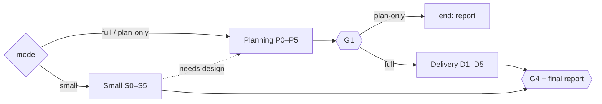
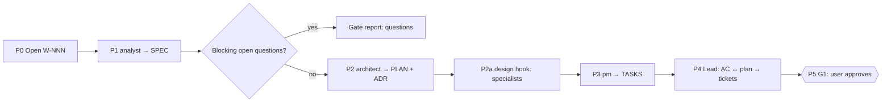
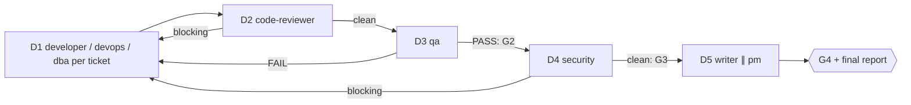
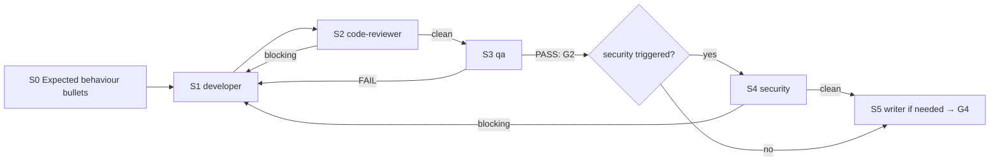

# /technical-team:feature — feature (T2 · plan-only · T1)

## Running this command

**Request:** $ARGUMENTS

| Situation | Do |
|---|---|
| Argument required | yes — empty → ask for the feature or change in one short question, stop; never guess |
| This session **is** the tech lead (`--agent technical-team:lead` or `agent` setting) | execute the **Pipeline** below yourself |
| Any other session | Agent tool → `subagent_type: technical-team:lead`, prompt below |
| Lead returns `Chờ duyệt …` | stop, wait for the user; never approve or choose for them |
| User answers | resume the same lead (SendMessage), or a new Agent call: `Continue W-NNN (feature). User's answer (verbatim): <answer>. Read .team/STATE.md first.` |
| Always | show the lead's report as written; do not do the team's work in the main session |

```
Execute the Pipeline section of ${CLAUDE_PLUGIN_ROOT}/commands/feature.md (Read the file).
Request (verbatim): <request>
User's language: <language>
Work item: <W-NNN or new>
User-provided context: <faithful summary of what the user supplied for this request in this conversation — files, notes, output of skills they ran — or "none">
Read .team/STATE.md first.
```
The lead and its agents cannot see this conversation: "User-provided context" is the only way context you were given reaches the team.

## Pipeline

_Executed by the tech lead. Shared rules: Lead manual (tiers §1, gates §2, delivery loop §3, brief §4, specialists §7, reports §8–§9). Other pipelines reuse the sections below by step ID (`run`, `new`); keep the step IDs stable (a test checks them)._

### Mode

| Flag (or the same intent in words) | Mode | Runs | Gates | Security | Writes code |
|---|---|---|---|---|---|
| none | **full** (T2) | Planning P0–P5 → Delivery D1–D5 | G1, G2, G3, G4 | always | yes |
| `--plan` ("chỉ lên kế hoạch", "plan only") | **plan-only** | Planning P0–P5, then end | G1 | – | no |
| `--small` ("thay đổi nhỏ") | **small** (T1) | Small S0–S5 | G2, G3, G4 | only if triggered (Lead manual §1) | yes |

Record the mode in `STATE.md` (`Pipeline / tier: feature (full) / T2`, `feature (plan-only)`, `feature (small) / T1`). The user may switch mode at any time; keep the same W-NNN. A plan-only item resumes as **full** at D1 when the user later says to build it (G1 already recorded).



### Planning (P0–P5)



| # | Step | Agent | Check before moving on |
|---|---|---|---|
| P0 | Open work item: next `W-NNN`, pipeline `feature (<mode>)`, status `running`, gate `G1 pending`; no `.team/` → init script | lead | — |
| P1 | Spec → `.team/SPEC.md#W-NNN` (goal, scope, constraints from the user) | analyst | every AC observable/testable; edge cases + open questions listed; gaps → send back once. Questions that block design → gate report now |
| P2 | Plan → `.team/PLAN.md#W-NNN` (+ ADR, `ARCHITECTURE.md`) | architect | `Satisfies:` covers every AC; files, interfaces, flags, rejected options present |
| P2a | **dba** when schema/data/pipelines are touched, and **hook `design`** specialists, review the draft | dba / specialists | blocking issue → one architect revision; leftover disagreement → gate report |
| P3 | Tickets → `.team/TASKS.md#W-NNN` | pm | every plan item ticketed; disjoint file sets per parallel group; no L. "Cannot split cleanly" → architect, then pm again |
| P4 | Consistency: AC ↔ plan ↔ tickets; flags decide who joins later | lead | gaps → re-brief the owner, never edit their file |
| P5 | **G1**: status `waiting-for-user`, gate report §9 | lead | — |

| G1 gate report content | |
|---|---|
| goal · key ACs · chosen design + rejected options · ticket count/order · risks · who joins later (security, devops, writer, dba, specialists) · open questions | |

| User answer at G1 | Next |
|---|---|
| approved | record `G1 approved by user on <date>: "<words>"`; plan-only → final report §8 with links to `SPEC.md#W-NNN`, `PLAN.md#W-NNN`, `TASKS.md#W-NNN`, suggest `feature W-NNN` to build; full → D1 |
| changes | brief the owner of the first changed file (analyst / architect / pm), redo the steps after it, G1 again |
| rejected | work item `done`, outcome "cancelled" |

### Delivery (D1–D5)

Input: G1-approved tickets of W-NNN (or the subset the calling pipeline names, e.g. one milestone in `new`).



| # | Step | Agent | Parallel | Check / on fail |
|---|---|---|---|---|
| D1 | Implementation, tickets in dependency order: developer tickets → developer, infra → devops (verify locally, update `OPS_HANDOFF.md`, no remote changes), migrations/seeds → dba (hand-written: parallel with developer; ORM-generated: after the model change), test-setup tickets → qa, docs wait for D5. **Hook `execute`** | developer, devops, dba, qa, specialists | same parallel group **and** disjoint files | evidence of build/lint/tests; `git diff --stat` (+ `git status --porcelain` for new files) = "Đã ghi vào"; developer stuck → debugger |
| D2 | Code review of the W-NNN diff (and new files) with plan + ACs. **Hook `review`** (dba for DB parts) | code-reviewer + specialists | specialists ∥ reviewer | blocking → D1 |
| D3 | Tests: all ACs in scope + changed files. **Hook `test`** | qa + specialists | specialists ∥ qa | FAIL → D1 (then D2, D3); PASS with output = **G2** |
| D4 | Security on the final diff + plan's security notes | security | no | blocking → D1 (then D2, D3, D4); clean = **G3** |
| D5 | Docs (README / API / CHANGELOG / runbooks; writer confirms with a reason if nothing changed) ∥ pm marks tickets `done` | writer ∥ pm | yes | then `STATE.md`: results, `G4 done`, status `done`; final report §8 |

### Small (S0–S5, T1)

| | |
|---|---|
| Input | change description (required) |
| Guard rail | needs a design decision (new component, contract change, schema migration) → stop, propose full mode (Planning from P1, same W-NNN) |



| # | Step | Agent | Check / on fail |
|---|---|---|---|
| S0 | Open W-NNN (pipeline `feature (small)`, T1); write 2–5 **expected behaviour** bullets in `STATE.md` (they replace ACs). Cannot write them without guessing → ask (main thread) or gate report with questions (subagent) | lead | — |
| S1 | Change + bullets + exact files. Infra part → devops. **Hook `execute`** | developer (devops) | evidence of build/lint/tests |
| S2 | Code review of the diff. **Hook `review`** | code-reviewer + specialists | blocking → S1 |
| S3 | Tests against the bullets. **Hook `test`** | qa + specialists | FAIL → S1 → S2 → S3; PASS = **G2** |
| S4 | Security on the final diff (if triggered) | security | blocking → S1 → S2 → S3 → S4 |
| S5 | **G3** = clean review (+ clean security) on the final code. Docs only if usage/API/operations changed (CHANGELOG at least when kept) → **G4**, final report | writer | — |

### Rules (all modes)

| Rule | Detail |
|---|---|
| Loop | Delivery loop (Lead manual §3): any code change restarts at code-reviewer; no round limit; the same failure unchanged for two rounds → debugger → architect/analyst → user. In small mode, needing the architect step means it was not T1: propose full mode |
| Non-blocking findings | fix now if cheap and in scope (through the loop), otherwise deferred with a reason |
| .team reads | all (small: `STATE`, `ROSTER`, `OPS_HANDOFF` if infra) |
| .team writes | lead → `STATE`; analyst → `SPEC`; architect → `PLAN`, `ARCHITECTURE.md`, ADR; pm → `TASKS`; devops → `OPS_HANDOFF` (small: `SPEC`/`PLAN`/`TASKS` not used) |
| Hook points | `design` (P2a), `execute` (D1 / S1), `review` (D2 / S2), `test` (D3 / S3) |
| End | full/small: after G4; plan-only: after G1 approved / changed-and-approved / rejected; or the user cancels/redirects. A stalled loop pauses for the user but never closes the work item as done |
