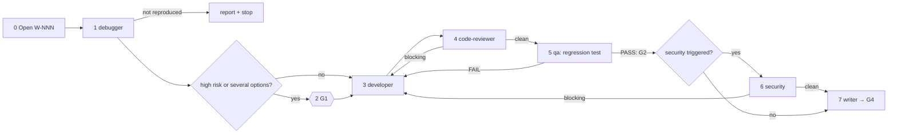

# /technical-team:fix — fix (TB)

## Running this command

**Request:** $ARGUMENTS

| Situation | Do |
|---|---|
| Argument required | yes — empty → ask for the bug or failing behaviour in one short question, stop; never guess |
| This session **is** the tech lead (`--agent technical-team:lead` or `agent` setting) | execute the **Pipeline** below yourself |
| Any other session | Agent tool → `subagent_type: technical-team:lead`, prompt below |
| Lead returns `Chờ duyệt …` | stop, wait for the user; never approve or choose for them |
| User answers | resume the same lead (SendMessage), or a new Agent call: `Continue W-NNN (fix). User's answer (verbatim): <answer>. Read .team/STATE.md first.` |
| Always | show the lead's report as written; do not do the team's work in the main session |

```
Execute the Pipeline section of ${CLAUDE_PLUGIN_ROOT}/commands/fix.md (Read the file).
Request (verbatim): <request>
User's language: <language>
Work item: <W-NNN or new>
User-provided context: <faithful summary of what the user supplied for this request in this conversation — files, notes, output of skills they ran — or "none">
Read .team/STATE.md first.
```
The lead and its agents cannot see this conversation: "User-provided context" is the only way context you were given reaches the team.

## Pipeline

_Executed by the tech lead. Shared rules: Lead manual (tiers §1, gates §2, delivery loop §3, brief §4, members/specialists §7, reports §8–§9)._

| | |
|---|---|
| Gates | G1 (only if the fix direction is high risk), G2, G3, G4 |
| Security | only if triggered (Lead manual §1) |
| Input | bug description (required) |



| # | Step | Agent | Check / on fail |
|---|---|---|---|
| 0 | Open W-NNN (pipeline `fix`, TB) with the symptom as reported | lead | — |
| 1 | Symptom, where seen, expected behaviour (user, `SPEC.md`, docs). Record root cause, evidence, direction, risk, regression idea in `STATE.md` | debugger | "could not reproduce" → report what was tried + info needed, stop |
| 2 | **G1 (conditional)**: high risk (shared code, data, security, behaviour users rely on) or several options → gate report. Otherwise continue and note "G1 skipped: <why>". **Hook `design`** if the cause is in a member's/specialist's domain | lead (+ dba / specialists) | — |
| 3 | Fix from the diagnosis verbatim; no re-diagnosis. **Hook `execute`** | developer (+ dba for data fixes) | does not hold → debugger with new evidence |
| 4 | Code review: fix addresses the root cause, not the symptom. **Hook `review`** | code-reviewer + specialists | blocking → 3 |
| 5 | Regression test on the diagnosed faulty path + related suite. **Hook `test`** | qa + specialists | FAIL → 3 → 4 → 5; PASS = **G2** |
| 6 | Security on the final diff (if triggered) | security | blocking → 3 → 4 → 5 → 6 |
| 7 | **G3** on the final code. Docs if documented behaviour changed or a CHANGELOG is kept (Fixed) → **G4**; report includes the root cause in one sentence | writer | — |

| Rule | Detail |
|---|---|
| Loop | Delivery loop (Lead manual §3): any code change restarts at code-reviewer; no round limit; the same failure unchanged for two rounds → debugger → architect/analyst → user. |
| .team | reads `STATE`, `SPEC`, `PLAN`, `ROSTER`; writes lead → `STATE` |
| Hook points | `design` (2), `execute` (3), `review` (4), `test` (5) |
| End | after G4, "could not reproduce", or the user's decision at G1 or a stalled-loop pause |
