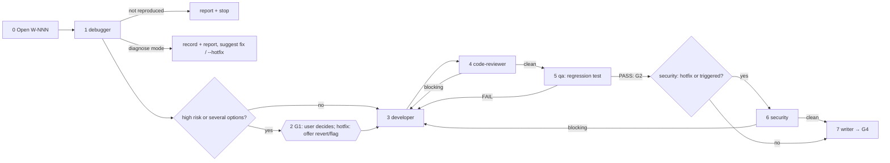

# /technical-team:fix — fix (TB · hotfix · diagnose)

## Running this command

**Request:** $ARGUMENTS

| Situation | Do |
|---|---|
| Argument required | yes — empty → ask for the bug or failing behaviour in one short question, stop; never guess |
| This session **is** the tech lead (`--agent technical-team:lead` or `agent` setting) | execute the **Pipeline** below yourself |
| Any other session | Agent tool → `subagent_type: technical-team:lead`, prompt below |
| Lead returns `Chờ duyệt …` | stop, wait for the user; never approve or choose for them |
| User answers | resume the same lead (SendMessage), or a new Agent call: `Continue W-NNN (fix). User's answer (verbatim): <answer>. Read .team/STATE.md first.` |
| Always | show the lead's report as written; do not do the team's work in the main session |

```
Execute the Pipeline section of ${CLAUDE_PLUGIN_ROOT}/commands/fix.md (Read the file).
Request (verbatim): <request>
User's language: <language>
Work item: <W-NNN or new>
User-provided context: <faithful summary of what the user supplied for this request in this conversation — files, notes, output of skills they ran — or "none">
Read .team/STATE.md first.
```
The lead and its agents cannot see this conversation: "User-provided context" is the only way context you were given reaches the team.

## Pipeline

_Executed by the tech lead. Shared rules: Lead manual (tiers §1, gates §2, delivery loop §3, brief §4, specialists §7, reports §8–§9)._

### Mode

| Flag (or the same intent in words) | Mode | Gates | Security | Docs | Writes code |
|---|---|---|---|---|---|
| none | **fix** (TB) | G1 only if the fix direction is high risk, G2, G3, G4 | only if triggered (Lead manual §1) | as needed | yes |
| `--hotfix` ("gấp", "production", "urgent") | **hotfix** | G2, G3, G4 (shortened); G1 only in the high-risk exception | always | CHANGELOG + note only, rest deferred | yes, minimal |
| `--diagnose` ("chỉ chẩn đoán", "investigate") | **diagnose** | none | – | – | no |

Record the mode in `STATE.md` (`Pipeline / tier: fix (<mode>) / TB`). Hotfix principle: speed from fewer participants and shorter docs — **never** from skipping tests or review. A diagnose item continues as fix/hotfix at step 2 with the same W-NNN when the user asks (no re-diagnosis).



| # | Step | Agent | Check / on fail |
|---|---|---|---|
| 0 | Open W-NNN (pipeline `fix (<mode>)`, TB) with the symptom as reported (hotfix: and the user's urgency) | lead | — |
| 1 | Symptom, where seen, expected behaviour (user, `SPEC.md`, docs). Record root cause, evidence, direction, risk, regression idea in `STATE.md`. Hotfix: the **smallest safe fix** + the fastest safe alternative (revert, feature flag, config switch). **Hook `design`**: cause in a specialist's domain → one confirmation call | debugger (+ dba / specialist) | "could not reproduce" → report what was tried + info needed, stop. **Diagnose mode ends here**: work item `done`, final report (root cause, evidence, fix + risk, regression test idea), suggest `fix` / `fix --hotfix`; do not start it unless asked |
| 2 | **G1 (conditional)**: high risk (shared code, data, security, behaviour users rely on) or several options → gate report (hotfix: include revert / flag / config switch). Otherwise continue and note "G1 skipped: <why>" | lead (+ dba / specialists) | — |
| 3 | Fix from the diagnosis verbatim; no re-diagnosis. Hotfix: minimal fix only, no refactors, no extra scope. **Hook `execute`** | developer (+ dba for data fixes) | does not hold → debugger with new evidence |
| 4 | Code review: fix addresses the root cause, not the symptom. Hotfix: anything beyond the minimal fix is blocking. **Hook `review`** | code-reviewer + specialists | blocking → 3 |
| 5 | Short test plan + defect record in `QA.md#W-NNN` (`test-process`); regression test on the diagnosed faulty path + related suite + retest of the reported defect (hotfix: most relevant suite; say what was not run); a bug a user or client can observe is also reproduced and re-checked in the **live preview** of the real product (`live-preview` skill). **Hook `test`** | qa + specialists | FAIL → 3 → 4 → 5; PASS = **G2**. UI/UX verification of the touched screens; items needing a design judgment → designer decides (fix → 3) |
| 6 | Security on the final diff (hotfix: always; fix: if triggered) | security | blocking → 3 → 4 → 5 → 6 |
| 7 | **G3** on the final code. Fix: docs if documented behaviour changed or a CHANGELOG is kept (Fixed). Hotfix: CHANGELOG (Fixed) if kept; short incident note in `.team/docs/` only if a runbook exists; everything else **deferred** with a suggested work item → **G4**; report includes the root cause in one sentence (hotfix: tested / not tested, deferred, commands the user runs to commit/deploy) | writer | — |

| Rule | Detail |
|---|---|
| Loop | Delivery loop (Lead manual §3): any code change restarts at code-reviewer; no round limit; the same failure unchanged for two rounds → debugger → architect/analyst → user. Hotfix: urgency never lets a failing test or blocking finding through; a stalled loop pauses for the user sooner — say how long it ran, offer revert / feature flag |
| .team | reads `STATE`, `SPEC`, `PLAN`, `ROSTER` (hotfix: + `OPS_HANDOFF`); writes lead → `STATE` |
| Hook points | `design` (1–2), `execute` (3), `review` (4), `test` (5); hotfix: when the domain is touched |
| End | after G4, "could not reproduce", the diagnose report, or the user's decision at G1 or a stalled-loop pause |
