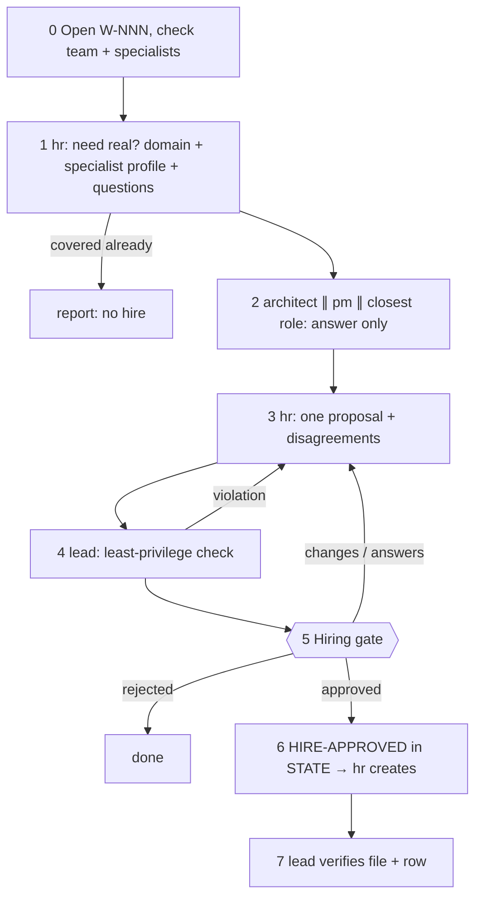
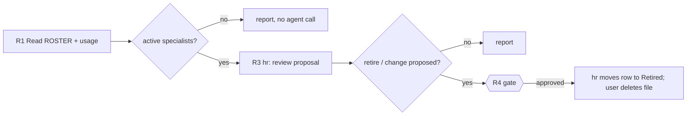

# /technical-team:hire — hire (recruit · roster)

## Running this command

**Request:** $ARGUMENTS

| Situation | Do |
|---|---|
| Argument required | yes (`<domain or need>` or `--roster`) — empty → ask for the domain or need (and, if you can, why the team needs it) in one short question, stop; never guess |
| This session **is** the tech lead (`--agent technical-team:team-lead` or `agent` setting) | execute the **Pipeline** below yourself |
| Any other session | Agent tool → `subagent_type: technical-team:team-lead`, prompt below |
| Lead returns `Chờ duyệt …` | stop, wait for the user; never approve or choose for them |
| User answers | resume the same lead (SendMessage), or a new Agent call: `Continue W-NNN (hire). User's answer (verbatim): <answer>. Read .team/STATE.md first.` |
| Always | show the lead's report as written; do not do the team's work in the main session |

```
Execute the Pipeline section of ${CLAUDE_PLUGIN_ROOT}/commands/hire.md (Read the file).
Request (verbatim): <request>
User's language: <language>
Work item: <W-NNN or new>
User-provided context: <faithful summary of what the user supplied for this request in this conversation — files, notes, output of skills they ran — or "none">
Read .team/STATE.md first.
```
The lead and its agents cannot see this conversation: "User-provided context" is the only way context you were given reaches the team.

## Pipeline

_Executed by the tech lead. Shared rules: Lead manual (tiers §1, gates §2, delivery loop §3, brief §4, specialists §7, reports §8–§9)._

| Flag | Mode | Gate | Input |
|---|---|---|---|
| none | **recruit** (steps 0–7) | hiring approval (adds an agent to the team) | domain or need (required) + reason |
| `--roster` ("xem danh bạ", "rà soát specialist") | **roster** (steps R1–R4) | retirement approval (only if hr proposes one) | none |

### Recruit (steps 0–7)

| Where the hire goes | Files | Effect |
|---|---|---|
| The project (default) | `.claude/agents/team-<name>.md` + `.team/ROSTER.md` row | project specialist `team-<name>`; the lead calls it only with `HIRE-APPROVED: <name>` in `STATE.md` |
| User scope (only if the user asks) | `~/.claude/agents/team-<name>.md` + the same row | same, available to the user's other projects once they add a row there |

Before hiring: a core role or an existing specialist that covers the need means no hire. Often a **skill** is enough: knowledge an existing role lacks goes into `.claude/technical-team.json` → `skills.<agent name>`; hire only when the work needs its own owner, area or review step. hr creates the agent file only after the brief says the user approved.



| # | Step | Agent | Parallel |
|---|---|---|---|
| 0 | Open W-NNN (pipeline `hire (recruit)`): need, who raised it; check core roles and the roster; would a skill for an existing role cover it? | lead | — |
| 1 | a) covered by a core role, an existing specialist or a skill for one of them? (yes → stop with "no hire" and say who or which skill, continue only if the user insists) · b) domain profile at the needed depth, sourced, with confidence + user questions · c) specialist profile draft · d) placement questions | hr | — |
| 2 | Placement consultation: hook point, trigger, where the specialist's area ends and theirs begins — **answer only, write no files** | architect ∥ pm ∥ closest role | yes |
| 3 | Relay answers verbatim → one proposal + disagreements | hr | — |
| 4 | Check: name is `team-<name>`, not a core name nor confusable; no `Agent` tool; Write/Edit/Bash in `tools:` justified (the tools line is the only hard limit); owned area does not overlap `.team/`, docs, infra, tests, dba's data area or another specialist; `technical-team:run-kit` preloaded | lead | — |
| 5 | **Hiring gate**: need + why the team lacks it, domain profile, specialist profile, placement, disagreements, user questions, where it goes, skills the user may add for it (`skills.team-<name>` in `.claude/technical-team.json`) | lead | — |
| 6 | Approved (explicit reply in the main thread, or relayed verbatim by the main session) → lead writes `- HIRE-APPROVED: <name> (<date>, scope: project|user): "<user's words>"` in `STATE.md`, then briefs hr with it → hr creates the agent file + `ROSTER.md` row (`active`, Hired = today). Anything short of an explicit approval → not approved: gate report, stop | lead → hr | — |
| 7 | Read the file and the row; they must match the approval (name, tools, owned area, hook points, trigger). A mismatch → back to hr, the specialist is not called until it matches | lead | — |

| | |
|---|---|
| .team | reads `STATE`, `ROSTER`; writes lead → `STATE` (incl. `HIRE-APPROVED`), hr → agent file + `ROSTER` |
| Activation | `.claude/agents/` is watched, usually live in seconds; restart if the folder did not exist at session start or the lead cannot spawn the name |
| End | final report: hired / not hired and why, file path, row, skills the user may add, activation |

### Roster (steps R1–R4)



| # | Step | Agent |
|---|---|---|
| R1 | Open W-NNN (pipeline `hire (roster)`). Read `.team/ROSTER.md` and "Specialist usage" in `STATE.md`; show the active specialists (name, domain, hook points, trigger, owned area, last used) | lead |
| R2 | No active specialists → report, stop | lead |
| R3 | Review: unused (default: 60 days, or never used 30 days after hire), overlapping domains/triggers, areas grown too wide, outdated profiles; update "Last used" from `STATE.md` | hr |
| R4 | Proposals → gate. Retirement approved → hr moves the row under "Retired" (`retired`); the user deletes the agent file (give the path). Profile changes go through recruit mode | lead → hr |

| | |
|---|---|
| .team | reads `ROSTER`, `STATE`; writes hr → `ROSTER`, lead → `STATE` |
| End | final report: roster table, proposals, decisions, files the user should delete |
