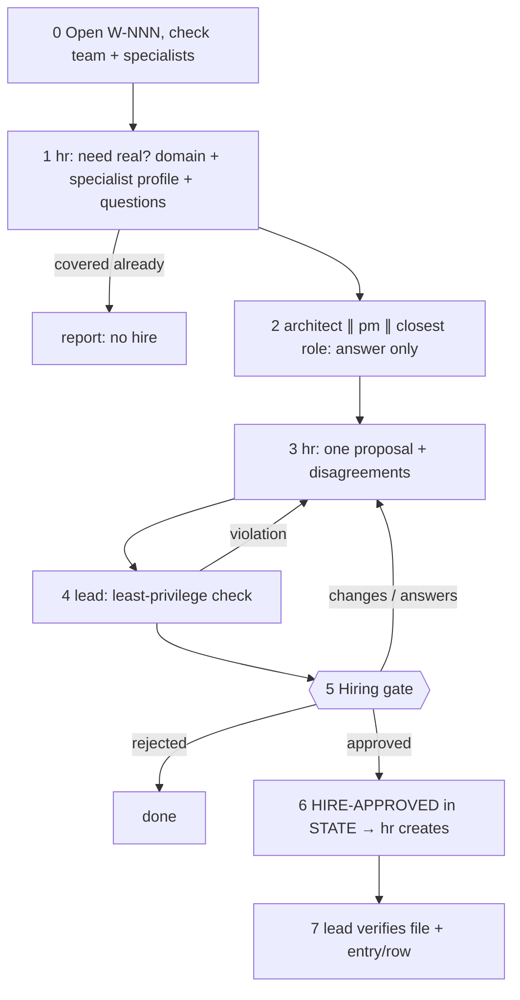

# /technical-team:hire — hire

## Running this command

**Request:** $ARGUMENTS

| Situation | Do |
|---|---|
| Argument required | yes — empty → ask for the domain or need (and, if you can, why the team needs it) in one short question, stop; never guess |
| This session **is** the tech lead (`--agent technical-team:lead` or `agent` setting) | execute the **Pipeline** below yourself |
| Any other session | Agent tool → `subagent_type: technical-team:lead`, prompt below |
| Lead returns `Chờ duyệt …` | stop, wait for the user; never approve or choose for them |
| User answers | resume the same lead (SendMessage), or a new Agent call: `Continue W-NNN (hire). User's answer (verbatim): <answer>. Read .team/STATE.md first.` |
| Always | show the lead's report as written; do not do the team's work in the main session |

```
Execute the Pipeline section of ${CLAUDE_PLUGIN_ROOT}/commands/hire.md (Read the file).
Request (verbatim): <request>
User's language: <language>
Work item: <W-NNN or new>
User-provided context: <faithful summary of what the user supplied for this request in this conversation — files, notes, output of skills they ran — or "none">
Read .team/STATE.md first.
```
The lead and its agents cannot see this conversation: "User-provided context" is the only way context you were given reaches the team.

## Pipeline

_Executed by the tech lead. Shared rules: Lead manual (tiers §1, gates §2, delivery loop §3, brief §4, specialists §7, reports §8–§9)._

| | |
|---|---|
| Gate | hiring approval (changes the team's permissions) |
| Input | domain or need (required) + reason |

| Where the hire goes | Files | Effect |
|---|---|---|
| Working in the technical-team plugin repo (root `.claude-plugin/plugin.json` named `technical-team`) | `agents/<name>.md` + entry in `config/agents.json` (write, bash, hookPoints, trigger); writer updates README | plugin specialist, in every project, after `/reload-plugins` |
| Any other project | `.claude/agents/<name>.md` (or `~/.claude/agents/` if the user asks) + `.team/ROSTER.md` row | project specialist; honoured only with `HIRE-APPROVED: <name>` in that project's `STATE.md` |

Before hiring: a core role or a plugin specialist (`config/agents.json`) that covers the need means no hire. The guard lets hr write the agent file only after `HIRE-APPROVED: <name>` is in `STATE.md`.



| # | Step | Agent | Parallel |
|---|---|---|---|
| 0 | Open W-NNN (pipeline `hire`): need, who raised it; check core roles, `config/agents.json` and the roster; decide plugin vs project specialist | lead | — |
| 1 | a) covered by a core role or an existing specialist? (yes → stop with "no hire", continue only if the user insists) · b) domain profile at the needed depth, sourced, with confidence + user questions · c) specialist profile draft · d) placement questions | hr | — |
| 2 | Placement consultation: hook point, trigger, boundary with their role — **answer only, write no files** | architect ∥ pm ∥ closest role | yes |
| 3 | Relay answers verbatim → one proposal + disagreements | hr | — |
| 4 | Check: no `Agent` tool; write scope does not overlap `.team/`, docs, infra, tests, `ARCHITECTURE.md`, `docs/adr/`, dba's data paths or another specialist; Write/Edit/Bash justified; `technical-team:run-kit` preloaded; name not a core name nor confusable | lead | — |
| 5 | **Hiring gate**: need + why the team lacks it, domain profile, specialist profile, placement, disagreements, user questions, where it goes, settings the user must add (e.g. `.claude/technical-team.json`) | lead | — |
| 6 | Approved → `- HIRE-APPROVED: <name> (<date>, scope: plugin|project|user)` in `STATE.md` → hr creates the agent file + `config/agents.json` entry (plugin repo) or `ROSTER.md` row (project: `active`, Hired = today) → plugin repo: writer updates README | lead → hr (→ writer) | — |
| 7 | Read the file and the entry/row; they must match the approval (tools, scope, Bash level, hook points) | lead | — |

| | |
|---|---|
| .team | reads `STATE`, `ROSTER`, `config/agents.json`; writes lead → `STATE` (incl. `HIRE-APPROVED`), hr → agent file + `config/agents.json` or `ROSTER` |
| Activation | plugin specialist: `/reload-plugins` or a new session · project: `.claude/agents/` is watched, usually live in seconds; restart if the folder did not exist at session start or the lead cannot spawn the name |
| End | final report: hired / not hired and why, file path, entry/row, settings the user must add, activation |
