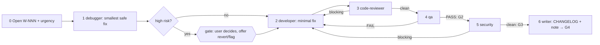

# /technical-team:hotfix — hotfix

## Running this command

**Request:** $ARGUMENTS

| Situation | Do |
|---|---|
| Argument required | yes — empty → ask for the urgent bug in one short question, stop; never guess |
| This session **is** the tech lead (`--agent technical-team:lead` or `agent` setting) | execute the **Pipeline** below yourself |
| Any other session | Agent tool → `subagent_type: technical-team:lead`, prompt below |
| Lead returns `Chờ duyệt …` | stop, wait for the user; never approve or choose for them |
| User answers | resume the same lead (SendMessage), or a new Agent call: `Continue W-NNN (hotfix). User's answer (verbatim): <answer>. Read .team/STATE.md first.` |
| Always | show the lead's report as written; do not do the team's work in the main session |

```
Execute the Pipeline section of ${CLAUDE_PLUGIN_ROOT}/commands/hotfix.md (Read the file).
Request (verbatim): <request>
User's language: <language>
Work item: <W-NNN or new>
User-provided context: <faithful summary of what the user supplied for this request in this conversation — files, notes, output of skills they ran — or "none">
Read .team/STATE.md first.
```
The lead and its agents cannot see this conversation: "User-provided context" is the only way context you were given reaches the team.

## Pipeline

_Executed by the tech lead. Shared rules: Lead manual (tiers §1, gates §2, delivery loop §3, brief §4, members/specialists §7, reports §8–§9)._

| | |
|---|---|
| Gates | G2, G3, G4 (shortened); G1 only in the high-risk exception |
| Security | always |
| Input | urgent bug (required) |
| Principle | speed from fewer participants and shorter docs — never from skipping tests or review |



| # | Step | Agent | Check / on fail |
|---|---|---|---|
| 0 | Open W-NNN (pipeline `hotfix`) with the user's urgency | lead | — |
| 1 | Reproduce, root cause, **smallest safe fix** + risk. High risk → gate report anyway, with the fastest safe alternative (revert, feature flag, config switch) | debugger | — |
| 2 | Minimal fix only; no refactors, no extra scope. **Hook `execute`** if the domain is touched | developer (+ dba) | — |
| 3 | Code review of the minimal diff; anything beyond the minimal fix is blocking. **Hook `review`** | code-reviewer + specialists | blocking → 2 |
| 4 | Regression test + most relevant suite (say what was not run). **Hook `test`** | qa + specialists | FAIL → 2 → 3 → 4; PASS = **G2** |
| 5 | Security on the final diff | security | blocking → 2 → 3 → 4 → 5; clean = **G3** |
| 6 | CHANGELOG (Fixed) if kept; short incident note in `docs/` only if a runbook exists. Everything else → **deferred** with a suggested work item | writer | final report: root cause, fix, tested / not tested, deferred, commands the user runs to commit/deploy |

| Rule | Detail |
|---|---|
| Loop | same delivery loop, until pass; urgency never lets a failing test or blocking finding through. A stalled loop pauses for the user sooner: say how long it ran, offer revert / feature flag |
| .team | reads `STATE`, `ROSTER`, `OPS_HANDOFF`; writes lead → `STATE` |
| Hook points | `execute` (2), `review` (3), `test` (4) when the domain is touched; `design` only in the high-risk exception |
| End | after G4, or the user's decision at the high-risk stop or a stalled-loop pause |
