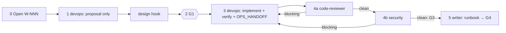

# /technical-team:infra — infra

## Running this command

**Request:** $ARGUMENTS

| Situation | Do |
|---|---|
| Argument required | yes — empty → ask for the infrastructure request in one short question, stop; never guess |
| This session **is** the tech lead (`--agent technical-team:team-lead` or `agent` setting) | execute the **Pipeline** below yourself |
| Any other session | Agent tool → `subagent_type: technical-team:team-lead`, prompt below |
| Lead returns `Chờ duyệt …` | stop, wait for the user; never approve or choose for them |
| User answers | resume the same lead (SendMessage), or a new Agent call: `Continue W-NNN (infra). User's answer (verbatim): <answer>. Read .team/STATE.md first.` |
| Always | show the lead's report as written; do not do the team's work in the main session |

```
Execute the Pipeline section of ${CLAUDE_PLUGIN_ROOT}/commands/infra.md (Read the file).
Request (verbatim): <request>
User's language: <language>
Work item: <W-NNN or new>
User-provided context: <faithful summary of what the user supplied for this request in this conversation — files, notes, output of skills they ran — or "none">
Read .team/STATE.md first.
```
The lead and its agents cannot see this conversation: "User-provided context" is the only way context you were given reaches the team.

## Pipeline

_Executed by the tech lead. Shared rules: Lead manual (tiers §1, gates §2, delivery loop §3, brief §4, specialists §7, reports §8–§9)._

| | |
|---|---|
| Gates | G1, G3, G4 (no G2) |
| Security | always (infra touches secrets, exposure, permissions) |
| Input | infrastructure request (required) |



| # | Step | Agent | Check / on fail |
|---|---|---|---|
| 0 | Open W-NNN (pipeline `infra`) | lead | — |
| 1 | **Proposal only**, no file changes: files, tools, environments affected, verification plan, remote steps the user will run, rollback. **Hook `design`** (e.g. dba for DB hosting/migration steps) | devops (+ specialists) | — |
| 2 | **G1**: gate report with proposal, risks, remote commands | lead | — |
| 3 | Implement the approved approach, verify locally (no remote changes unless enabled), update `OPS_HANDOFF.md`. **Hook `execute`** | devops (+ specialists) | — |
| 4a | Code review of the diff. **Hook `review`** | code-reviewer + specialists | blocking → 3 |
| 4b | Security on the final diff | security | blocking → 3 → 4a → 4b; clean = **G3** |
| 5 | Runbook(s) in `.team/docs/` (deploy, rollback, incident) from `OPS_HANDOFF.md` + real files; unverified facts marked → **G4** | writer | — |

| Rule | Detail |
|---|---|
| Loop | delivery loop with devops in the developer's place and no qa: devops → code-reviewer → security; any change restarts at code-reviewer; no round limit; same finding unchanged two rounds → debugger (if a failure) → architect → user |
| Tests | change affects application tests or CI test stages → tell the user, suggest `test` |
| Inside `new` | step 1 comes from the approved MVP plan (its infra section is the proposal) and step 2 is covered by the MVP G1; anything beyond it (new tool, remote step, environment not in the plan) → G1 here as usual |
| .team | reads `STATE`, `PLAN`, `OPS_HANDOFF`, `ROSTER`; writes lead → `STATE`, devops → `OPS_HANDOFF` |
| Hook points | `design` (1), `execute` (3), `review` (4a) |
| End | final report with the exact remote commands the user must run, in order, with rollback |
