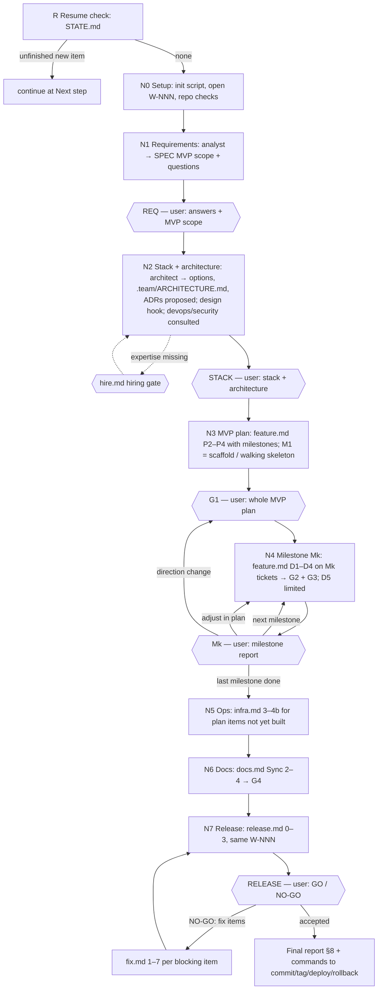

# /technical-team:new — new project (idea → release-ready MVP)

## Running this command

**Request:** $ARGUMENTS

| Situation | Do |
|---|---|
| Argument required | no — empty means **resume**: delegate anyway; the lead resumes the unfinished `new` work item from `.team/STATE.md`, or asks for an idea / PRD path if there is none |
| This session **is** the tech lead (`--agent technical-team:lead` or `agent` setting) | execute the **Pipeline** below yourself |
| Any other session | Agent tool → `subagent_type: technical-team:lead`, prompt below |
| Lead returns `Chờ duyệt …` | stop, wait for the user; never approve or choose for them |
| User answers | prefer a **new** Agent call (the run is long; `.team/STATE.md` holds everything): `Continue W-NNN (new). User's answer (verbatim): <answer>. Read .team/STATE.md first.` Resuming the same lead (SendMessage) also works |
| Always | show the lead's report as written; do not do the team's work in the main session |

```
Execute the Pipeline section of ${CLAUDE_PLUGIN_ROOT}/commands/new.md (Read the file).
Request (verbatim): <request, or "(empty — resume)">
User's language: <language>
Work item: <W-NNN or new>
User-provided context: <faithful summary of what the user supplied for this request in this conversation — files, notes, output of skills they ran — or "none">
Read .team/STATE.md first.
```
The lead and its agents cannot see this conversation: "User-provided context" is the only way context you were given reaches the team.

## Pipeline

_Executed by the tech lead. Shared rules: Lead manual (tiers §1, gates §2, delivery loop §3, brief §4, specialists §7, reports §8–§9). This pipeline **orchestrates other pipelines and never restates their steps**: it names the file + step IDs to run and only adds what is specific to a new project. If a referenced step changes there, it changes here._

| | |
|---|---|
| Input | an idea (a few sentences) **or** a path to a PRD / existing document (`.md`, `.txt`, `.pdf`; other formats → ask for an export) |
| User gates (the only planned stops) | **REQ** requirements · **STACK** stack + architecture · **G1** MVP plan (once for the whole MVP) · **Mk** end of each milestone · **RELEASE** GO/NO-GO |
| Internal gates | G2, G3, G4 as usual, without stopping for the user |
| Stops that always stay | hiring gate (`hire.md`), delivery-loop escalation step 3 (Lead manual §3), a direction change after G1 (back through G1 for the changed part), a guard denial or missing tool only the user can fix |
| Never | deploy, tag, commit, push. The release report gives the user the exact commands |
| Work item | one `W-NNN` for the whole project (pipeline `new`); SPEC/PLAN/TASKS sections use it; milestones are `M1…Mn` inside it |



### R — Resume check (every invocation, before anything else)

| `STATE.md` has an unfinished work item with pipeline `new`? | Request | Do |
|---|---|---|
| no | idea or path | start at N0 |
| no | empty | gate report `Chờ duyệt — Đầu vào`: ask for an idea or a PRD path; stop |
| yes, `waiting-for-user` | the user's answer (prompt or arguments) | apply it to the pending gate (tables below), record it, continue |
| yes, `waiting-for-user` | empty | repeat the pending gate report from `STATE.md`; stop |
| yes, `running` (interrupted) | any | continue at **Next step**. First compare `TASKS.md` statuses and `git status --porcelain` with the last checkpoint; a step that has no recorded result is re-run by its owner, not assumed done |
| yes | a different new idea | do not start a second `new` in the same repository: ask whether to resume or cancel the existing one |

**Checkpoint rule:** after every completed step (not only at gates) update the work item's `Phase`, `Next step` and `Milestones` lines in `STATE.md` (template: `templates/team/STATE.md`, block "pipeline `new`"). `status` reads these lines.

### Phases

| Phase | Step | Agent | Reuses | Specific to `new` |
|---|---|---|---|---|
| N0 | Setup | lead | init script (`init`) | run `node "${CLAUDE_PLUGIN_ROOT}/scripts/team-init.mjs"` (creates `STATE.md` only; other `.team/` files are created right before their owner's first step); open `W-NNN` (pipeline `new`, gate `REQ pending`), record **Input** (idea verbatim, or document path). `git status` fails → not a repository: ask the user to run `git init` at REQ (do not block N1). Application code already present (anything beyond `.team/`, `.claude/`, `docs/`, README, LICENSE, the PRD, dotfiles) → gate report now: propose `feature` / `run`, or `new` in a subfolder the user names |
| N1 | Requirements | analyst | `feature.md` P1 | **MVP** spec in `SPEC.md#W-NNN`: problem, users, MVP scope **in / out**, stories, testable ACs, edge cases, non-functional constraints (scale, platforms, compliance, deadline). Idea → analyst asks clarifying questions in **Open questions**, each with a proposed default answer. Document → analyst reads it (the brief gives the path), cites its sections, asks only about gaps and contradictions. No blocking question may stay hidden in assumptions |
| — | **REQ** | lead | gate report §9 | MVP scope in/out, key stories, numbered questions with defaults ("OK" = accept all defaults), assumptions, user actions needed (e.g. `git init`) |
| N2 | Stack + architecture | architect (+ dba / specialists via hook `design`; devops, security **answer only**) | `feature.md` P2, P2a; `docs.md` ADR A2 | the plugin is stack-agnostic, so the stack is a proposal: 2–3 options scored against the SPEC constraints, one recommended; `.team/ARCHITECTURE.md` (components, data flow, mermaid); ADRs `proposed` for stack and major choices. devops answers: local runtime (e.g. compose), CI fit; security answers: auth/data approach. A domain nobody covers → `hire.md` recruit (its gate stops as usual) |
| — | **STACK** | lead | gate report §9 | recommended stack + alternatives and why not, architecture summary, ADR list, risks, what the user's machine needs (runtimes, Docker). Optional for the user: fill `commands.*` allowlists and `skills.*` in `.claude/technical-team.json` for this stack. Approved → architect sets the ADRs `accepted` |
| N3 | MVP plan | architect → pm → lead | `feature.md` P2–P4 | `PLAN.md#W-NNN` **Milestones** table: M1 = walking skeleton (structure, build, lint, test runner, one end-to-end slice, local run), each next milestone a runnable increment with its ACs (`Satisfies`) and exit criteria; infra items placed in milestones (local env in M1, CI where it fits). pm: `TASKS.md#W-NNN` grouped `### Mk — <name>`; scaffold tickets split by owner (developer: source + manifests · qa: test setup + smoke test · devops: Dockerfile/compose/CI · writer: README run section · dba: initial migrations) because the guard enforces ownership; aim ≤ 8 tickets per milestone so one lead run stays focused. Lead P4: every MVP AC lands in exactly one milestone |
| — | **G1** | lead | `feature.md` P5 | G1 report content + milestones table, ticket count per milestone, rough agent-call estimate. Approval covers the whole MVP: no per-feature G1 later |
| N4 | Milestone Mk | per ticket owner | `feature.md` D1–D4 on the Mk tickets | review scope = the milestone's files (`git diff` + `git status --porcelain`, since a new project has untracked files). G2 + G3 on the milestone's final code. D5 limited to: pm marks Mk tickets `done`; writer only for docs tickets of Mk; full docs wait for N6 |
| — | **Mk** | lead | gate report §9 | done (tickets, ACs met) · test evidence (command → summary) · review/security counts · deviations from the plan and why · deferred findings · how to try it locally (exact command) · suggested commit command for the user (`git add -A && git commit -m "feat: Mk <name>"`, gives the next milestone a clean diff) · next milestone preview |
| N5 | Ops | devops → code-reviewer → security | `infra.md` 3–4b | only plan infra items not built in a milestone (typically CI); proposal = the approved plan, so `infra.md` step 2 is covered by G1 (`infra.md` → "Inside `new`"). Nothing left → skip with a note |
| N6 | Docs | (devops) → writer | `docs.md` Sync 2–4 | scope: all — README (setup, run, test), docs, runbooks from `OPS_HANDOFF.md`, ADR index check → **G4** for the project |
| N7 | Release | qa ∥ security ∥ devops ∥ specialists → writer → lead | `release.md` 0–3 (same W-NNN, first release: no tag, default `0.1.0`) | GO additionally needs **local run proof**: a qa smoke/e2e test that boots the app, or devops start + health check, with real output |
| — | **RELEASE** | lead | gate report §9 | GO/NO-GO + reasons, version, test/security evidence, exact commands for the user in order: commit (incl. `git init` if needed), tag, push, deploy (only if `OPS_HANDOFF.md` has a target; otherwise "local only"), rollback |

### User answers at the gates

| Gate | Approve | Change | Other |
|---|---|---|---|
| REQ | record answers in `STATE.md` (`Approvals:`); analyst folds them into `SPEC` (no new stop unless an answer opens a **blocking** question) → N2 | analyst revises → REQ again | "stop" → status `waiting-for-user`, resume later |
| STACK | architect marks ADRs `accepted` → N3 | architect revises (+ hook) → STACK again | pick another option → architect updates → N3 |
| G1 | `G1 approved by user on <date>: "<words>"` → N4 with M1 | brief the owner of the first changed file, redo after it, G1 again (`feature.md` P5 rules) | rejected → work item `done`, outcome "cancelled" |
| Mk | next milestone (or N5 after the last) | inside the plan → pm adds/edits tickets in Mk or Mk+1 and the loop runs; direction change → architect revises `PLAN` → G1 for the changed part | "stop" → paused at Mk, resume with `new` |
| RELEASE | accepted → final report §8, status `done` | NO-GO items the user wants fixed → `fix.md` steps 1–7 per blocking item (same W-NNN, loop log in `STATE.md`) → N7 again | the user may close with NO-GO: status `done`, outcome "MVP delivered, not release-ready" + open items |

| | |
|---|---|
| .team | reads all; writes lead → `STATE`; analyst → `SPEC`; architect → `PLAN`, `.team/ARCHITECTURE.md`, ADR; pm → `TASKS`; devops → `OPS_HANDOFF`; hr → `ROSTER` (only through `hire.md`) |
| Hook points | `design` (N2, N3), `execute` / `review` / `test` (N4 through `feature.md` D1–D3), `test` / `review` (N7 through `release.md` 1) |
| End | RELEASE accepted (GO, or closed as NO-GO by the user), G1 rejected, or the user cancels. Final report §8 also lists: milestones with dates, ADRs, how to run locally, deferred findings, commands for the user |
