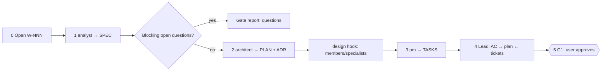

# /technical-team:plan — plan (stop at G1)

## Running this command

**Request:** $ARGUMENTS

| Situation | Do |
|---|---|
| Argument required | yes — empty → ask for the goal to plan in one short question, stop; never guess |
| This session **is** the tech lead (`--agent technical-team:lead` or `agent` setting) | execute the **Pipeline** below yourself |
| Any other session | Agent tool → `subagent_type: technical-team:lead`, prompt below |
| Lead returns `Chờ duyệt …` | stop, wait for the user; never approve or choose for them |
| User answers | resume the same lead (SendMessage), or a new Agent call: `Continue W-NNN (plan). User's answer (verbatim): <answer>. Read .team/STATE.md first.` |
| Always | show the lead's report as written; do not do the team's work in the main session |

```
Execute the Pipeline section of ${CLAUDE_PLUGIN_ROOT}/commands/plan.md (Read the file).
Request (verbatim): <request>
User's language: <language>
Work item: <W-NNN or new>
User-provided context: <faithful summary of what the user supplied for this request in this conversation — files, notes, output of skills they ran — or "none">
Read .team/STATE.md first.
```
The lead and its agents cannot see this conversation: "User-provided context" is the only way context you were given reaches the team.

## Pipeline

_Executed by the tech lead. Shared rules: Lead manual (tiers §1, gates §2, delivery loop §3, brief §4, members/specialists §7, reports §8–§9)._

| | |
|---|---|
| Gates | G1 |
| Writes code | no |
| Input | goal (required) |



| # | Step | Agent | Check before moving on |
|---|---|---|---|
| 0 | Open work item: next `W-NNN`, pipeline `plan` (or `feature`), status `running`, gate `G1 pending`; no `.team/` → init script | lead | — |
| 1 | Spec → `.team/SPEC.md#W-NNN` (goal, scope, constraints from the user) | analyst | every AC observable/testable; edge cases + open questions listed; gaps → send back once. Questions that block design → gate report now |
| 2 | Plan → `.team/PLAN.md#W-NNN` (+ ADR, `ARCHITECTURE.md`) | architect | `Satisfies:` covers every AC; files, interfaces, flags, rejected options present |
| 2a | **Hook `design`**: matching members/specialists (e.g. dba when schema/data is touched) review the draft | dba / specialists | blocking issue → one architect revision; leftover disagreement → gate report |
| 3 | Tickets → `.team/TASKS.md#W-NNN` | pm | every plan item ticketed; disjoint file sets per parallel group; no L. "Cannot split cleanly" → architect, then pm again |
| 4 | Consistency: AC ↔ plan ↔ tickets; flags decide who joins later | lead | gaps → re-brief the owner, never edit their file |
| 5 | **G1**: status `waiting-for-user`, gate report §9 | lead | — |

| Gate report content | |
|---|---|
| goal · key ACs · chosen design + rejected options · ticket count/order · risks · who joins later (security, devops, writer, dba, specialists) · open questions | |

| User answer | Next |
|---|---|
| approved | record `G1 approved by user on <date>: "<words>"`; `plan` → finish; `feature` → continue there |
| changes | brief the owner of the first changed file (analyst / architect / pm), redo the steps after it, G1 again |
| rejected | work item `done`, outcome "cancelled" |

| .team | |
|---|---|
| Reads | `STATE`, `SPEC`, `PLAN`, `TASKS`, `ROSTER`, `ARCHITECTURE.md`, `config/members.json` |
| Writes | lead → `STATE`; owners → their own files |
| Hook points | `design` (2a) |
| End | after G1 approved / changed-and-approved / rejected → final report §8 with links to `SPEC.md#W-NNN`, `PLAN.md#W-NNN`, `TASKS.md#W-NNN`; suggest `feature` |
