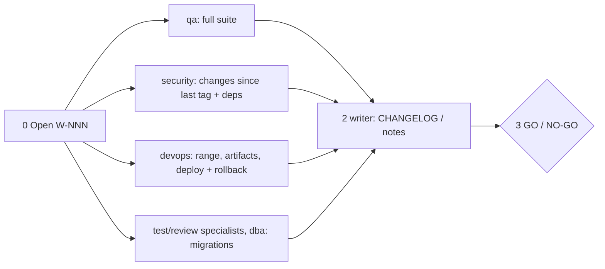

# /technical-team:release — release (GO/NO-GO)

## Running this command

**Request:** $ARGUMENTS

| Situation | Do |
|---|---|
| Argument required | no |
| This session **is** the tech lead (`--agent technical-team:team-lead` or `agent` setting) | execute the **Pipeline** below yourself |
| Any other session | Agent tool → `subagent_type: technical-team:team-lead`, prompt below |
| Lead returns `Waiting for approval …` | stop, wait for the user; never approve or choose for them |
| User answers | resume the same lead (SendMessage), or a new Agent call: `Continue W-NNN (release). User's answer (verbatim): <answer>. Read .team/STATE.md first.` |
| Always | show the lead's report as written; do not do the team's work in the main session |

```
Execute the Pipeline section of ${CLAUDE_PLUGIN_ROOT}/commands/release.md (Read the file).
Request (verbatim): <request>
User's language: <language>
Work item: <W-NNN or new>
User-provided context: <faithful summary of what the user supplied for this request in this conversation — files, notes, output of skills they ran — or "none">
Read .team/STATE.md first.
```
The lead and its agents cannot see this conversation: "User-provided context" is the only way context you were given reaches the team.

## Pipeline

_Executed by the tech lead. Shared rules: Lead manual (tiers §1, gates §2, delivery loop §3, brief §4, specialists §7, reports §8–§9)._

| | |
|---|---|
| Gates | G2, G3, G4 |
| Deploys / tags | never |
| Input | version (optional; otherwise proposed by semver after step 1) |



| # | Step | Agent | Parallel |
|---|---|---|---|
| 0 | Open W-NNN (pipeline `release`); range = last release tag → `HEAD` (devops determines it: your shell has no `git log`). No tag yet (first release, e.g. from `new`) → range = all history + uncommitted files (`git status --porcelain`); default version `0.1.0` | lead | — |
| 1 | qa: full regression + open-defect review + test summary for the release in the `### QA` subsection of `TASKS.md` + live-preview smoke of the main flows on the release build of each product (web, mobile, desktop, CLI, service) (**G2**) · security: changes since the last tag + dependency audit (**G3**) · devops: range (`git log --oneline`), artifacts, migration steps, config/secret names, deploy + rollback in `OPS_HANDOFF.md` · **Hook `test`/`review`**: release-relevant domain checks (dba: pending migrations and their order) · lead: open blocking findings / deferred items in `STATE.md` | qa ∥ security ∥ devops ∥ specialists | yes |
| 2 | CHANGELOG entry / release notes from the work items and commits in range, verified against the code; upgrade notes for breaking changes. No version given → propose one (breaking → major, feature → minor, fix → patch) | writer | — |
| 3 | **GO** only if G2 passed, no blocking findings, deploy + rollback ready, docs updated; otherwise **NO-GO** with each reason and the shortest path to GO | lead | — |

| | |
|---|---|
| .team | reads `STATE`, `TASKS`, `OPS_HANDOFF`, `ROSTER`; writes lead → `STATE`, devops → `OPS_HANDOFF` |
| Hook points | `test`, `review` (1) |
| End | final report: GO/NO-GO + reasons, version, contents, test/security evidence, exact commands the user runs (commit if uncommitted, tag, push, deploy, rollback) |
