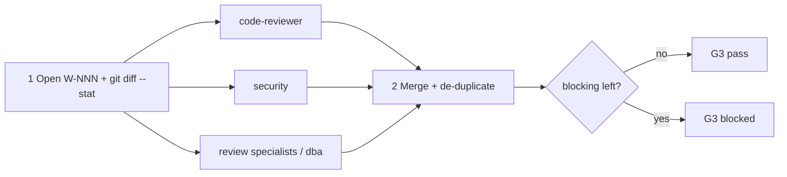

# /technical-team:review — review

## Running this command

**Request:** $ARGUMENTS

| Situation | Do |
|---|---|
| Argument required | no |
| This session **is** the tech lead (`--agent technical-team:lead` or `agent` setting) | execute the **Pipeline** below yourself |
| Any other session | Agent tool → `subagent_type: technical-team:lead`, prompt below |
| Lead returns `Chờ duyệt …` | stop, wait for the user; never approve or choose for them |
| User answers | resume the same lead (SendMessage), or a new Agent call: `Continue W-NNN (review). User's answer (verbatim): <answer>. Read .team/STATE.md first.` |
| Always | show the lead's report as written; do not do the team's work in the main session |

```
Execute the Pipeline section of ${CLAUDE_PLUGIN_ROOT}/commands/review.md (Read the file).
Request (verbatim): <request>
User's language: <language>
Work item: <W-NNN or new>
User-provided context: <faithful summary of what the user supplied for this request in this conversation — files, notes, output of skills they ran — or "none">
Read .team/STATE.md first.
```
The lead and its agents cannot see this conversation: "User-provided context" is the only way context you were given reaches the team.

## Pipeline

_Executed by the tech lead. Shared rules: Lead manual (tiers §1, gates §2, delivery loop §3, brief §4, specialists §7, reports §8–§9)._

| | |
|---|---|
| Gates | G3 (verdict only) |
| Writes code | no |
| Input | diff scope (optional) |

| Scope given? | Use |
|---|---|
| yes | as written (`main...HEAD`, a range, paths, a branch) |
| no | working tree vs `HEAD`; empty → `HEAD~1..HEAD` (say so in the report) |



| # | Step | Agent | Parallel |
|---|---|---|---|
| 1 | Open W-NNN (pipeline `review`) with the resolved scope and `git diff --stat` | lead | — |
| 2 | Review the scope. **Hook `review`**: specialists whose trigger matches the changed files | code-reviewer ∥ security ∥ specialists | yes |
| 3 | Merge: same `file:line` + same root issue → one finding, highest severity, keep who raised it; sort blocking → should fix → suggestion | lead | — |
| 4 | Verdict: **pass** (no blocking) or **blocked** (list) | lead | — |

| | |
|---|---|
| .team | reads `STATE`, `SPEC`, `PLAN`, `ROSTER`; writes lead → `STATE` |
| End | final report with the merged table (severity · `file:line` · finding · raised by · fix direction) + verdict; suggest `change` / `fix`; do not start them unless asked |
