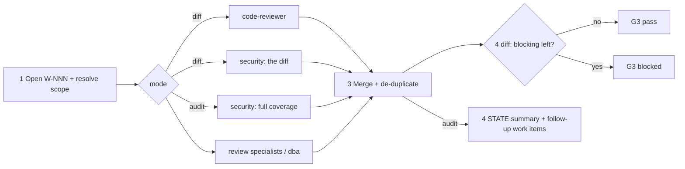

# /technical-team:review — review (diff · audit)

## Running this command

**Request:** $ARGUMENTS

| Situation | Do |
|---|---|
| Argument required | no |
| This session **is** the tech lead (`--agent technical-team:lead` or `agent` setting) | execute the **Pipeline** below yourself |
| Any other session | Agent tool → `subagent_type: technical-team:lead`, prompt below |
| Lead returns `Chờ duyệt …` | stop, wait for the user; never approve or choose for them |
| User answers | resume the same lead (SendMessage), or a new Agent call: `Continue W-NNN (review). User's answer (verbatim): <answer>. Read .team/STATE.md first.` |
| Always | show the lead's report as written; do not do the team's work in the main session |

```
Execute the Pipeline section of ${CLAUDE_PLUGIN_ROOT}/commands/review.md (Read the file).
Request (verbatim): <request>
User's language: <language>
Work item: <W-NNN or new>
User-provided context: <faithful summary of what the user supplied for this request in this conversation — files, notes, output of skills they ran — or "none">
Read .team/STATE.md first.
```
The lead and its agents cannot see this conversation: "User-provided context" is the only way context you were given reaches the team.

## Pipeline

_Executed by the tech lead. Shared rules: Lead manual (tiers §1, gates §2, delivery loop §3, brief §4, specialists §7, reports §8–§9)._

| | |
|---|---|
| Writes code | no (both modes) |

| Flag (or the same intent in words) | Mode | Who | Scope | Gate |
|---|---|---|---|---|
| none | **diff** (code-level review, not a project review) | code-reviewer ∥ security ∥ review specialists / dba | diff scope (below) | G3 verdict only |
| `--audit` ("audit bảo mật") | **audit** (full security coverage) | security ∥ review specialists / dba (domain security) | given scope, default the whole repository | none |

| Diff scope given? | Use |
|---|---|
| yes | as written (`main...HEAD`, a range, paths, a branch) |
| no | working tree vs `HEAD`; empty → `HEAD~1..HEAD` (say so in the report) |



| # | Step | Agent | Parallel |
|---|---|---|---|
| 1 | Open W-NNN (pipeline `review (<mode>)`) with the resolved scope; diff mode: `git diff --stat` | lead | — |
| 2 | Diff: review the scope. Audit: trust boundaries, vulnerability classes, dependency audit, secret scan, config and IaC review; large repo → list covered / skipped. **Hook `review`**: specialists whose trigger matches (audit: domains with their own security concerns — firmware, payments, DB access…) | diff: code-reviewer ∥ security ∥ specialists · audit: security ∥ specialists / dba | yes |
| 3 | Merge: same `file:line` + same root issue → one finding, highest severity, keep who raised it; sort blocking → should fix → suggestion | lead | — |
| 4 | Diff: verdict **pass** (no blocking) or **blocked** (list). Audit: summary in `STATE.md` — counts by severity, top issues | lead | — |

| | |
|---|---|
| .team | reads `STATE`, `SPEC`, `PLAN`, `ROSTER` (audit: + `ARCHITECTURE.md`, `OPS_HANDOFF`); writes lead → `STATE` |
| End | diff: final report with the merged table (severity · `file:line` · finding · raised by · fix direction) + verdict; suggest `feature --small` / `fix`. Audit: findings by severity with `file:line` + fix direction, coverage and gaps, missing scanners; follow-up work items grouped by effort (`fix` single issues, `feature --small` / `feature` structural). Do not start them unless asked |
