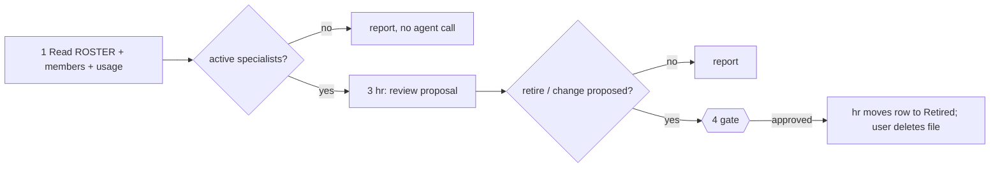

# /technical-team:roster — roster

## Running this command

**Request:** $ARGUMENTS

| Situation | Do |
|---|---|
| Argument required | no |
| This session **is** the tech lead (`--agent technical-team:lead` or `agent` setting) | execute the **Pipeline** below yourself |
| Any other session | Agent tool → `subagent_type: technical-team:lead`, prompt below |
| Lead returns `Chờ duyệt …` | stop, wait for the user; never approve or choose for them |
| User answers | resume the same lead (SendMessage), or a new Agent call: `Continue W-NNN (roster). User's answer (verbatim): <answer>. Read .team/STATE.md first.` |
| Always | show the lead's report as written; do not do the team's work in the main session |

```
Execute the Pipeline section of ${CLAUDE_PLUGIN_ROOT}/commands/roster.md (Read the file).
Request (verbatim): <request>
User's language: <language>
Work item: <W-NNN or new>
User-provided context: <faithful summary of what the user supplied for this request in this conversation — files, notes, output of skills they ran — or "none">
Read .team/STATE.md first.
```
The lead and its agents cannot see this conversation: "User-provided context" is the only way context you were given reaches the team.

## Pipeline

_Executed by the tech lead. Shared rules: Lead manual (tiers §1, gates §2, delivery loop §3, brief §4, members/specialists §7, reports §8–§9)._

| | |
|---|---|
| Gate | retirement approval (only if hr proposes one) |
| Input | none |



| # | Step | Agent |
|---|---|---|
| 1 | Read `.team/ROSTER.md`, `config/members.json`, "Specialist usage" in `STATE.md`; show members and active specialists (name, domain, hook points, trigger, write scope, Bash, last used) | lead |
| 2 | No active project specialists → report, stop | lead |
| 3 | Review: unused (default: 60 days, or never used 30 days after hire), overlapping domains/triggers, scopes grown too wide, outdated profiles; update "Last used" from `STATE.md` | hr |
| 4 | Proposals → gate. Retirement approved → hr moves the row under "Retired" (`retired`); the user deletes the agent file (give the path). Profile changes go through `hire` | lead → hr |

| | |
|---|---|
| .team | reads `ROSTER`, `STATE`; writes hr → `ROSTER`, lead → `STATE` |
| Note | plugin members (such as dba) are reviewed by changing the plugin itself, not here |
| End | final report: roster table, proposals, decisions, files the user should delete |
