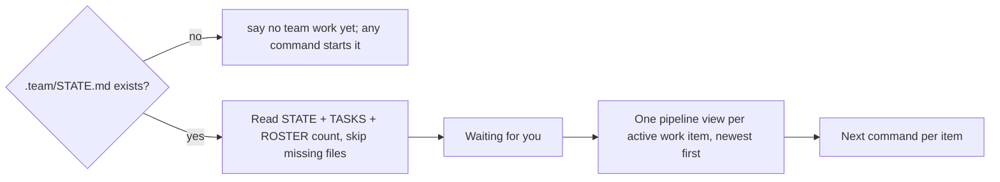

# /technical-team:status — current state

Run this yourself in the current session; do not delegate (read-only, no agent, no file changes).



## Output

In this order, in the user's language.

| Part | Content | Source |
|---|---|---|
| 1. **Waiting for you** | every pending gate and decision, with its work-item ID; `nothing` when there is none | `STATE.md` → status `waiting-for-user`, `Waiting on user` |
| 2. Pipeline view | one block per active work item (below) | `STATE.md`, `TASKS.md` |
| 3. Specialists (count) | one line | `ROSTER.md` |
| 4. Next command | one per item: answer the pending gate, `new` (no argument) to resume a new-project run where it stopped, `feature` to continue, `fix` for a reported bug, … | |

## Pipeline view

One fenced text block per work item, at most 80 columns:

```
W-012  Offline sync            feature (full) / T2      running
────────────────────────────────────────────────────────────────
Discovery  ba ✓  designer ✓  architect ✓  pm ✓  qa-plan ✓
  ▣ G1 approved 2026-11-10
Build      developer ●  dba ✓                    tickets 3/5
  ✗ W-012-T4 blocked (developer): <note>
Verify     code-reviewer ○  qa ○  security ○
  ▢ G2   ▢ G3
────────────────────────────────────────────────────────────────
⚠ Waiting for you: nothing
↻ Loop: round 2 — round 1 FAIL (D1, D3) → fixed · escalation: none
⏸ Deferred: 1 — <finding> (<owner>)
```

| Line | Rule | Source |
|---|---|---|
| Header | ID, title, pipeline (mode) / tier, status | `STATE.md` |
| Squad rows | Discovery → Build → Verify, in that order; Support roles (debugger, writer, hr) join the row where they acted. A squad the work item has not reached is one line: `Verify     ○ not reached` | marks below |
| Gate lines | under the squad the gate closes: `▣` approved / passed (with date when recorded), `▢` pending or not reached | `STATE.md` → `Gate`, `Approvals` |
| Tickets | `tickets <done>/<total>` on the Build row; every `blocked` ticket on its own `✗` line with owner role | `TASKS.md` ticket table |
| `⚠` | the decision needed, or `nothing` | `STATE.md` → `Waiting on user` |
| `↻` | current round and the last failure; flag `stalled` when the same failure repeats two rounds or an escalation step is reached. Omit when there is no loop log | `STATE.md` → `Loop log` |
| `⏸` | open deferred findings, count + one line each. Omit when none | `STATE.md` → `Deferred findings` |

### Marks

Show a role only when a source names it; never list a role because the pipeline usually has it.

| Mark | Meaning | Evidence |
|---|---|---|
| `✓` | done | the role's part for this ID exists (ticket table → pm, `### QA` test plan → qa-plan), all its tickets are `done`, or its `Results` line is a pass |
| `●` | working now | a ticket `doing` / `review` for that owner role, QA status `executing`, or `Next step` names the role |
| `✗` | failed or blocked | ticket `blocked`, QA status `failed`, a `Results` line with FAIL or blocking findings |
| `○` | not reached | named by a source but nothing done yet (e.g. ticket `todo`) |

| Shortcut | Applies when |
|---|---|
| Discovery roles all `✓` | G1 is approved — no need to prove each role |
| Verify shows result counts | `Results` has them: `code-reviewer ✓ (0/2/3)` = blocking / should-fix / suggestions, `qa ✓ PASS`, `security ✗ (1 blocking)` |
| Unknown stays unknown | when no source says, leave the role out rather than guess a mark |

## New-project runs (pipeline `new`)

Same block, with the phase strip in place of the squad rows' header line and the squad rows for the current milestone only:

```
W-001  Shop app                new                      running
────────────────────────────────────────────────────────────────
N0 ✓  N1 ✓  N2 ✓  N3 ✓  N4 ● M2/4  N5 ○  N6 ○  N7 ○
Milestones  M1 Catalog ✓ 2026-11-02 · M2 Cart ● · M3 Checkout ○
  ▣ REQ  ▣ STACK  ▣ G1  ▣ M1  ▢ M2  ▢ RELEASE
Build      developer ●                           tickets 2/6
Verify     ○ not reached
────────────────────────────────────────────────────────────────
⚠ Waiting for you: nothing
→ Next step: feature.md D3 on M2 tickets (round 2)
```

| Line | Source |
|---|---|
| Phase strip, milestones, gates, `→ Next step` | `STATE.md` → `Phase`, `Milestones`, `Gate`, `Next step` |
| Squad rows, tickets | `TASKS.md` → the current milestone's `### M<k>` group |
