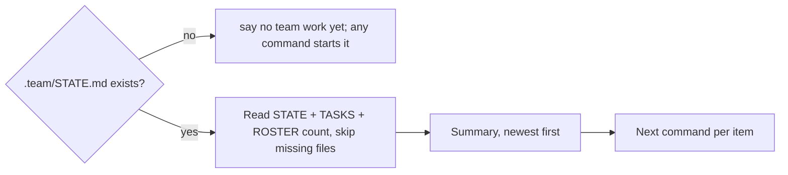

# /technical-team:status — current state

Run this yourself in the current session; do not delegate (read-only, no agent, no file changes).

| Section (in this order, user's language) | Source |
|---|---|
| **Waiting for you** — pending gates and decisions | `STATE.md` → status `waiting-for-user` |
| Active work items — ID, title, pipeline/tier (with mode), status, gate, what it waits for | `STATE.md` |
| New-project runs (pipeline `new`) — phase, milestone k/n, next step, pending gate | `STATE.md` → `Phase`, `Milestones`, `Next step`, `Gate` |
| Tickets `blocked` / `doing` with owner role | `TASKS.md` |
| Delivery loops stalled (same failure two rounds) or long-running, escalation step reached | `STATE.md` → `Loop log` |
| Deferred findings still open | `STATE.md` |
| Specialists (count) | `config/agents.json`, `ROSTER.md` |

| Then | |
|---|---|
| Suggest the next command per item | answer the pending gate, `new` (no argument) to resume a new-project run where it stopped, `feature` to continue, `fix` for a reported bug, … |
