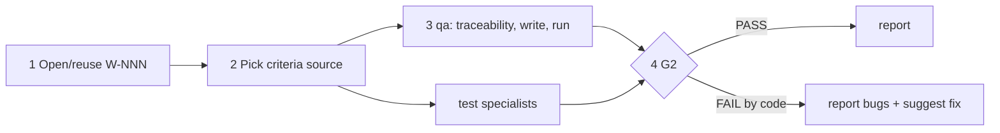

# /technical-team:test — test (G2)

## Running this command

**Request:** $ARGUMENTS

| Situation | Do |
|---|---|
| Argument required | no |
| This session **is** the tech lead (`--agent technical-team:lead` or `agent` setting) | execute the **Pipeline** below yourself |
| Any other session | Agent tool → `subagent_type: technical-team:lead`, prompt below |
| Lead returns `Chờ duyệt …` | stop, wait for the user; never approve or choose for them |
| User answers | resume the same lead (SendMessage), or a new Agent call: `Continue W-NNN (test). User's answer (verbatim): <answer>. Read .team/STATE.md first.` |
| Always | show the lead's report as written; do not do the team's work in the main session |

```
Execute the Pipeline section of ${CLAUDE_PLUGIN_ROOT}/commands/test.md (Read the file).
Request (verbatim): <request>
User's language: <language>
Work item: <W-NNN or new>
User-provided context: <faithful summary of what the user supplied for this request in this conversation — files, notes, output of skills they ran — or "none">
Read .team/STATE.md first.
```
The lead and its agents cannot see this conversation: "User-provided context" is the only way context you were given reaches the team.

## Pipeline

_Executed by the tech lead. Shared rules: Lead manual (tiers §1, gates §2, delivery loop §3, brief §4, specialists §7, reports §8–§9)._

| | |
|---|---|
| Gates | G2 |
| Writes production code | no |
| Input | scope (optional: W-NNN, feature, folder, files; default: work items with code changes but no G2, otherwise ask) |

| Criteria source (first that exists) | |
|---|---|
| 1 | `SPEC.md#W-NNN` acceptance criteria |
| 2 | expected-behaviour bullets in `STATE.md` |
| 3 | documented behaviour (README / docs) |
| 4 | current behaviour of the code — qa lists the behaviours it assumed for the user to confirm |



| # | Step | Agent | Parallel |
|---|---|---|---|
| 1 | Open or reuse W-NNN (pipeline `test`) with the scope | lead | — |
| 2 | Choose the criteria source; tell qa which one | lead | — |
| 3 | Traceability table, missing tests, run; live preview of the UI in scope (`live-preview` skill). **Hook `test`** | qa ∥ specialists | yes |
| 4 | G2 verdict; failures caused by production code are **reported as bugs** (failing test = evidence), not fixed here | lead | — |

| | |
|---|---|
| .team | reads `STATE`, `SPEC`, `PLAN`, `ROSTER`; writes lead → `STATE` |
| End | final report: coverage table, tests added, real output, PASS/FAIL, one suggested `fix` per bug |
