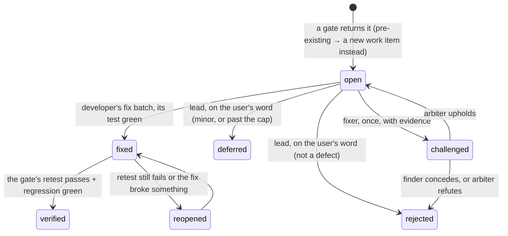

# Defects, retest, regression and the test summary

## A finding (one entry in `.team/items/<slug>.json`, via the structured output)

```json
{ "id": "", "result": "new", "title": "Double tap creates two projects", "severity": "major", "blocking": true,
  "test": "e2e/projects.spec.ts::create is idempotent on double tap", "ac": "CART-AC1", "file": "src/screens/NewProject.tsx",
  "detail": "Create stays enabled while saving; two POST /api/projects 201. Expected disabled 'Creating…' (design state pending)." }
```

The failing test (or a one-line repro command) is the evidence; steps, screenshots and logs go in the Handoff, never a `.team/` file. A known finding is returned with its `id` (`F3`) and `result` verified or failing.

| Rule | |
|---|---|
| One defect per finding | split unrelated symptoms; title ≤ 8 words, verb + object |
| Reproducible | a failing test or minimal repro from a known state, with test data named (seeded, never real data) |
| Expected from a source | AC, frontend design, docs, platform convention, heuristic — cite it |
| Impact for major+ | one sentence of concrete user impact; without source + impact the severity is at most minor (test-process §2a) |
| Scope | in-scope or pre-existing (test-process §2a); pre-existing never blocks a PASS |
| Evidence | screenshot / capture / transcript / log lines, never secrets |
| No fix prescriptions | suspected location is fine; the fix is the developer's |

## Severity (impact) × priority (urgency)

| Severity | Meaning |
|---|---|
| **Blocker** | blocks testing or a core flow; crash on start; data loss/corruption; security hole suspected |
| **Critical** | core function wrong, no reasonable workaround; wrong money/calculation; user misled into a harmful action |
| **Major** | function or designed state missing/wrong with a workaround; broken on a required platform/form factor; accessibility failure on a core flow |
| **Minor** | non-core function wrong, inconsistency, unclear copy, cosmetic issue users notice |
| **Trivial** | polish |

| Priority | Meaning |
|---|---|
| P0 | fix before anything else in this round |
| P1 | fix in this work item (required for PASS) |
| P2 | fix if cheap now, otherwise defer with a reason (main session decides) |
| P3 | backlog |

Default: blocker/critical → P0, major → P1, minor → P2, trivial → P3. Raise priority for high exposure (first screen, most-used flow, release-critical); say why when you deviate.

## Finding lifecycle (the item's `status`)



Only the gate that raised a finding moves it to `verified` or `reopened`, and only after a retest. An in-scope blocking finding is never `deferred` silently: the user's words go in the item's `decisions`. A known defect keeps its ID (`reopened`, never a new one); reopened twice → the loop stalls for the user. A spec question is a blocking finding with test `spec: <what conflicts>`, routed to ba, designer or architect.

## Retest and regression

| Step | Do |
|---|---|
| Retest | every listed finding in `fixed`: run its test |
| Regression | the area around each fix (same screen/module, callers, shared components), plus the relevant suite; full suite before PASS and at `release` |
| New findings | only a regression a fix caused; name the finding it came from in `detail` |

## Test summary (T2 `qa.md` and `release`; below T2 the Handoff, a few lines)

| Section | Content |
|---|---|
| Scope | work item, build/commit, platforms × form factors, what was out of scope and why |
| Coverage | RTM totals: conditions / test cases — passed · failed · blocked · not run; ACs covered n/n; designed states verified n/n; quality characteristics in scope and their result |
| Execution | commands + summary lines; live preview evidence table; exploratory sessions (charter, duration, findings) |
| Defects | in-scope: found / closed / open by severity; open and deferred list with reasons · pre-existing: list with suggested new work items |
| UX | conformance result, heuristics issues, accessibility result, design questions and their decisions |
| Risks | residual risks, areas tested less (risk-based) and why, platforms not previewed |
| Exit criteria | each criterion → met / not met |
| Verdict | PASS / FAIL / PASS pending design decision |
| Lessons | escaped-defect root causes, missing ACs, catalogue rows proposed, testability problems |
