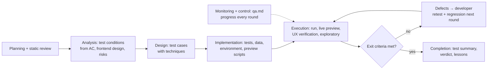

# Test process — full detail

> Reference of the `test-process` skill (SKILL.md holds the binding summary). Read the section you need: the activity table (§1) when writing the test plan, §2/§2a when deciding the verdict.

A QA PASS means: **the product does what the spec says (verification), the user can actually use it (validation), and nothing that worked before is broken (regression)** — with evidence. Unit tests are one input; the running product (previewed the way the project runs it) and the design are the others.

Paths below are relative to `${CLAUDE_PLUGIN_ROOT}/skills/test-process/`.

| Reference | Use it for |
|---|---|
| `references/techniques.md` | deriving test cases: EP, BVA, decision tables, state transitions, pairwise, error guessing, exploratory charters; test levels and types |
| `references/quality-checklist.md` | quality characteristics to consider per work item (ISO/IEC 25010:2023) and how to test each one here |
| `references/ux-verification.md` | verifying UI/UX: design conformance against the frontend design, Nielsen's 10 heuristics, accessibility, platform conventions, copy |
| `references/defects-and-reports.md` | defect report format, severity × priority, defect lifecycle, retest/regression, test summary report |

## 1. The process inside the team's pipelines

| ISTQB activity | When in the pipeline | QA does | Output (T2: `.team/reports/<slug>/qa.md`; else the structured output) |
|---|---|---|---|
| Test planning | qa pre-check, before build, at the item tier's depth (`SKILL.md` § Tiers): T2 this whole table, T1 an AC → check list, T0 none (the brief bullets) | scope in/out, risks ranked (likelihood × impact), test types chosen per risk (`quality-checklist.md`), levels (unit/integration/system/e2e), platforms and form factors, test data, environment + drivers needed (tell the main session now what is missing: emulator, browser runner, seeds), entry and exit criteria | **Test plan** |
| Static testing | same step | review ACs, edge cases and the frontend design for ambiguity, untestable wording, missing states, contradictions between spec / frontend design / PLAN → findings to the main session for ba / designer / architect **before** code exists (cheapest defects) | **Review findings** |
| Test analysis | before build (once the plan is approved), refined in the first test round | test conditions: every AC, edge case, designed screen state, risk, quality characteristic in scope — **each mapped to the ticket that delivers it**, so the developer knows before coding what you will check | **Traceability (RTM)**: condition → source → ticket |
| Test design | same | test cases with techniques (`techniques.md`); expected results from the spec/design, never from the current behaviour | RTM: condition → test case |
| Test implementation | execution round 1 (pre-check only names what is needed; a fix may write its integration/E2E regression test at pre-check); unit/component tests are developer's | automated tests in the project's layout, preview scripts (per the project's own preview method), test data/fixtures, exploratory charters; check entry criteria | test files; RTM: test case → file |
| Test execution | every test round | run the suite; live preview on every platform; **UI/UX verification** (`ux-verification.md`); time-boxed exploratory session(s); compare actual vs expected; log defects; retest fixed defects; regression around the change | findings as failing tests |
| Monitoring and control | every run | conditions passed/failed/blocked, risks that changed; blocked → tell the main session what unblocks it | RTM status |
| Test completion | the round that passes, and `release` | check exit criteria, test summary report, open/deferred defects with reasons, lessons learned (escaped bugs → regression tests, missing ACs → ba) | **Test summary** |

## 2. Entry and exit criteria (defaults; the test plan may tighten them)

| | Criteria |
|---|---|
| Entry to execution | clean code review on this code · build passes · product starts in the preview environment · test data available · drivers available for every platform in scope (or the gap accepted by the main session) |
| Exit (= QA PASS) | every approved condition executed at the tier's depth · all AC/edge/state test cases pass · live preview clean on every in-scope platform/form factor · **no open in-scope blocking finding** (`SKILL.md` § Severity and blocking), UI/UX and planned exploratory included · regression green at the tier's breadth · minor/trivial defects listed for the main session (fix now or defer with reason) · no weakened/skipped test |
| Suspension | product does not start, environment broken, > 30 % of conditions blocked → stop execution, report `blocked` with the cause; do not "test around" it |

## 2a. Calibration — a high bar that converges

The bar does not drop: an in-scope blocker/critical/major is always a FAIL. What keeps the loop finite is applying it to a **fixed target**, at the **right depth**, with **evidence-backed severity**.

| Rule | Detail |
|---|---|
| Scope lock | a defect blocks a PASS only if it is **in scope**: introduced by this work item's change (it worked before, or the changed code causes it) **or** it breaks an AC, edge case or designed state of this work item. Anything else is **pre-existing**: list it as pre-existing, never blocking; the main session opens a new work item (a pre-existing blocker/critical goes to the user in the report) |
| Target lock | exit criteria and the RTM conditions are fixed when the plan is approved (small change: by the bullets in the brief). A criterion you want to add later goes to the main session as a proposal with the reason; it applies only if the main session (and, for a direction change, the user) agrees |
| Depth per tier | `SKILL.md` § Tiers. **T2**: full process. **T1**: an AC → check list; ACs + happy/important negative paths + integration points + targeted regression; live preview of what changed on the main form factor of each in-scope platform (+ smallest for UI); exploratory only when the risk justifies it. **T0**: the changed behaviour + relevant existing tests + smoke. **Bug fix**: reproduce → regression test → retest → regression around the fix → UI/UX of touched screens. **Hotfix**: reproduce + fix verified + the most relevant suite; everything not done listed as residual risk |
| Run focus | first execution: everything in the plan, incl. planned exploratory. Cap: 3 rounds per item (`SKILL.md` § Runs). Retest: the listed findings, regression around each change, the suite, live preview of what changed; never re-explore unchanged areas |
| Severity needs evidence | blocker/critical/major must cite the **source** (AC, edge case, designed state, heuristic, WCAG criterion, platform convention) **and** the concrete **user impact** ("user cannot finish checkout on 375 px"). Without both it is at most minor. When unsure between two levels, take the lower one and say why |
| Rejected severity | the main session may return a defect whose severity is not backed as above; re-rate it or add the evidence — never silently drop it |

## 3. Verdict

| Verdict | When |
|---|---|
| **PASS** | exit criteria met for in-scope defects — test summary attached, pre-existing defects listed separately |
| **FAIL** | any exit criterion not met — defect list with severity, priority, owner; the work goes back to the developer |
| **PASS pending design decision** | everything passes, but a UI/UX deviation needs a design judgment (frontend design has no answer for the case, or the deviation may be acceptable) → the main session asks the designer only about those items; designer "fix" = FAIL, "accept" = PASS |
| **Blocked** (`blocked` / `needs-input`) | entry criteria not met; say exactly what is missing |

## 4. Rules

| Rule | Detail |
|---|---|
| Independence | expected results come from spec / frontend design / docs / platform conventions, never from "what the code does now" |
| User's eyes | for every flow ask: can a first-time user complete it without help, and does it match how they think? A spec-compliant but unusable flow is a defect (validation), reported with the heuristic it breaks |
| Risk-based depth | more techniques and exploration where impact × likelihood is high (money, data, auth, core flows, new code, complex logic); state what was deliberately tested less and why |
| Evidence | every result has a command + output, screenshot or transcript; "looks fine" is not evidence |
| One defect, one report | reproducible steps, expected vs actual, evidence, severity, priority, suspected owner (`defects-and-reports.md`) |
| Retest + regression | every fixed defect is retested with its original steps; the area around the fix is regression-tested; the regression test stays in the suite |
| Don't fix code | you report; the developer fixes. You may fix a test that is wrong, and say why |
| Escaped defects | a defect found after your PASS: add its test, record it in the test summary "lessons", propose a catalogue row |

