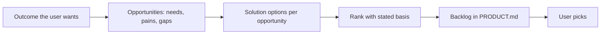

# Contexts — greenfield, operating system, discovery

> Reference of the `business-analysis` skill. Read the section of the context you are in.

## 1. Greenfield (pipeline `new` N1, no application code yet)

| Step | Do | Output |
|---|---|---|
| Problem and vision | whose problem, how they cope today, what is better afterwards | `PRODUCT.md` → Vision |
| Users and stakeholders | roles, their goals, who decides, who is affected | `PRODUCT.md` → Users |
| Goals and measures | 1–3 business goals, each with a measure the user can observe | `PRODUCT.md` → Goals |
| Context | other systems, data that already exists elsewhere, constraints (legal, deadline, budget, platforms, scale) | `PRODUCT.md` → Context |
| Capability map | story map of the whole product; mark the MVP slice | `PRODUCT.md` → Capability map |
| Glossary and rules | the business words and the rules behind them, with examples | `PRODUCT.md` → Glossary, Business rules |
| MVP spec | stories, ACs, edge cases, quality targets for the MVP slice only | `requirements/<slug>.md` |

Benchmark comparable products (web) for conventions users will expect; cite the URLs. The MVP is the smallest slice that reaches one goal end to end, not a list of the user's first ideas.

## 2. Operating system (a change to something that exists)

| Step | Do | Output in `requirements/<slug>.md` |
|---|---|---|
| As-is | read the code and docs for the flow being changed: what happens today, which rules are enforced where (file:line), who can do it | **As-is** |
| To-be and gap | what must be different; what stays exactly as it is | **Problem / goal**, **Out of scope** |
| Impact | every place the change is felt (table below) | **Impact** |
| Existing users and data | records created under the old rule, saved settings, habits, links, exports | **Impact** → data / users rows |
| Elicit only the gap | questions about the new behaviour and about each impact you cannot decide | rounds |

| Impact area | Look for |
|---|---|
| Flows | other flows that pass through the changed step |
| Roles | who gains or loses an action |
| Data | fields added/changed/removed, old records, migrations (→ dba) |
| Integrations | consumers of the API, webhooks, files, reports that read the changed data |
| Rules | rules elsewhere that assume the old behaviour |
| Operations | support, runbooks, monitoring, documentation (→ writer / devops) |
| Regression risk | behaviour that must not change — qa builds regression scope from this list |

No `PRODUCT.md` yet on an operating system: create it from what you read (capabilities found in the code, marked `live`), kept short; do not document the whole system for a small change.

## 3. Discovery (`feature --discover`: what to build next, how to grow a feature)

| Step | Do |
|---|---|
| Outcome | one measurable outcome for the business or the user (not a feature). Elicit it if the user gave a feature |
| Evidence | what the user supplied (feedback, tickets, analytics exports, sales notes), the product itself (dead ends, missing states, friction in existing flows — read the code and `.team/frontend-design/`), comparable products (web) |
| Opportunities | needs/pains phrased from the user's side ("when …, I want …, so that …"), each with its evidence |
| Options | 1–3 ways to address each top opportunity, smallest first |
| Rank | value (toward the outcome) · reach (who, how many) · confidence · rough size (S/M/L — your guess, the architect confirms later). Each score carries its basis C / E / A |
| Backlog | ranked rows in `PRODUCT.md` → Backlog, status `idea`; your recommendation for the next one or two and why |

| Rule | Detail |
|---|---|
| No invented numbers | without data say "assumption" and rank qualitatively (high / medium / low); name the evidence that would raise confidence |
| Opportunities before solutions | compare opportunities first, then choose an option for the chosen opportunity |
| The user decides | you recommend; the pick becomes a normal `feature` work item, where the spec is elicited in full |
| Basics before delighters | an option that fixes a broken or missing basic expectation outranks a new delighter of equal size |

## 4. After delivery (milestone gates in `new`, when briefed)

Check the delivered behaviour against the goal, not only the ACs: which goal each delivered capability serves, what is still missing for the goal, capabilities to mark `live` in `PRODUCT.md`, new backlog rows the work revealed.
