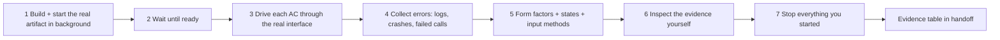

# live-preview — "the tests pass" is not "the product works"

Green unit tests prove functions behave. They do not prove the app starts, the screen renders on a small phone, the CLI exits with the right code, the endpoint answers with the documented shape, or that the log is free of errors. This skill closes that gap with **evidence from the running product, driven through the same interface its user uses**.

Paths below are relative to `${CLAUDE_PLUGIN_ROOT}/skills/live-preview/`.

| Who | When | Depth |
|---|---|---|
| qa | every work item whose change a user or client can observe: UI, routes/navigation, styling, i18n, CLI flags/output, API responses, messages a bot/worker sends, build/bundling/packaging config — and `release` / `new` N7 | full pass (§2), verdict input for G2 |
| developer | before handing off a ticket with an observable change | quick pass: §2 steps 1–4 + 6 on what changed; paste the summary in your handoff |
| designer | decisions on UI/UX items qa escalates (D3a / S3a) | reads qa's screenshots / recordings + `.team/DESIGN.md` (no shell) |

Not applicable (say so with the reason): a refactor with no observable change, test-only or docs-only changes, a library with no example/consumer in the repo (then the public API tests are the preview).

## 1. Identify the product and its driver

Find the app type from manifests and config (`package.json` deps, `app.json`/`eas.json`, `pubspec.yaml`, `android/`, `ios/`, `*.xcodeproj`, `electron`/`tauri.conf.json`, `Cargo.toml` `[[bin]]`, `pyproject` `[project.scripts]`, `main.go`, `Dockerfile`, `openapi.*`, `manifest.json` with `manifest_version`). A repo can have several (web + API + mobile): preview each one the change touches.

| Product | Run it | Drive it (prefer what the project already has) | Evidence | Reference |
|---|---|---|---|---|
| Web app / SPA / SSR / PWA | `commands.run`, `dev`/`preview`/`start` script; prefer the production build | Playwright (or Cypress) | console + page errors, failed requests, screenshots 375 / 768 / 1280 | `references/web.md` |
| Mobile (React Native, Expo, Flutter, native iOS/Android, Capacitor/Ionic) | build a debug/release build onto an emulator/simulator (`npx expo run:android`, `flutter run`, `./gradlew installDebug`, `xcodebuild … -destination`) | Maestro (any stack), Detox (RN), `integration_test` / `patrol` (Flutter), Espresso / UI Automator (Android), XCUITest (iOS), Appium | device log (`adb logcat`, `xcrun simctl spawn booted log`), crashes/ANRs, screenshots on small phone + large phone (+ tablet if supported), both orientations if supported | `references/mobile.md` |
| Desktop (Electron, Tauri, Qt, .NET WPF/WinUI/MAUI, Swift/AppKit, Java/JavaFX, GTK) | the packaged or dev build; on headless Linux wrap with `xvfb-run` | Playwright `_electron`, WebDriver (`tauri-driver`, WinAppDriver, Appium Mac2), the toolkit's UI test framework | main + renderer logs, crash dumps, screenshots at minimum and typical window size, HiDPI if supported | `references/desktop.md` |
| CLI / TUI | the built binary or the installed entry point (not `go run` of a sub-package, not an import) | shell harness: real args, stdin, env, exit codes; TUI via a pty (`expect`, `pexpect`, `script`, `tmux send-keys` + `capture-pane`) | transcript: command, stdout, stderr, exit code; terminal snapshot for TUIs at 80×24 and wide | `references/cli.md` |
| API / backend service / gRPC / GraphQL | start the service with its real dependencies (compose, local DB with seeds, test doubles only for third parties) | HTTP client (`curl`, `httpie`, Hurl, the project's API test tool), `grpcurl`, GraphQL query | request/response transcript, status codes, response vs the contract (OpenAPI/schema), service log free of errors, timing | `references/service.md` |
| Worker / queue consumer / cron / bot (Slack, Discord, Telegram) | start it against local broker/emulator or the platform's test mode | publish a real message / trigger the job / send the bot command | resulting side effect (DB row, outgoing message, file), log, retry/dead-letter behaviour | `references/service.md` |
| Browser extension | load unpacked into Chromium (`--load-extension`) | Playwright persistent context | popup/options screenshots, background/service-worker errors, behaviour on a real page | `references/web.md` |
| Game / canvas / 3D | the build in its target runtime | engine test runner (Unity Test Framework, Godot GUT), scripted input, frame capture | screenshots/recording of the scene, frame time, errors in the engine log | `references/desktop.md` |

| Before you start | If missing |
|---|---|
| Run command | `commands.run`, scripts, Makefile, compose, README, `.team/OPS_HANDOFF.md` → still missing: `vướng`, ask for the exact command |
| Driver / runtime (browser runner, emulator/simulator, Xvfb, device driver) | **never install it yourself** (the guard blocks installs). `cần quyết định`: name what is needed (e.g. "`@playwright/test` dev dependency", "an Android emulator image `system-images;android-34;google_apis;x86_64`", "macOS host for the iOS simulator"). Until then report "live preview not run" — not a PASS |
| Platform the environment cannot host (iOS simulator on Linux, Windows-only desktop app on Linux, a physical device) | preview what *can* run (Android for a cross-platform app, the web build of RN/Flutter) and say exactly what was **not** previewed; the lead puts it in the report as an open risk. A web build is supporting evidence for a mobile app, never a replacement |
| Test data / accounts | seeds/fixtures (dba / qa), the project's test users, sandbox keys; an empty state is a case to check, not a reason to skip |
| What to check | ACs in `.team/SPEC.md#W-NNN` (T1: bullets in `STATE.md`), screens in `.team/DESIGN.md#W-NNN`, changed entry points in `git diff --stat` |

## 2. The pass (same for every platform)

| # | Step | Rule |
|---|---|---|
| 1 | Start | Bash with `run_in_background: true` for servers, emulators, watchers (never a foreground dev server: it blocks forever). Prefer the build closest to what users get (production web build, release-mode mobile build when feasible, packaged desktop app, installed CLI): many bugs exist only there |
| 2 | Ready | poll a real signal (URL answers, `adb shell getprop sys.boot_completed` = 1, app process up, `--version` works, health endpoint 200), max a few minutes. Not ready → the startup output **is** the finding |
| 3 | Drive | a scripted check per AC in the project's e2e folder (`e2e/preview/<w-nnn>.*` or the platform's convention — qa owns it), using what the user perceives: accessible labels/text for UIs, real args and stdin for CLIs, real requests for APIs. Assert on observable outcomes |
| 4 | Signals | collect the platform's error channels (§1 Evidence column). Any crash, uncaught exception, ANR, error-level log line or unexpected failed call on the changed path = **FAIL** unless the brief lists it as known |
| 5 | Breadth | **form factors** from §1 (screen widths / devices / window sizes / terminal sizes); **states**: empty, loading/slow (throttle, delay a dependency), error (dependency 500, offline, timeout, permission denied), long content and large data; **input**: keyboard and focus for UIs, touch + back gesture/button + rotation for mobile, pipes/non-TTY/`--help`/bad args for CLIs, malformed and unauthorized requests for APIs; **lifecycle**: reload/deep link (web), background → foreground and kill → relaunch (mobile), quit → reopen with saved state (desktop), retry/idempotency (services); dark mode / locale if supported |
| 6 | Inspect | open screenshots with Read (it shows images), read transcripts and logs. Compare with `.team/DESIGN.md` and the catalogue. Evidence you never looked at is not evidence |
| 7 | Stop | stop servers, emulators/simulators you booted, app processes, containers you started (same background task / PID). Leftovers break the next run (port taken, stale app version on the emulator) |

**Where outputs go:** the runner's output folder (`test-results/` by default; name files `<w-nnn>-<screen>-<form-factor>.<png|txt|mp4>`). Never into `.team/` (summaries only); never commit them.

## 3. Evidence and verdict

Paste into the handoff (qa: next to the traceability table):

| Field | Content |
|---|---|
| Product + target | e.g. "Android app, release build, Pixel 6 API 34 emulator" · "CLI `mytool` 1.4.0 built from HEAD" · "API, docker compose up" |
| Command | how it was built/started + the exact driver command |
| Result | runner summary line (e.g. `6 passed (14.2s)`, `Flow passed`, per-request status list) |
| Errors | crashes / exceptions / error-level log lines / failed calls: count + first lines, or `0` |
| Form factors | table: screen or command → each form factor → ok / issue (file name) |
| States + input + lifecycle | each from §2 step 5: ok / issue / n/a (why) |
| Not previewed | platforms or flows that could not run here, and why |
| Known-bug sweep | IDs from `references/common-bugs.md` checked for this change, and any hit |

| Verdict rule | |
|---|---|
| PASS needs | every AC driven through the real interface and passing · 0 crashes / uncaught errors / unexpected failed calls on the changed path · no blocker on any required form factor |
| FAIL | any of the above; name the screen/command/endpoint, form factor, step, error text and likely owner (developer for code, devops for env/build/packaging, dba for data) |
| Not run | only with the reason. For an observable change, "not run" = no G2; partial ("Android ok, iOS not runnable here") = G2 only if the lead records the gap and the user accepts it |

## 4. Known-bug catalogue

`references/common-bugs.md` lists bugs that most often slip past green suites — cross-platform sections (build/env, data/contract, state, forms/input, navigation, layout, a11y, i18n/time, auth, performance) and platform sections (mobile, desktop, CLI, service). Each row: **symptom → how to catch it in the preview → usual cause**. Sweep the sections that match the product and the diff, list the IDs you checked. When a bug escapes to the user anyway, report the missing row in "Còn mở" so the plugin maintainer adds it.

## 5. Rules

| Rule | Detail |
|---|---|
| Real artifact, real interface | jsdom, widget/component tests, calling handlers directly, importing the CLI's `main()` do not count as live preview |
| No production | only local, emulators/simulators, compose services, sandboxes; never a deployed environment with real users or data, never a store/TestFlight upload |
| No secrets | test credentials, seeded users, sandbox keys; never paste tokens into specs, screenshots, transcripts or handoffs |
| Don't weaken | no fixed sleeps to hide a race, no filtering an error out of the log to get green; a flaky check is a finding |
| Keep it | the preview check stays in the suite as a regression test; the next round re-runs it |
| Guard | with a `commands.test` allowlist, qa starts the product only through `commands.run` (and drives it through `commands.test`); add emulator/driver commands there (e.g. `adb`, `maestro test`, `xvfb-run`, `flutter test integration_test`) |
