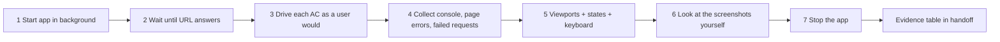

# live-preview — "the tests pass" is not "the app works"

Green unit tests prove functions behave. They do not prove the page loads, the API base URL is right, the button is visible on a phone, or that the console is clean. This skill closes that gap with **evidence from the running app**.

| Who | When | Depth |
|---|---|---|
| qa | every work item whose diff touches UI, routes, API consumed by a UI, styling, i18n, build/bundling config — and `release` / `new` N7 | full pass (§2), verdict input for G2 |
| developer | before handing off a UI ticket | quick pass: §2 steps 1–4 + 6 on the changed screens only; paste the summary in your handoff |
| designer | UI review right after qa (D3a / S3a) | reads qa's screenshots + `.team/DESIGN.md` (no shell) |

Not applicable (say so with the reason in your handoff): pure backend with no UI consumer, CLI, library, infra-only change.

## 1. Before you start

| Check | How | If missing |
|---|---|---|
| How the app runs locally | `.claude/technical-team.json` → `commands.run`; else `package.json` scripts (`dev`, `start`, `preview`), `Makefile`, `docker-compose`, README "run" section, `.team/OPS_HANDOFF.md` | ask in handoff (`vướng`): exact run command needed |
| Browser runner | `@playwright/test` / `playwright` in the manifest, `playwright.config.*`, or Cypress | **do not install it yourself** (the guard blocks installs). Handoff `cần quyết định`: developer adds `@playwright/test` as a dev dependency + `npx playwright install chromium`; until then you may only report "live preview not run" — which is **not** a PASS for UI work |
| Port / base URL | run script, framework default (Vite 5173, Next 3000, CRA 3000, Angular 4200, Django 8000, Rails 3000, Flask 5000), server log | read it from the server output, never guess |
| Test data | seeds/fixtures (dba / qa), or a mock API layer the project already has | an empty database is a valid case to check (empty states), not a reason to skip |
| Which screens | ACs in `.team/SPEC.md#W-NNN` (T1: expected-behaviour bullets in `STATE.md`), screens in `.team/DESIGN.md#W-NNN`, changed routes in `git diff --stat` | — |

## 2. The pass

| # | Step | Rule |
|---|---|---|
| 1 | Start | Bash with `run_in_background: true` (never `&` + forget, never a foreground dev server: it blocks forever). Prefer the production-like command when one exists (`build` + `preview`/`start`): many bugs appear only in the built app (§4 B-01…B-06). Note the PID / background task |
| 2 | Ready | poll the URL (e.g. `curl -sf -o /dev/null http://localhost:5173` in a short loop, max ~60 s). Still down → read the server output: that error **is** the finding |
| 3 | Drive | a Playwright spec under the project's e2e folder (`e2e/preview/<w-nnn>.spec.ts` if none exists — qa owns it). One `test()` per AC, using user-visible locators (`getByRole`, `getByLabel`, `getByText`), real clicks and typing, assertions on what the user sees. Template: `${CLAUDE_PLUGIN_ROOT}/skills/live-preview/references/preview-check.md` |
| 4 | Signals | attach listeners for `console` (type `error`, plus `warning` for React/Vue key/hydration warnings), `pageerror`, `requestfailed`, and responses with status ≥ 400 on the app's own API. Any uncaught error on a page of the change = **FAIL** unless the brief lists it as known |
| 5 | Breadth | viewports **375×812, 768×1024, 1280×800** (full-page screenshot of each changed screen); states **empty, loading (throttle or delay the API), error (API 500 / offline), long content** (long names, 50+ rows, long translations); **keyboard**: Tab reaches every control in order, focus is visible, Enter/Space activate, Esc closes dialogs; **reload + deep link** on every new route; **back button** after each navigation; dark mode if the app has one |
| 6 | Look | open the PNGs with Read (it shows images) and check against §4 visual rows and `.team/DESIGN.md`. A screenshot you never looked at is not evidence |
| 7 | Stop | kill the background server (same task / PID). Leaving it running breaks the next run (port taken → app starts on another port → wrong URL) |

**Where outputs go:** screenshots and traces under the runner's output folder (`test-results/` by default; name files `<w-nnn>-<screen>-<width>.png`). Never into `.team/` (summaries only) and never commit them.

## 3. Evidence and verdict

Paste into the handoff (qa: next to the traceability table):

| Field | Content |
|---|---|
| Command | how the app was started + the exact test command |
| Result | runner summary line (e.g. `6 passed (14.2s)`) |
| Console / page errors | count + first lines, or `0` |
| Failed requests | method, URL path, status, or `0` |
| Screens × viewports | table: screen → 375 / 768 / 1280 → ok / issue (file name) |
| States checked | empty · loading · error · long content · keyboard · reload/deep link · back — each ok / issue / n/a (why) |
| Known-bug sweep | IDs from §4 you checked that apply to this change, and any hit |

| Verdict rule | |
|---|---|
| PASS needs | every AC driven in the browser and passing · 0 uncaught console/page errors · 0 unexpected ≥ 400 responses · no blocker from the visual rows on any of the three widths |
| FAIL | any of the above; name the screen, width, step, error text and likely owner (developer for code, devops for env/build config, dba for data) |
| Not run | allowed only when the change has no UI (say why). For UI work "not run" = no G2 |

## 4. Known-bug catalogue

`${CLAUDE_PLUGIN_ROOT}/skills/live-preview/references/common-bugs.md` lists the bugs that most often slip past green suites, each with **symptom → how to catch it in the preview → usual cause**. Sweep the categories that match the diff (build/env, data/API, state, forms, navigation, layout, a11y, i18n/time, auth, performance) and list the IDs you checked. When a bug escapes to the user anyway, the lesson belongs in that file: report it in "Còn mở" so the plugin maintainer can add a row.

## 5. Rules

| Rule | Detail |
|---|---|
| Real app, real browser | jsdom / component tests do not count as live preview |
| No production | only `localhost` / `127.0.0.1` / the compose service; never a deployed URL with real users or data |
| No secrets | use the project's test credentials or seeded test users; never paste tokens into specs, screenshots or handoffs |
| Don't weaken | never add `waitForTimeout` to paper over a race, never filter a console error out to get green; a flaky check is a finding |
| Keep it | the preview spec stays in the suite as a regression test; next round re-runs it |
| Guard | qa with a `commands.test` allowlist can start the app only through `commands.run`; if that is empty, ask the user to add the run command there |
