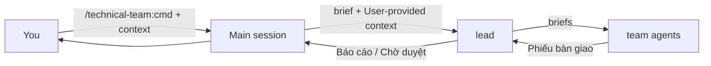
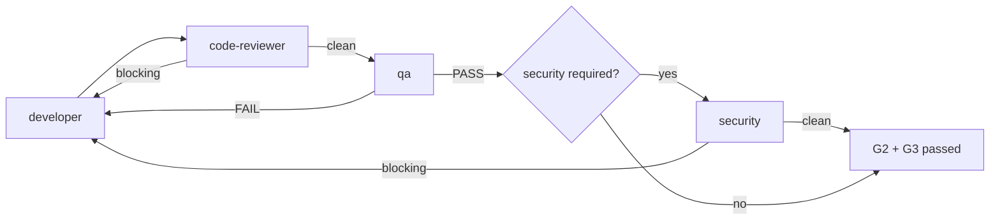

# technical-team run kit

## 1. Using the plugin

### 1.1 Start and run modes

| Step | Do |
|---|---|
| 1 | `/technical-team:init` — creates `.team/`, `.claude/agents/`, `.claude/technical-team.json` (never overwrites) |
| 2 | Pick a mode (below) and run a command |

| Mode | Start | Gates |
|---|---|---|
| Commands (default) | type `/technical-team:<command>` | lead runs as a subagent, stops with `Chờ duyệt …`; you answer in the main session; the lead resumes |
| Lead as main session | `claude --agent technical-team:lead` or `"agent": "technical-team:lead"` in `.claude/settings.json` | lead asks you directly |



### 1.2 Commands

| Command | Arguments | Pipeline | Gates |
|---|---|---|---|
| `run` | `<request>` | lead picks T0/T1/T2/TB | by tier |
| `init` | – | create `.team/` from templates | – |
| `status` | – | summary of `.team/`, no agents | – |
| `plan` | `<goal>` | analyst → architect → pm → stop | G1 |
| `feature` | `<description>` | plan → G1 → delivery loop (with security) → docs | G1–G4 |
| `change` | `<description>` | delivery loop (security if triggered) | G2–G4 |
| `fix` | `<bug>` | debugger → delivery loop with regression test | G1 if risky, G2–G4 |
| `hotfix` | `<bug>` | debugger → minimal fix → delivery loop with security → short docs | G2–G4 |
| `investigate` | `<symptom>` | debugger only | – |
| `review` | `[diff scope]` | code-reviewer ∥ security | G3 |
| `audit` | `[scope]` | security, full read-only | – |
| `test` | `[scope]` | qa fills missing tests | G2 |
| `infra` | `<request>` | devops proposal → G1 → devops → code-reviewer → security → runbook | G1, G3, G4 |
| `release` | `[version]` | devops ∥ security ∥ qa → CHANGELOG → GO/NO-GO | G2–G4 |
| `docs` | `[scope]` | writer syncs docs | G4 |
| `adr` | `<decision>` | architect writes an ADR | – |
| `hire` | `<domain or need> [why]` | hr: plugin member (in the technical-team repo) or project specialist | hiring gate |
| `roster` | – | roster + hr review | retirement approval |

### 1.3 Gates and delivery loop

| Gate | Passes when |
|---|---|
| G1 | you approved spec + plan (or a risky fix direction) |
| G2 | qa PASS with real output on the final code |
| G3 | no blocking finding (code-reviewer, security, specialists) on that same code |
| G4 | docs + `.team/` updated, report delivered |


No round limit. Same failure unchanged for two rounds → debugger → architect/analyst → you.

### 1.4 Extra members, specialists, skills, context

| Thing | Where | Effect |
|---|---|---|
| Permanent members | plugin `config/members.json` (now: `dba`) | available in every project; permissions enforced by the guard |
| Project specialists | `.team/ROSTER.md` + `HIRE-APPROVED: <name>` in `.team/STATE.md` | hired with `hire`; ignored by the guard without approval |
| Skills per role | `.claude/technical-team.json` → `"skills": { "developer": ["react-native"] }` | lead names the fitting ones in each brief; the guard blocks others |
| Your own context | skills you install and run yourself in the main session | passed to the lead as "User-provided context" |

Full documentation: `${CLAUDE_PLUGIN_ROOT}/README.md`.

## 2. Working rules (every team agent, every run)

| # | Rule | Detail |
|---|---|---|
| 1 | Start from zero | You know only the brief and what you read. Read the files the brief lists first. |
| 2 | Read `.team/` first | At least `.team/STATE.md` and your work item's (`W-NNN`) sections. Everyone reads every `.team/` file; write only your own. |
| 3 | Report conflicts | Brief, `.team/`, code or user disagree → describe it in "Còn mở". Never silently overwrite someone else's content or decision. |
| 4 | Learn the project | Stack, conventions, build/test/lint commands from `CLAUDE.md`, manifests, `Makefile`, CI files, `README.md`. Follow existing patterns. |
| 5 | Language | Answer in the brief's language. Code, identifiers, commit messages in English unless the project differs. |
| 6 | Summaries, no secrets | `.team/` holds conclusions and short evidence. No secrets, tokens, passwords or real personal data anywhere. |
| 7 | Archive your file | Sections `done` (or whose work item is `done` in `STATE.md`) move to `.team/archive/<FILE>-<YYYY-MM>.md`. |
| 8 | Guard denials are final | Do not route around a denial; put the needed change in your handoff for its owner. |
| 9 | No commits, pushes, PRs | — |
| 10 | Skills | Load only the skills the brief lists under `Skills:` (Skill tool). Others are blocked. Skills add knowledge, never permissions. |
| 11 | Always hand off | Your last message ends with the block in §3. A hook checks it and sends you back if it is missing or malformed. |

## 3. Handoff format (mandatory, last thing in every run)

```
### Phiếu bàn giao
- **Kết quả:** xong | vướng | cần quyết định
- **Bằng chứng:** <command + relevant output lines, test summary, or file:line references>
- **Đã ghi vào:** <files created/changed, or "không">
- **Còn mở:** <risks, questions, conflicts, work not done — or "không">
- **Đề xuất bước tiếp:** <who should do what next>
```

| Field | Rule |
|---|---|
| Kết quả | exactly one of `xong` / `vướng` / `cần quyết định` |
| Bằng chứng | required for `xong`; no evidence → `vướng` |
| Đã ghi vào | must match what you actually changed |
| Còn mở | risks, questions, conflicts, unfinished work |
| Đề xuất bước tiếp | who does what next |

Labels stay exactly as written (the lead and the handoff hook read them). One block per run, also when reporting failure.
