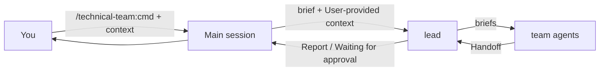
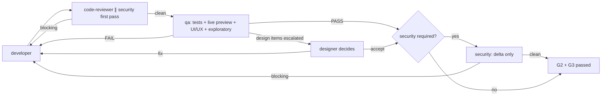

# technical-team — using the plugin

> Reference of the `run-kit` skill: read it when the user asks how to use the technical team or what a command does. Agents do not need it for their work.

## 1. Start and run modes

| Step | Do |
|---|---|
| 1 | Optional: `/technical-team:init` — creates `.team/STATE.md` + `.claude/technical-team.json` (per-agent skills; never overwrites). Other `.team/` files are created on demand |
| 2 | Pick a mode (below) and run a command |

| Mode | Start | Gates |
|---|---|---|
| Commands (default) | type `/technical-team:<command>` | lead runs as a subagent, stops with `Waiting for approval …`; you answer in the main session; the lead resumes |
| Lead as main session | `claude --agent technical-team:team-lead` or `"agent": "technical-team:team-lead"` in `.claude/settings.json` | lead asks you directly |

## 2. Commands

| Command | Arguments | Pipeline | Gates |
|---|---|---|---|
| `run` | `<request>` | lead picks T0/T1/T2/TB (or `new`) and the mode | by tier |
| `new` | `<idea \| path/to/PRD>` (empty = resume) | requirements → stack + architecture → MVP plan → milestones (delivery loop) → ops → docs → release; resumes from `.team/STATE.md` | stops only at REQ, STACK, G1, each milestone, RELEASE (+ hiring gate / escalation) |
| `init` | `[--all]` | create `.team/STATE.md` + `.claude/technical-team.json` (per-agent skills); `--all` = every file up front | – |
| `status` | – | summary of `.team/`, no agents | – |
| `feature` | `<description>` | ba elicitation (REQ rounds when it must ask) → plan → G1 → delivery loop (with security) → docs | G1–G4 |
| | `<goal> --plan` | ba → architect → pm → stop, no code | G1 |
| | `<description> --small` | T1: delivery loop (security if triggered) | G2–G4 |
| | `<need> --discover` | not sure what to build: ba finds opportunities and ranks options into the backlog in `.team/PRODUCT.md`; you pick; no code | DISCOVER |
| `fix` | `<bug>` | debugger → delivery loop with regression test | G1 if risky, G2–G4 |
| | `<bug> --hotfix` | urgent: minimal fix, security always, short docs | G2–G4 |
| | `<symptom> --diagnose` | debugger only, no code | – |
| `review` | `[diff scope]` | code-reviewer ∥ security on a diff | G3 |
| | `--audit [scope]` | security, full read-only audit | – |
| `test` | `[scope]` | qa fills missing tests | G2 |
| `infra` | `<request>` | devops proposal → G1 → devops → code-reviewer → security → runbook | G1, G3, G4 |
| `release` | `[version]` | devops ∥ security ∥ qa → CHANGELOG → GO/NO-GO | G2–G4 |
| `docs` | `[scope]` | writer syncs docs | G4 |
| | `--adr <decision>` | architect writes an ADR + updates `.team/ARCHITECTURE.md` | – |
| `hire` | `<domain or need> [why]` | hr hires a specialist `team-<name>` into this project | hiring gate |
| | `--roster` | roster + hr review | retirement approval |

Flags can also be said in words ("chỉ lên kế hoạch", "gấp", "chỉ chẩn đoán", "audit", "ghi ADR"); the lead records the mode in `STATE.md`.

## 3. Gates and delivery loop

When the request does not say exactly how things should work, the ba does not guess: it reads the documents and the code, then sends a **round** through the lead (gate `REQ`) — its understanding as concrete scenarios, plus at most 7 questions, each with why it matters, options with consequences and a recommended default. Answer per question, "OK" (all defaults) or "proceed" (stop asking; the rest become assumptions listed again at G1). The big picture it builds is kept in `.team/PRODUCT.md`.

| Gate | Passes when |
|---|---|
| G1 | you approved spec + plan (or a risky fix direction) |
| G2 | qa PASS on the final code: its exit criteria met (tests with real output, live preview for observable changes, UI/UX verified, no open blocker/critical/major defect); design items qa escalates decided by the designer |
| G3 | no blocking finding (code-reviewer, security, specialists) on that same code |
| G4 | docs + `.team/` updated, report delivered |

Squads: Discovery (ba → designer → architect → pm → qa plan) runs as a chain; Build (developer ×N, devops, dba) in parallel on disjoint files; Verify fans out (code-reviewer ∥ security on one diff; with ≥ 2 independent platforms one core qa ∥ one qa per platform, then a merge run gives the single verdict); Support (debugger, writer, hr) on demand. The lead stays the only dispatcher. Agents are named `technical-team:team-<role>`; each area of the project has one owner (run-kit §4) and nothing but the agents and the lead's handoff check keeps it that way.

Small mode: a micro change (≤ 3 files, ≤ 40 lines, no security/contract/shared/test/infra/data/dependency change, no new screen) gets one qa micro verify instead of code-reviewer + qa. No round limit. Progress = fewer open in-scope blocker/critical/major defects; same failure unchanged for two rounds, or three rounds without progress → debugger → architect/ba → you. Only in-scope defects block; pre-existing ones become new work items. Suspected design flaw (developer evidence, plan-level root cause, defect cluster) → straight to the architect, who researches and revises the plan; a user-visible revision comes back to you at G1.

## 4. Specialists, skills, context

| Thing | Where | Effect |
|---|---|---|
| Specialists | `.claude/agents/team-<name>.md` + a row in `.team/ROSTER.md` + `HIRE-APPROVED: <name>` in `.team/STATE.md` | hired with `hire`; the lead calls one only when its row is `active` and approved |
| Plugin skills | `business-analysis` (the ba's method: guided elicitation rounds, greenfield / operating system / discovery contexts, ready-to-spec check) | preloaded into ba |
| | `test-process` (qa's full test process: plan, static review, techniques, quality characteristics, UI/UX verification, defects, test summary) | preloaded into qa |
| | `live-preview` (run the real product — web, mobile, desktop, CLI, API/service — drive it through its interface, per-platform drivers, known-bug catalogue) | preloaded into qa; developer and designer load it when needed |
| Skills per agent | `.claude/technical-team.json` → `"skills": { "*": [], "team-designer": ["<design skill>"], "team-developer": ["react-native"] }` | the project's way to extend a role: the lead names the fitting ones in each brief, and an agent called without a brief reads its own list |
| Your own context | skills you install and run yourself in the main session | passed to the lead as "User-provided context" |
| Explore | built-in read-only agent | the lead may call it for current-state context; never as gate evidence |

Full documentation: `${CLAUDE_PLUGIN_ROOT}/README.md`.
