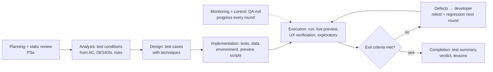

# test-process — QA is the gate for product quality, not only for green tests

A QA PASS means: **the product does what the spec says (verification), the user can actually use it (validation), and nothing that worked before is broken (regression)** — with evidence. Unit tests are one input; the running product (`live-preview`) and the design are the others.

Paths below are relative to `${CLAUDE_PLUGIN_ROOT}/skills/test-process/`.

| Reference | Use it for |
|---|---|
| `references/techniques.md` | deriving test cases: EP, BVA, decision tables, state transitions, pairwise, error guessing, exploratory charters; test levels and types |
| `references/quality-checklist.md` | quality characteristics to consider per work item (ISO/IEC 25010:2023) and how to test each one here |
| `references/ux-verification.md` | verifying UI/UX: design conformance against `DESIGN.md`, Nielsen's 10 heuristics, accessibility, platform conventions, copy |
| `references/defects-and-reports.md` | defect report format, severity × priority, defect lifecycle, retest/regression, test summary report |

## 1. The process inside the team's pipelines

| ISTQB activity | When in the pipeline | QA does | Output in `.team/QA.md#W-NNN` |
|---|---|---|---|
| Test planning | `feature` **P3a** (after pm tickets, before G1); `new` N3; `fix` at step 5 (short); small mode at S3 (short) | scope in/out, risks ranked (likelihood × impact), test types chosen per risk (`quality-checklist.md`), levels (unit/integration/system/e2e), platforms and form factors, test data, environment + drivers needed (tell the lead now what is missing: emulator, browser runner, seeds), entry and exit criteria | **Test plan** |
| Static testing | same step | review ACs, edge cases and `DESIGN.md` for ambiguity, untestable wording, missing states, contradictions between SPEC / DESIGN / PLAN → findings to the lead for analyst / designer / architect **before** code exists (cheapest defects) | **Review findings** |
| Test analysis | first D3 / S3 round (or P3a when the design is final) | test conditions: every AC, edge case, designed screen state, risk, quality characteristic in scope | **Traceability (RTM)**: condition → source |
| Test design | same | test cases with techniques (`techniques.md`); expected results from the spec/design, never from the current behaviour | RTM: condition → test case |
| Test implementation | same | automated tests in the project's layout, preview scripts (`live-preview`), test data/fixtures, exploratory charters; check entry criteria | test files; RTM: test case → file |
| Test execution | every D3 / S3 round | run the suite; live preview on every platform; **UI/UX verification** (`ux-verification.md`); time-boxed exploratory session(s); compare actual vs expected; log defects; retest fixed defects; regression around the change | **Execution log** per round, **Defects** |
| Monitoring and control | every round | progress (conditions passed/failed/blocked), defect trend, risks that changed; blocked → tell the lead what unblocks it | round summary |
| Test completion | the round that passes, and `release` | check exit criteria, test summary report, open/deferred defects with reasons, lessons learned (escaped bugs → `live-preview` catalogue, missing ACs → analyst) | **Test summary** |

## 2. Entry and exit criteria (defaults; the test plan may tighten them)

| | Criteria |
|---|---|
| Entry to execution | clean code review on this code (D2) · build passes · product starts in the preview environment · test data available · drivers available for every platform in scope (or the gap accepted by the lead) |
| Exit (= QA PASS) | every condition in the RTM executed · all AC/edge/state test cases pass · live preview clean on every in-scope platform/form factor · **UI/UX verification: no blocker/critical/major defect** · exploratory session(s) done with no blocker/critical/major · regression suite green · no open defect of severity blocker/critical/major in scope · minor/trivial defects listed for the lead (fix now or defer with reason) · no weakened/skipped test |
| Suspension | product does not start, environment broken, > 30 % of conditions blocked → stop execution, report `vướng` with the cause; do not "test around" it |

## 3. Verdict

| Verdict | When |
|---|---|
| **PASS** | exit criteria met — test summary attached |
| **FAIL** | any exit criterion not met — defect list with severity, priority, owner; the loop goes back to D1 |
| **PASS pending design decision** | everything passes, but a UI/UX deviation needs a design judgment (DESIGN.md has no answer for the case, or the deviation may be acceptable) → the lead asks the designer only about those items; designer "fix" = FAIL, "accept" = PASS |
| **Blocked** (`vướng` / `cần quyết định`) | entry criteria not met; say exactly what is missing |

## 4. Rules

| Rule | Detail |
|---|---|
| Independence | expected results come from SPEC / DESIGN / docs / platform conventions, never from "what the code does now" |
| User's eyes | for every flow ask: can a first-time user complete it without help, and does it match how they think? A spec-compliant but unusable flow is a defect (validation), reported with the heuristic it breaks |
| Risk-based depth | more techniques and exploration where impact × likelihood is high (money, data, auth, core flows, new code, complex logic); state what was deliberately tested less and why |
| Evidence | every result has a command + output, screenshot or transcript; "looks fine" is not evidence |
| One defect, one report | reproducible steps, expected vs actual, evidence, severity, priority, suspected owner (`defects-and-reports.md`) |
| Retest + regression | every fixed defect is retested with its original steps; the area around the fix is regression-tested; the regression test stays in the suite |
| Don't fix code | you report; the developer fixes. You may fix a test that is wrong, and say why |
| Escaped defects | a defect found after your PASS: add its test, record it in the test summary "lessons", propose a catalogue row |
