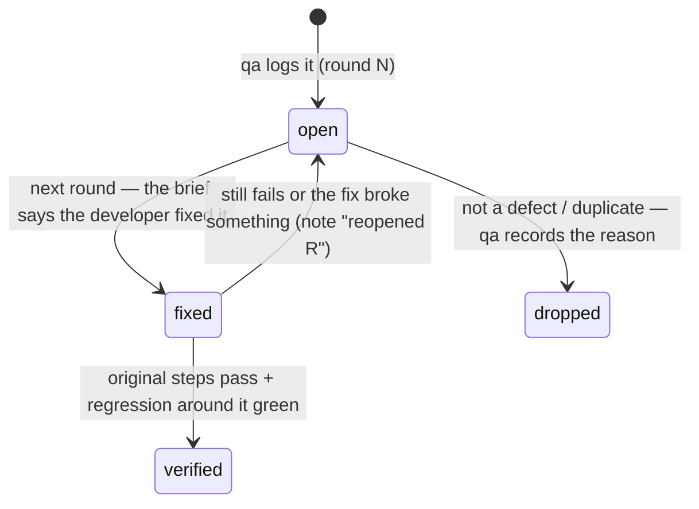

# Findings (defects), retest, regression and the test summary

Every finding gets one row in the cumulative **Findings** table of `.team/qa/<slug>.md` (ID, title, severity, priority, type, scope, owner, round found, status). Its full report below goes into **Round detail** of the round that found or reopened it, and into the handoff; the next round replaces the detail, the row stays.

## Finding report

```
### Q-03 — Create button stays enabled while saving; double click creates two projects
- Severity: major · Priority: P1 · Type: functional | ui-ux | a11y | compatibility | performance | reliability | data | security-suspect
- Status: open · Scope: in-scope (introduced by W-012) | in-scope (breaks W-012.AC1 / designed state) | pre-existing
- Found in: round 2 · build/commit <short sha or "working tree"> · Android emulator Pixel 6 API 34 (release build)
- Source: W-012.AC1 · frontend-design/W-012-offline-sync.md state "pending" · heuristic H1 (if UX)
- User impact: a user who taps twice gets duplicate projects and has to delete one by hand
- Steps:
  1. Open Projects → New project
  2. Type "Alpha"
  3. Double-tap "Create" quickly
- Expected: button shows "Creating…" and is disabled; one project created (frontend design state matrix, W-012.AC1)
- Actual: two "Alpha" rows; no pending state
- Evidence: test-results/w-012-create-double.png · e2e/preview/w-012.yaml step 6 · backend log 2× POST /api/projects 201
- Frequency: 5/5
- Suspected owner: developer (src/screens/NewProject.tsx submit handler)
```

| Rule | |
|---|---|
| One defect per finding | split unrelated symptoms; the ID (`Q-01`, `Q-02`…) is never reused or renumbered |
| Reproducible | minimal steps from a known state, with test data named (seeded user, not real data) |
| Expected from a source | AC, frontend design, docs, platform convention, heuristic — cite it |
| Impact for major+ | one sentence of concrete user impact; without source + impact the severity is at most minor (test-process §2a) |
| Scope | in-scope or pre-existing (test-process §2a); pre-existing never blocks G2 |
| Evidence | screenshot / capture / transcript / log lines, never secrets |
| No fix prescriptions | suspected location is fine; the fix is the developer's |

## Severity (impact) × priority (urgency)

| Severity | Meaning |
|---|---|
| **Blocker** | blocks testing or a core flow; crash on start; data loss/corruption; security hole suspected |
| **Critical** | core function wrong, no reasonable workaround; wrong money/calculation; user misled into a harmful action |
| **Major** | function or designed state missing/wrong with a workaround; broken on a required platform/form factor; accessibility failure on a core flow |
| **Minor** | non-core function wrong, inconsistency, unclear copy, cosmetic issue users notice |
| **Trivial** | polish |

| Priority | Meaning |
|---|---|
| P0 | fix before anything else in this round |
| P1 | fix in this work item (required for PASS) |
| P2 | fix if cheap now, otherwise defer with a reason (lead decides) |
| P3 | backlog |

Default: blocker/critical → P0, major → P1, minor → P2, trivial → P3. Raise priority for high exposure (first screen, most-used flow, release-critical); say why when you deviate.

## Finding lifecycle



| Status | Meaning | Who sets it |
|---|---|---|
| `open` | logged, not yet shown fixed | qa |
| `fixed` | the developer's handoff claims the fix; not yet re-checked | qa, at the start of the next round |
| `verified` | qa retested it with the original steps | qa |
| `dropped` | not a defect (works as specified) or a duplicate, with the reason | qa |

Only qa edits the table. An **in-scope** blocker/critical/major can never stay `open` while the work item passes G2. Everything still `open` when the item closes — pre-existing defects, deferred minor/trivial ones — becomes a follow-up ticket in `TASKS.md` (the lead briefs pm); a design question the designer accepted is closed by that decision in `frontend-design/<slug>.md` and needs no ticket.

## Retest and regression per round

| Step | Do |
|---|---|
| Retest | every finding in `fixed`: run its original steps and its automated test |
| Regression | the area around each fix (same screen/module, callers, shared components), plus the relevant suite; full suite before PASS and at `release` |
| New findings | next free ID, with the round number; a defect introduced by a fix names the finding it came from |
| Trend | per round: **open in-scope blocker/critical/major** (the number the lead tracks for progress), newly found, closed, reopened, pre-existing found — a rising reopen count is reported to the lead (escalation signal) |

## Test summary report (completion, attached to PASS / at `release`)

| Section | Content |
|---|---|
| Scope | work item, build/commit, platforms × form factors, what was out of scope and why |
| Coverage | RTM totals: conditions / test cases — passed · failed · blocked · not run; ACs covered n/n; designed states verified n/n; quality characteristics in scope and their result |
| Execution | commands + summary lines; live-preview evidence table; exploratory sessions (charter, duration, findings) |
| Defects | in-scope: found / closed / open by severity; still `open` with reasons (they become follow-up tickets at closing) · pre-existing: listed separately |
| UX | conformance result, heuristics issues, accessibility result, design questions and their decisions |
| Risks | residual risks, areas tested less (risk-based) and why, platforms not previewed |
| Exit criteria | each criterion → met / not met |
| Verdict | PASS / FAIL / PASS pending design decision |
| Lessons | escaped-defect root causes, missing ACs, catalogue rows proposed, testability problems |
