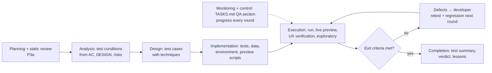

# Test process — full detail

> Reference of the `test-process` skill (SKILL.md holds the binding summary). Read the section you need: the activity table (§1) when writing the test plan, §2/§2a when deciding the verdict.

A QA PASS means: **the product does what the spec says (verification), the user can actually use it (validation), and nothing that worked before is broken (regression)** — with evidence. Unit tests are one input; the running product (`live-preview`) and the design are the others.

Paths below are relative to `${CLAUDE_PLUGIN_ROOT}/skills/test-process/`.

| Reference | Use it for |
|---|---|
| `references/techniques.md` | deriving test cases: EP, BVA, decision tables, state transitions, pairwise, error guessing, exploratory charters; test levels and types |
| `references/quality-checklist.md` | quality characteristics to consider per work item (ISO/IEC 25010:2023) and how to test each one here |
| `references/ux-verification.md` | verifying UI/UX: design conformance against `DESIGN.md`, Nielsen's 10 heuristics, accessibility, platform conventions, copy |
| `references/defects-and-reports.md` | defect report format, severity × priority, defect lifecycle, retest/regression, test summary report |

## 1. The process inside the team's pipelines

| ISTQB activity | When in the pipeline | QA does | Output in `.team/TASKS.md#W-NNN` → `### QA` |
|---|---|---|---|
| Test planning | `feature` **P3a** (after pm tickets, before G1); `new` N3; `fix` at step 5 (short); small mode at S3 (short) | scope in/out, risks ranked (likelihood × impact), test types chosen per risk (`quality-checklist.md`), levels (unit/integration/system/e2e), platforms and form factors, test data, environment + drivers needed (tell the lead now what is missing: emulator, browser runner, seeds), entry and exit criteria | **Test plan** |
| Static testing | same step | review ACs, edge cases and `DESIGN.md` for ambiguity, untestable wording, missing states, contradictions between SPEC / DESIGN / PLAN → findings to the lead for ba / designer / architect **before** code exists (cheapest defects) | **Review findings** |
| Test analysis | P3a (design is final at G1), refined in the first D3 / S3 round | test conditions: every AC, edge case, designed screen state, risk, quality characteristic in scope — **each mapped to the ticket that delivers it**, so the developer knows before coding what you will check | **Traceability (RTM)**: condition → source → ticket |
| Test design | same | test cases with techniques (`techniques.md`); expected results from the spec/design, never from the current behaviour | RTM: condition → test case |
| Test implementation | same | automated tests in the project's layout, preview scripts (`live-preview`), test data/fixtures, exploratory charters; check entry criteria | test files; RTM: test case → file |
| Test execution | every D3 / S3 round | run the suite; live preview on every platform; **UI/UX verification** (`ux-verification.md`); time-boxed exploratory session(s); compare actual vs expected; log defects; retest fixed defects; regression around the change | **Execution log** per round, **Defects** |
| Monitoring and control | every round | progress (conditions passed/failed/blocked), defect trend, risks that changed; blocked → tell the lead what unblocks it | round summary |
| Test completion | the round that passes, and `release` | check exit criteria, test summary report, open/deferred defects with reasons, lessons learned (escaped bugs → `live-preview` catalogue, missing ACs → ba) | **Test summary** |

## 2. Entry and exit criteria (defaults; the test plan may tighten them)

| | Criteria |
|---|---|
| Entry to execution | clean code review on this code (D2) · build passes · product starts in the preview environment · test data available · drivers available for every platform in scope (or the gap accepted by the lead) |
| Exit (= QA PASS) | every condition in the RTM executed · all AC/edge/state test cases pass · live preview clean on every in-scope platform/form factor · **UI/UX verification: no blocker/critical/major defect** · exploratory session(s) done with no blocker/critical/major · regression suite green · no open defect of severity blocker/critical/major in scope · minor/trivial defects listed for the lead (fix now or defer with reason) · no weakened/skipped test |
| Suspension | product does not start, environment broken, > 30 % of conditions blocked → stop execution, report `blocked` with the cause; do not "test around" it |

## 2a. Calibration — a high bar that converges

The bar does not drop: an in-scope blocker/critical/major is always a FAIL. What keeps the loop finite is applying it to a **fixed target**, at the **right depth**, with **evidence-backed severity**.

| Rule | Detail |
|---|---|
| Scope lock | a defect blocks G2 only if it is **in scope**: introduced by this work item's change (it worked before, or the changed code causes it) **or** it breaks an AC, edge case or designed state of this work item. Anything else is **pre-existing**: log it with `Scope: pre-existing`, severity as usual, never blocking; the lead opens a new work item (a pre-existing blocker/critical goes to the user in the report) |
| Target lock | exit criteria and the RTM conditions are fixed when G1 passes (small mode: at S0 with the bullets). A criterion you want to add later goes to the lead as a proposal with the reason; it applies only if the lead (and, for a direction change, the user) agrees |
| Depth per tier | **T2 / `new`**: full process. **T1 small**: short plan; ACs/bullets + regression of the touched area + live preview of what changed on the main form factor of each in-scope platform (+ smallest form factor for UI); UI/UX conformance + heuristics on the changed screens; exploratory only if a core flow is touched. **Bug fix**: reproduce → regression test → retest → regression around the fix → UI/UX of touched screens. **Hotfix**: reproduce + fix verified + the most relevant suite; everything not done listed as residual risk |
| Round focus | round 1: everything in the plan, incl. exploratory. Round ≥ 2: retest every `fixed` defect, regression around each change since the last round, re-run the suite, live preview of the screens/commands that changed; new exploration only on newly changed areas. Do not re-explore unchanged areas looking for more |
| Severity needs evidence | blocker/critical/major must cite the **source** (AC, edge case, DESIGN state, heuristic, WCAG criterion, platform convention) **and** the concrete **user impact** ("user cannot finish checkout on 375 px"). Without both it is at most minor. When unsure between two levels, take the lower one and say why |
| Rejected severity | the lead may return a defect whose severity is not backed as above; re-rate it or add the evidence — never silently drop it |

## 3. Verdict

| Verdict | When |
|---|---|
| **PASS** | exit criteria met for in-scope defects — test summary attached, pre-existing defects listed separately |
| **FAIL** | any exit criterion not met — defect list with severity, priority, owner; the loop goes back to D1 |
| **PASS pending design decision** | everything passes, but a UI/UX deviation needs a design judgment (DESIGN.md has no answer for the case, or the deviation may be acceptable) → the lead asks the designer only about those items; designer "fix" = FAIL, "accept" = PASS |
| **Blocked** (`blocked` / `needs decision`) | entry criteria not met; say exactly what is missing |

## 4. Rules

| Rule | Detail |
|---|---|
| Independence | expected results come from SPEC / DESIGN / docs / platform conventions, never from "what the code does now" |
| User's eyes | for every flow ask: can a first-time user complete it without help, and does it match how they think? A spec-compliant but unusable flow is a defect (validation), reported with the heuristic it breaks |
| Risk-based depth | more techniques and exploration where impact × likelihood is high (money, data, auth, core flows, new code, complex logic); state what was deliberately tested less and why |
| Evidence | every result has a command + output, screenshot or transcript; "looks fine" is not evidence |
| One defect, one report | reproducible steps, expected vs actual, evidence, severity, priority, suspected owner (`defects-and-reports.md`) |
| Retest + regression | every fixed defect is retested with its original steps; the area around the fix is regression-tested; the regression test stays in the suite |
| Don't fix code | you report; the developer fixes. You may fix a test that is wrong, and say why |
| Escaped defects | a defect found after your PASS: add its test, record it in the test summary "lessons", propose a catalogue row |

## 5. Micro verify (small mode, S2m — one pass instead of code-reviewer + qa)

Only when the lead has checked the **micro criteria** on the developer's diff (Lead manual §3, `feature.md` S2m). You do the code-review part and the test part in one run; you are the only independent check, so the bar does not drop.

| Part | Do |
|---|---|
| Re-check eligibility | read the full diff (`git diff`, `git status --porcelain`): any criterion broken, or the change is less trivial than it looked (logic branch, shared code, a contract, a state the UI did not handle) → **stop: "not micro"**, the lead runs S2 + S3. Doubt = not micro |
| Code check | every changed line: does what the bullets say · error/empty paths still handled · no unrelated change · no debug leftovers · follows neighbouring code and tokens (UI) · developer did not touch test files |
| Tests | a test for the changed behaviour exists or you add one; run the relevant suite + regression of the touched area |
| Live preview | the changed screen/command/endpoint on the main form factor (+ smallest for UI), error channels clean |
| UI/UX | conformance of the changed element to the design system, heuristics for the touched step |
| Verdict | PASS / FAIL as usual, plus a one-line "micro: eligible because …"; G2 **and** the code-review half of G3 rest on this run (security never runs in micro: a security trigger excludes it) |
