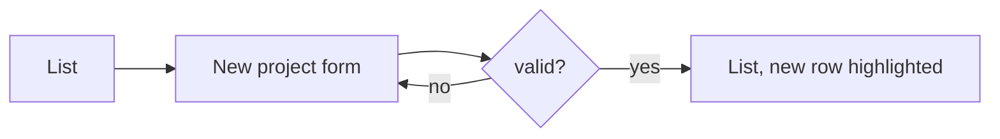

# UI/UX design

> Owner: **designer** (only the designer writes this file; everyone reads it).
> Top: the product's design system (changes only when the system changes). Below: one section per work item. Status: `draft` → `done`. Approval (G1) is recorded by the lead in `.team/STATE.md`, not here.
> Done items move to `.team/archive/DESIGN-<YYYY-MM>.md`. No real user data in examples.

## Design system

**Component library / theme:** <e.g. shadcn/ui + Tailwind theme in `tailwind.config.ts`, or MUI theme in `src/theme.ts`>

**Tokens:**
| Group | Values |
|---|---|
| Type scale | <display / h1 / h2 / body / small — size, weight, line height> |
| Spacing | <4 · 8 · 12 · 16 · 24 · 32 · 48> |
| Color roles | <surface, text, muted, primary, danger, success, warning, border — light / dark> |
| Radius · elevation · motion | <…> |

**Layout shell:** <navigation model, breakpoints 375 / 768 / 1280, what collapses>

**Glossary:** <term — meaning — never call it>

## W-000 — <title> · status: draft

**Satisfies:** W-000.AC1 → flow F1, screen `/projects`

**Users + top tasks:** <ranked>

**Flows:**

**Screens:**
| Screen | URL | Primary action | Pattern | Components |
|---|---|---|---|---|
| Projects | `/projects` | New project | list/table | DataTable, SearchInput, FilterChips, EmptyState |

**Screen specs:** <per screen: content priority; mobile + desktop wireframe>

**State matrix:**
| Screen | Empty | Loading | Partial | Success | Validation error | System error | No permission | Edge content |
|---|---|---|---|---|---|---|---|---|
| Projects | <…> | skeleton rows | n/a — single request | toast + highlighted row | n/a | banner + Retry | hide "New" | 80-char names wrap |

**Completeness:** <per screen: capabilities designed / out of scope (agreed with analyst)>

**Copy:** <labels, empty and error texts>

**Tokens / components changed:** <none | what>

**Open questions:** <for analyst / user>
