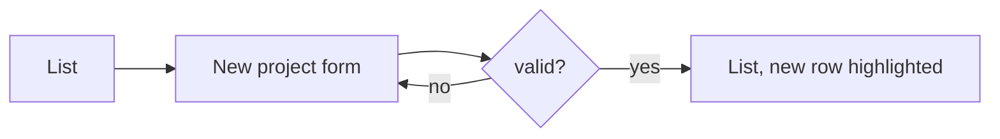

# W-000 — <title> · frontend design

> Owner: **team-designer** (only the designer writes this file; everyone reads it). Path: `.team/frontend-design/W-000-<kebab-title>.md`.
> This work item's flows, screens and states. The product's design system lives in `.team/frontend-design/_system.md`; name its tokens and components here, do not redefine them.
> Status: draft → done. Approval (G1) is recorded by the lead in `.team/STATE.md`, not here. No real user data in examples.

**Status:** draft

**Satisfies:** W-000.AC1 → flow F1, screen `/projects`

**Users + top tasks:** <ranked>

## Flows

## Screens
| Screen | URL | Primary action | Pattern | Components |
|---|---|---|---|---|
| Projects | `/projects` | New project | list/table | DataTable, SearchInput, FilterChips, EmptyState |

## Screen specs
<per screen: content priority; mobile + desktop wireframe>

## State matrix
| Screen | Empty | Loading | Partial | Success | Validation error | System error | No permission | Edge content |
|---|---|---|---|---|---|---|---|---|
| Projects | <…> | skeleton rows | n/a — single request | toast + highlighted row | n/a | banner + Retry | hide "New" | 80-char names wrap |

## Completeness
<per screen: capabilities designed / out of scope (agreed with ba)>

## Copy
<labels, empty and error texts>

## Design system changes
<none | tokens or components this item adds — merged into `_system.md` when the item closes>

## Decisions on escalated items
<!-- Items qa escalated ("PASS pending design decision"): Q-ID — fix | accept — reason. -->

## Open questions
<for ba / user>
